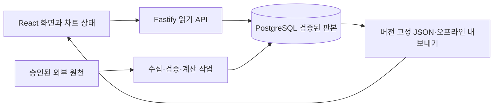

# 프론트엔드·백엔드·데이터베이스 분리 제안

2026-11-03 KST. 상태: 소스에 근거한 설계 후보. 제품 코드 변경·이전·배포 없음. 외부 교차 검토 미완료.

## 판단

세 계층 분리를 권장한다. 현재 필요한 것은 데이터의 일관된 수집·검증·저장·제공과 복잡한 화면 상태의 명확한 소유권이다. 저장소 하나에 프론트엔드, API, 수집 작업, 공통 계산을 두고 배포 단위를 분리하는 구조가 적합하다. 서비스마다 별도 저장소를 만드는 단계까지 갈 근거는 없다.

권장 후보는 **React + TypeScript + Vite / Node.js + TypeScript + Fastify / PostgreSQL**이다. 프론트엔드 전환보다 백엔드·DB 계약과 데이터 이전을 먼저 한다. 기존 차트 엔진과 수학 모듈은 보존하며 경계부터 만든다. 현재 Node 24 기반 스크립트를 활용할 수 있고, 백엔드까지 같은 언어를 쓰면 계산 규칙을 이중 구현할 필요가 줄어든다. 이는 설계상 이점이며 생산성·성능 향상을 측정한 결과는 아니다.

## 확인한 대상과 기존 요구

- 제안 조사 당시 원래 작업 폴더의 `main`: `53f587bf04f45ea7b3caa639ea88268fa7dca918`, v1.27.0. 조사 시작 시 깨끗했다.
- `git fetch origin main`으로 확인한 원격 `main`: `b43cbf0348526b64d7c4c6d547fc8de2db974c35`, v1.30.6. 로컬 `main`보다 126커밋 앞선 소스를 읽었다. 작업 폴더를 checkout/pull하지 않았다.
- 세 축 연구실: `aside/plspo-market-lab-20261102-vgT0`, `db794bc4e6bfbdf35b035850ee8ddba3a73b584b`. 해당 작업본의 상태도 읽기 전용으로 확인했으며 깨끗했다. 원격 main과 별도로 평가했다. 병합하지 않았다.
- Aside `vgT0woMivNn7zAVv`: 정확한 로컬 `messages.jsonl`에서 연구실 요구와 후속 결과를 선택해서 읽었다. 국내·미국 자료, 삼플레·RSI, 핵심 점수 세 칸, 컴팩트한 화면, 시간대·저장 복구 검토, 브랜치 커밋/푸시까지 확인했다. 다른 발표자료·음성 등은 이 설계의 입력으로 복제하지 않았다.
- Aside `A0BSyEfhJm3yJTVH`: 정확한 로컬 `messages.jsonl`에서 리플레이·미래선 유지·레이아웃·중첩 대화상자 문제와 매일 데이터 수집·간결한 분석 요구를 확인했다. 새 확인창·숫자 배지·모의 주문·분봉 합성 제외 요구도 보존한다.

두 세션은 과거 요구와 관측의 근거다. 과거 배포·테스트 성공 진술을 현재 운영 상태의 증명으로 사용하지 않았다. 이번에는 공개 사이트를 조작하거나 외부 모델 대화를 재개하지 않았다.

## 현재 구조에서 보이는 분리 이유

| 관측 | 근거 | 설계에 주는 의미 |
| --- | --- | --- |
| 런타임 의존성 없는 ESM 정적 앱과 Node 갱신 스크립트 | 원격 main의 `package.json`, `dist/app.js`, `scripts/` | 이미 계산·상태 모듈이 있으므로 전부 새로 쓰는 비용을 피할 수 있다. |
| 브라우저가 원천 API를 직접 호출하고 저장 스냅샷으로 대체 | `dist/data-source.js`, `dist/ohlc-data.js`, `dist/market-data-controller.js` | 원천별 검증·재시도·신선도 정책의 서버 소유권을 정할 가치가 있다. 기존 취소·요청 소유권·대체 동작은 유지해야 한다. |
| Actions가 데이터를 갱신하고 검증·커밋·Pages 발행까지 수행 | `.github/workflows/refresh-data.yml` | 코드 배포와 데이터 공개가 결합돼 있다. 데이터는 검증된 DB 판본으로 공개하고 화면 배포와 분리할 수 있다. 현재 설정은 하루 4회이며 실제 실행 성공은 이번에 조회하지 않았다. |
| 세 축 수집기에 여러 파일의 교체·백업·복구 절차 존재 | 연구실 브랜치 `scripts/refresh-market-lab.mjs:43–71` | 수집 판본 전체의 공개를 하나의 DB 트랜잭션으로 처리하면 일관성 경계를 명확히 할 수 있다. 파일별 rename은 다중 파일 트랜잭션이 아니다. |
| 복구 중 일부 실패를 삼키고, 종전에 없던 새 원천 파일의 제거 경로가 없음 | 같은 함수의 `replaced`, `hadPrev`, catch 경로 | 기존 검토의 우려에 코드 근거가 있다. 이번에 장애를 재현하거나 수정하지는 않았다. |
| 가격일 판정과 출처 시간대가 별도 정책 | 연구실 `dist/market-lab-math.js`, `scripts/refresh-market-lab.mjs` | UTC 순간과 거래소 달력일을 구분하고, 종목-거래소-시간대 대응을 검증해야 한다. DB 도입만으로 잘못된 시간대가 해결되지는 않는다. |
| 리플레이 저장과 발행 예측 자료의 의미가 다름 | 원격 main `dist/chart-replay-snapshot.js`, `dist/data/*forecast-ledger/` | 로컬 재생 캡처와 당시에 공개된 예측을 DB에서도 별개로 보존해야 한다. |

## 책임과 배포 단위

| 계층 | 맡을 일 | 경계 |
| --- | --- | --- |
| 프론트엔드 | 라우팅, 차트 렌더링, 확대·이동, 리플레이 재생, 다이얼로그, 입력, 상태 표시 | DB 접속·원천 API 비밀값·공식 데이터 쓰기는 서버가 맡는다. 사용자의 가정 실험은 공통 순수 계산을 브라우저에서 실행할 수 있다. |
| API | 버전 있는 응답 계약, 기간 조회, 출처·신선도 제공, 판본 선택 | 입력 스키마 검증과 응답 직렬화 계약을 둔다. TypeScript 타입만으로 외부 데이터를 신뢰하지 않는다. |
| 수집 작업 | 원천 호출, 정규화, 검증, 지표 계산, 데이터 판본 발행, 실패 기록 | HTTP 요청마다 전체 수집을 실행하지 않는다. Actions는 초기 스케줄러로 유지할 수 있고 작업은 API와 별도 프로세스로 실행한다. |
| DB | 원천·관측·수정 이력, 계산 입력, 모델 버전, 발행 예측, 수집 실행·상태 | 공개 API 역할은 읽기 권한만 가진다. 수집 쓰기와 스키마 변경 권한을 분리한다. |
| 공통 계산 | 기존 산술, 표준화, RSI, 시나리오, 명시적인 데이터 계약 | DOM·네트워크·DB에 의존하지 않게 한다. 서버의 확정 계산과 화면의 가정 실험이 같은 구현을 사용한다. |

초기 저장소 모양은 `apps/web`, `apps/api`, `apps/jobs`, `packages/domain`, `packages/contracts`, `db/migrations`면 충분하다. API와 jobs는 같은 백엔드 코드·계약을 공유한다. npm workspaces로 시작할 수 있으며 별도 빌드 오케스트레이터는 필요성이 생길 때 검토한다.

React는 도구막대·패널·페이지의 상태 소유권을 정리하는 후보로 삼는다. 기존 차트의 매 프레임 포인터·재생 갱신은 명령형 렌더러 내부에 둘 수 있다. React로 바꿨다는 사실을 차트 성능·품질 개선의 증거로 삼지 않는다. 기존 색상·단일 상단줄·조작·URL 계약도 유지한다.

## 데이터 계약에서 먼저 정할 것

1. **시계의 의미:** 관측 기간/거래일, 원천 공표 시각, 수집 시각, 앱 공개 시각을 분리한다. 순간은 `timestamptz`, 거래일은 `date`, 거래소 시간대는 별도 IANA 식별자로 둔다. `timestamptz`가 원래 시간대 이름을 보존하는 것은 아니다. 모르는 공표 시각은 null이다.
2. **수정 이력:** 경제지표의 과거 값이 바뀌어도 이전 판본을 덮어쓰지 않는다. 새로 수집한 현재 판본을 과거에도 알 수 있었던 값처럼 사용하지 않는다. 과거 공표 판본이 없던 데이터는 DB로 옮겨도 진정한 당시 시점 검증이 가능해지지 않는다.
3. **출처·조정 기준:** 제공자, 종목·거래소, 빈도, 단위, 분할/배당 조정, 원문 위치와 해시, 원천 상태를 기록한다. 같은 날짜라는 이유로 조정 기준이 다른 가격을 합치지 않는다.
4. **발행 원자성:** 수집 실행별 검증된 관측과 파생 결과를 하나의 판본에 묶고 트랜잭션 안에서 공개 포인터를 바꾼다. 동시 실행은 고유 작업 키와 명시적 잠금/충돌 처리로 직렬화한다. 커밋 결과가 불확실하면 같은 실행 ID로 조회해 확인한 뒤 재시도를 결정한다.
5. **원문 파일과 DB:** 작은 원문은 DB에 함께 저장할 수 있다. 외부 저장소를 쓸 경우 불변 객체를 먼저 저장·검증하고 DB 트랜잭션에서 그 해시를 참조한다. 외부 파일 업로드까지 DB 트랜잭션이 원자적으로 묶어준다고 가정하지 않는다.
6. **결측·실패·오래된 값:** API는 `ready / stale / missing / error`와 실제 마지막 성공 시각을 명시한다. 실패 때 새 성공 시각을 만들지 않으며 유효한 이전 판본을 제공하되 오래된 자료임을 표시한다. 축이 빠지면 종합 점수를 null로 두는 규칙을 유지한다.
7. **예측 보존:** 발행 당시 입력 판본·모델 버전·발행 시각·경로를 고정한다. 최신 모델로 과거 예측을 조용히 다시 계산하지 않는다. 로컬 재생 저장과 발행된 예측을 구분한다.

초기 테이블 후보는 `sources`, `instruments`, `ingestion_runs`, `source_artifacts`, `observation_versions`, `dataset_revisions`, `model_runs`, `forecast_publications`, `ipo_event_versions`다. 타입별 관측 필드와 고유키는 실제 이전할 자료 하나로 검증한 뒤 확장한다. 모든 값을 출처 없는 범용 JSON 한 덩어리로 넣지는 않는다.

API 예시는 `/api/v1/market-lab?region=kr&revision=...`, `/api/v1/candles?instrument=...&interval=...&from=...&to=...`, `/api/v1/ipo-events?...`, `/api/v1/forecast-publications/:id`다. 묶음 응답에 `schemaVersion`, `revision`, `modelVersion`, 출처 상태와 시계를 포함해 서로 다른 판본의 점수가 섞이지 않게 한다. 기존 외부 링크는 그대로 해석할 수 있어야 한다.

세 줄 요약에 LLM을 사용한다면 확정된 숫자·출처·결측 상태를 입력으로 받는 후처리로 한정한다. 입력 판본/해시·모델·프롬프트 버전을 결과와 함께 보존하고, 모델 실패 시 결정론적 숫자와 상태는 계속 제공한다. LLM이 원자료·점수·투자 신호를 임의로 만드는 경로를 추가하지 않는다. 현재 요청에서는 API 키 발급이나 호출을 하지 않았다.

## 대안과 이전 순서

| 선택지 | 장점 | 비용·판단 |
| --- | --- | --- |
| 현행 정적 앱의 폴더·모듈만 정리 | 가장 작은 변화, 기존 배포·오프라인 유지 | UI 정돈에는 유효하나 데이터 판본·동시 갱신·이력 요구가 계속 파일 처리에 남는다. |
| 정적 화면 유지 + API·PostgreSQL 추가 | 수집·저장 경계를 먼저 개선, 화면 회귀 범위 제한 | **첫 이전 단계로 권장.** JSON 어댑터와 버전 계약으로 기존 화면을 연결한다. |
| React·Vite 화면 + Fastify API·jobs + PostgreSQL | 장기적인 화면·데이터 책임과 독립 배포가 명확 | **목표 후보.** 의존성·서버 운영·DB 백업·계약 마이그레이션 비용을 감수해야 한다. |

1. **기준 고정:** 최신 main과 연구실 브랜치의 통합 경계를 먼저 결정한다. 현재 브랜치를 무조건 병합하지 않는다. 기존 데이터·계산·URL·리플레이 저장 계약과 관련 검사 결과를 기준으로 남긴다.
2. **작은 세로 이전:** 세 축 연구실의 한 지역을 대상으로 기존 스냅샷 → DB → 읽기 API → 기존 화면 어댑터를 연결한다. 원천 재수집 없이 고정 자료를 가져와 값·기간·단위·null·해시를 대조한다.
3. **수집 연결:** 수집 실행의 멱등성, 트랜잭션, 실패 기록, 마지막 유효 판본을 검증한다. API/DB 장애와 재시도 경계에서 이전 결과를 보존하는지 확인한다. 해소되지 않은 원천의 접근 거부를 자동 재시도로 덮지 않는다.
4. **화면 전환:** 세 축 연구실 또는 공모주 화면 하나부터 React로 옮긴다. 복잡한 차트·리플레이는 마지막으로 옮기며 기존 엔진과 수치 모듈을 재사용한다.
5. **나머지 자료와 운영:** 가격·연구 근거·발행 예측 이력을 차례로 이전한다. 이전 판본으로 되돌리는 절차와 실제 백업 복구를 확인한 뒤 데이터 공개 경로를 바꾼다. JSON·단일 HTML 내보내기는 별도의 산출물 계약으로 유지한다.

수집 주기는 자료의 공표 빈도와 원천 허용 범위에 맞춘다. 매일 확인한다는 요구가 모든 지표가 매일 새로 공표된다는 의미는 아니다. 초기에는 PostgreSQL 하나와 배치 실행으로 시작하며 별도 캐시·메시지 브로커·실시간 통신은 입증된 요구가 생겼을 때 추가한다. 호스팅 사업자·요금제는 아직 선택하지 않았다.

## 수용 기준과 검증 상태

이전 완료는 다음 관측으로 판단한다: 고정 입력의 계산 결과 일치, 관측/공표/수집 시각 구별, 중복 실행 시 중복 발행 없음, 저장 도중 실패 시 절반 판본 비공개, 불확실한 커밋의 원래 실행 조회, 원천/API/DB 장애 시 올바른 대체 표시, 과거 예측 경로 보존, 기존 링크·저장본·오프라인 산출물 호환, 실제 화면 조작 및 백업 복구 확인.

변경 모듈에 해당하는 기존 수치·연구·발행·요청 소유권·리플레이 검사를 재사용한다. React 전환의 근거로 전체 테스트 재작성이나 새 프레임워크 도입을 전제하지 않는다. DB의 트랜잭션·동시성은 실제 PostgreSQL로 검사해야 하며 메모리 mock만 통과해서 완료로 판단하지 않는다. 차트 성능은 같은 자료·범위·환경의 전후 측정으로만 판단한다.

이번 작업은 설계 검토이므로 제품 테스트·브라우저 QA·DB 통합 테스트를 실행하지 않았다. 소스·브랜치 상태 확인과 문서 readback은 기능 검증과 구별한다. 공개 배포 상태와 DB/서버의 실제 가용성도 미확인이다.

## 작업 기록과 남은 검토

- 목표: 두 지정 세션과 현재 코드를 근거로 계층 분리의 타당성·후보 스택·이전 순서를 제시한다.
- 교정: 초기 로컬 v1.27.0 관측 뒤 최신 원격 v1.30.6 및 별도 연구실 커밋으로 판단 대상을 확장했다.
- 완료: 지정 세션의 관련 대화, 최신 main, 연구실 소스, 기존 검증·배포 계약, 공식 기술 문서를 확인하고 이 제안을 작성했다.
- 외부 교차 검토: thesis / Gemini adversarial / ChatGPT reverse 모두 **NOT_RUN**. 공유 원장 조회 시 Gemini 요청 `c6235be1eaa923fdbce88efb`(소유자 `Yj1cocEjMV9nXXQ4`), ChatGPT 요청 `4de8ce2771f0b17f46614fda`(소유자 `vgT0woMivNn7zAVv`)가 활성 슬롯을 점유했고 두 서비스의 `free_slots`는 0이었다. 요청 상태를 원격에서 재확인하거나 해제·재전송하지 않았다. 기존 연구실 검토는 이 아키텍처 제안의 검토를 대체하지 않는다.
- 다음 체크포인트: 기존 소유자가 원래 작업을 조정해 유효한 용량이 생기면, 이 설계와 고정한 관련 소스 묶음으로 새로운 범위의 교차 검토를 수행한다. 그 전까지 설계 후보 상태이며 구현·발행 완료로 표시하지 않는다.
- pstack 최신성: 공식 `cursor/plugins` pstack 경로의 `c742dd61706fbacc1b95f1a20b7b988cf096ce6c`, manifest 0.15.36이 설치 기준과 같음을 확인했다. Lauren 원문 X 접근은 403이었고 공개 검색으로 후속 연재의 완전성을 확인하지 못했다. 지침을 갱신하지 않았으며 저자 연재 최신성은 미확인이다.
- OSK overview/search에서 이 프로젝트의 군집·기존 scope 결속을 찾지 못했다. 다른 프로젝트의 scope를 추측해 읽거나 기억을 기록하지 않았다.

### 근거 식별

세션 원문은 사용자 로컬 경로에서 읽었으며 이 문서에 전문을 복제하지 않았다.

| 대상 | 읽은 경로/판본 | SHA-256 |
| --- | --- | --- |
| 연구실 세션 | `/Users/twoimo/.aside/u/0/sessions/2026-10-31_vgT0woMivNn7zAVv/messages.jsonl` | `1a611d6b7d5543ead58ea7ebd8a292483c761802448547d678bce7d2e463be5d` |
| UI 세션 | `/Users/twoimo/.aside/u/0/sessions/2026-10-30_A0BSyEfhJm3yJTVH/messages.jsonl` | `d8294a3cb10a0f8a2dd2ee18dd4633b1434c2af0a9fbca0ed0b45018251f11ff` |
| main 갱신 workflow | `b43cbf0:.github/workflows/refresh-data.yml` | `658b5c305f7df0dda21470db8e90f770e66074b19bb5cae404ac7dee4a249b1c` |
| main 요청 제어 | `b43cbf0:dist/market-data-controller.js` | `978ad14a70fdb3011f0761ceb7c6f6ebc0d37bc0b25aa047ad2ef2014eff07d6` |
| 연구실 수집기 | `db794bc:scripts/refresh-market-lab.mjs` | `1729fa9c4a0117d9727c0f16f78802cc2876310b6ed7df9e37750e6071796b06` |

공식 문서: [React의 점진적 도입](https://react.dev/learn/add-react-to-an-existing-project), [Vite 시작과 템플릿](https://vite.dev/guide/), [Fastify 스키마 검증과 직렬화](https://fastify.dev/docs/latest/Reference/Validation-and-Serialization/), [PostgreSQL 트랜잭션](https://www.postgresql.org/docs/current/tutorial-transactions.html), [날짜·시각 타입](https://www.postgresql.org/docs/current/datatype-datetime.html).

고정 소스: [main의 데이터 공개 workflow](https://github.com/twoimo/bitcoin-cycle-atlas/blob/b43cbf0348526b64d7c4c6d547fc8de2db974c35/.github/workflows/refresh-data.yml), [연구실 수집과 파일 교체](https://github.com/twoimo/bitcoin-cycle-atlas/blob/db794bc4e6bfbdf35b035850ee8ddba3a73b584b/scripts/refresh-market-lab.mjs).
