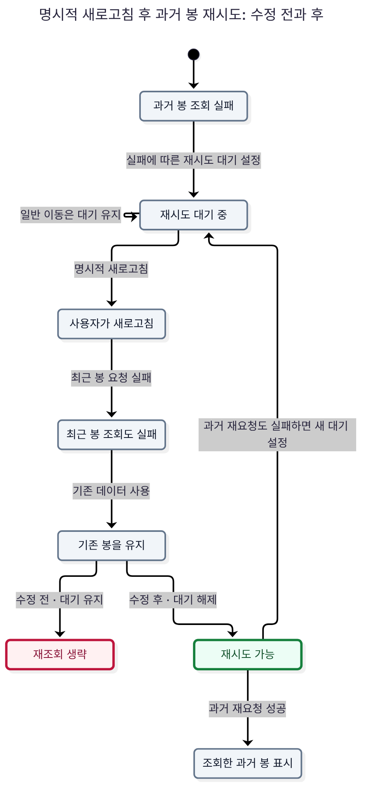
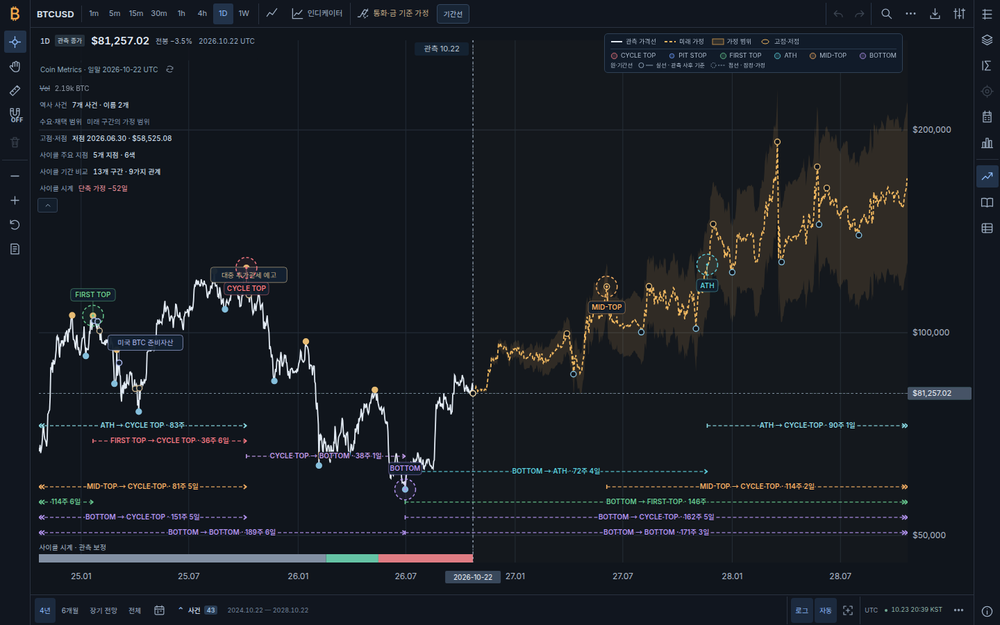
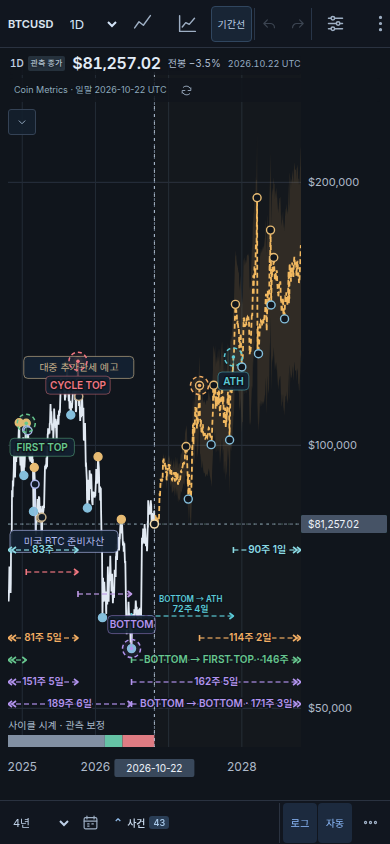

# 성능·수학·상태·반응형 심층 감사 — 2026-10-24

v1.14.1은 실제로 재현한 계산·입력·로딩·재시도 결함을 고치고, 그 결과를 다시 검사할 수 있는 스크립트와 상태전이도를 추가한다. 기준은 `d906df3b42a555c57552f005d25a9fef4cfd4c5e`이다. 검증한 구현 커밋은 `c302fb4f0249d6920536d2da70f58e5426e9f472`이다. 시장 자료는 **2026-10-22 UTC까지의 저장 관측**을 그대로 사용했다.

자동 검사와 독립 코드 검토에서 현재 수정본의 미해결 구체적 회귀는 발견하지 못했다. 이 결론은 아래에 기록한 입력·화면·유한 상태 범위에 한정한다. 전체 프로그램의 무결성, 모든 브라우저, 미래 가격 예측력을 증명했다는 뜻은 아니다.

## 1. pstack과 병렬 검토 방식

[Cursor pstack](https://github.com/cursor/plugins/tree/8b3326d99fd4b993cb33a24dad8af03175c642c5/pstack) **0.15.30**, 소스 커밋 `8b3326d99fd4b993cb33a24dad8af03175c642c5`의 실제 지침과 스크립트를 읽고 적용했다.

| 적용한 지침 | 이번 작업에서 실행한 내용 |
|---|---|
| `swarm` | 계산·수학, 반응형·입력, 상태모델을 나누어 병렬 분석하고 별도의 검토자가 변경을 재검증 |
| `create-formal-verification-skill` | 기존 프로젝트 전용 `verify-market-state` 스킬을 새 history retry 모델·실제 코드 mutation 검사까지 확장 |
| `maintain-formal-verification-skill` | 기존 요청 소유권 모델의 구현 대응과 source hash를 다시 확인 |
| `statechart` | TLC 결과와 실제 코드 가드 위치를 연결해 Mermaid·PNG·반례 이야기 생성 |
| `tdd` | 원본 또는 중간 패치에서 실패하는 반례를 먼저 확인하고 수정 후 재실행 |
| `benchmark-checklist` | 같은 저장 입력, 전후 각 5회 교대 측정, 결과 소비·정확성 검사, 중앙값·범위, 별도 CPU 프로파일 기록 |

독립 검토는 최종 계산 코드의 수치 반례를 직접 다시 실행했고, 추적·패널 조절의 실제 호출 경로와 동기 재진입도 검토했다. 구현 담당자의 자체 검사 결과만으로 통과를 판단하지 않았다. 독립 실행 그래프는 검증기와 같은 정규식을 반복하는 데 그치지 않고 JavaScript 모듈 파서로 76개 모듈·180개 import의 연결과 원문을 대조했다. [독립 검토 집계](audit-2026-10-24/independent-review.json)

## 2. 재현한 결함과 수정

| ID | 재현한 문제 | 수정과 확인 근거 |
|---|---|---|
| A01 | Google Fonts CSS가 실패하면 부모 `styles.css`의 로딩 오류로 취급되어 차트 전체가 초기 오류 화면에 머묾 | 외부 글꼴을 선택적·비차단 링크로 분리. 필수 로컬 CSS·JS 실패는 기존 복구 화면을 유지. 글꼴이 늦게 오면 차트·페이지 배치를 다시 계산. [부트 회귀](../tests/boot-shell.test.mjs), 글꼴 차단 7개 화면 검사 |
| A02 | 이동평균·범위·변동성을 매 행마다 창 전체에서 재계산하고 배열을 반복 생성 | 보정 합계, 단조 큐, 두 스택의 분산 통계로 계산을 분할상환 `O(n)`으로 변경. [구현](../dist/market-structure.js), [계산 비교 원시 결과](audit-2026-10-24/computation.json) |
| A03 | 기하평균 경계에서 같은 가격 경로의 표시 단위만 바꿔도 국면이 달라짐 | 최초 관측 대비 로그 가격에서 비교하고, 아주 작은 수치 오차만 동률 처리. 극단적인 비율·평균 복원 경계도 검사. [수치 회귀](../tests/market-structure.test.mjs) |
| A04 | `asOf` 뒤의 가격에 `NaN` 하나가 있으면 이미 관측 가능한 과거 결과까지 예외로 실패 | 날짜로 범위를 먼저 정한 후 범위 안의 가격을 검증. 범위 안의 잘못된 값과 판독 불가능한 날짜는 계속 거부. 국면·확정 전환점·기간 집계의 접두 구간 일치 검사 |
| A05 | 과거 캔들 요청 실패 후 사용자가 새로고침했는데, 최근 캔들 요청도 실패하면 기존 봉은 유지되지만 과거 재시도 대기가 풀리지 않음 | 명시적 refresh 시작에서 이전 history cooldown을 해제. 일반 이동과 새로 실패한 요청의 대기는 유지. [실제 회귀](../tests/intraday-history.test.mjs), 아래 `HistoryRetry` 모델과 mutation |
| A06 | 터치 추적 중 한 프레임 전에 240개의 move가 오면 미리보기 DOM 계산도 240번 실행 | 최신 좌표 하나만 RAF에서 그리되 원래 포인터 좌표는 즉시 저장. 놓는 마지막 좌표는 즉시 적용하고 오래된 예약 작업은 취소. [제스처 회귀](../tests/mobile-gestures.test.mjs) |
| A07 | 연구 창 높이를 조절하며 놓을 때 마지막 좌표가 누락. 조절 중 창을 숨긴 후 놓으면 저장 높이가 오염 | release 좌표로 최종 높이를 계산하고, 이벤트 발행 전에 드래그 소유권 해제. 숨김·접힘·최대화·외부 높이 변경·blur·resize 등에 취소 연결. [연구 창 회귀](../tests/analysis-focus.test.mjs) |
| A08 | 상세 패널 너비 조절이 마지막 release를 누락하고 다른 포인터나 capture 상실에 일관되게 대응하지 못함 | 실제 UI가 사용하는 `mountReaderResize`로 소유권·RAF·최종 위치·취소를 한곳에서 처리. [회귀](../tests/reader-resize.test.mjs), 실제 Chromium 마우스 조작 검사 |
| A09 | 844×390 가로 휴대전화에서는 범례가 숨겨져도 지표 목록은 기본으로 펼쳐짐 | 기본 접힘 조건을 기존 compact CSS와 맞춤. 저장한 `indicator-list=open/closed` 선택은 유지. 7개 화면에서 최초 상태·대화상자·선/캔들 전환 검사 |
| A10 | 독립 실행 HTML의 모듈 data URL이 의존성마다 중첩되어 파일과 브라우저 처리 비용이 증폭 | 모듈당 하나의 URL을 가진 평평한 import map으로 패키징. 같은 코드·내장 자료를 유지하며 파일 크기와 실제 `file://` 로딩을 재검증. 아래 독립 실행 검증 참조 |

`volume-forecast.js`의 표준편차에서도 같은 평균을 반복 계산하던 부분을 한 번 계산하도록 옮겼다. 전체 fitting 결과는 깊은 비교에서 같았고, 측정 분산이 겹치므로 별도 속도 향상은 주장하지 않는다.

## 3. 수학적 검토

### 기하평균과 단위 불변성

양수 가격의 창 크기가 `m`일 때 기하평균은 다음과 같다. 코드의 `shortWindow`·`longWindow`는 **되돌아보는 간격 수**이므로 가격 창에는 양 끝을 포함하여 각각 한 행이 더 들어간다.

$$G_t=\exp\left(\frac1m\sum_{j=0}^{m-1}\log P_{t-j}\right).$$

모든 가격에 양수 `c`를 곱하면 정확한 산술에서는 `G(cP)=cG(P)`이므로 가격과 평균의 대소관계가 바뀌면 안 된다. 예를 들어 `[50,100,25,50]`의 네 가격 곱은 `50⁴`이고 마지막 가격과 기하평균이 같다. 원래 구현은 로그·지수 복원 오차 때문에 단위에 따라 이 동률을 서로 다르게 판정했다.

수정은 최초 관측가격 `P₀` 대비 `log(P/P₀)`에서 평균과 판정을 수행한다. 같은 단위 배율은 비율에서 사라지고, 기준점은 미래 자료 추가에 따라 바뀌지 않아 접두 구간의 인과성을 보존한다. 동률 허용치는 경제적 신호 임계값을 바꾸는 장치가 아니다. 정확한 동률과 `±1e−8`, `±1e−12`의 실제 차이를 `1e−100`, `1`, `1e100` 배율과 서로 다른 초기 관측에서 검사했다.

독립 검토는 **중간 최적화 패치**에서 두 극단 입력 문제도 찾아 최종본에 포함되기 전에 수정했다. 이는 원본에서 새로 발견한 두 운영 결함이라고 세지 않는다.

- `price/reference`가 양수 subnormal이면 0이 아니어도 상대 정밀도를 크게 잃을 수 있다. `2⁻¹⁰²²` 미만은 `log(price)−log(reference)`로 처리한다. `[MAX_VALUE, …10개 1e−15]`의 마지막 평균이 약 11.18% 작아지던 중간 패치 반례가 해결됐다.
- 유한 양수들의 기하평균은 양수 표현 범위 안에 있다. 로그 복원의 반올림이 `Infinity` 또는 0으로 경계를 넘으면 `MIN_VALUE…MAX_VALUE`의 수치 표현 경계를 보존한다. 경제 전망 가격에 상한을 부과한 변경은 아니다.

이 검사는 모든 표현 가능한 부동소수 입력과 배율에 대한 보편적 증명을 대신하지 않는다. 극단적 가격비로 계산하는 다른 수익률·범위 필드까지 모두 유한하다고 확대하지 않는다.

### 이동 분산과 계산 복잡도

원래 정의인 표본 분산 `Σ(r−평균)²/(k−1)`과 연간 환산을 유지한다. 두 스택은 각 구간의 개수·평균·중심 제곱합을 보관하고, 두 구간을 Welford 방식으로 합친다. 창을 떠나는 큰 충격의 제곱합을 계속 빼는 방식에서 생길 수 있는 잔여 오차를 피한다. 상수 가격, 큰 충격 뒤의 조용한 창, 결측일, 일·주 표본, 여러 창 길이와 단위에서 직접 정의와 비교했다.

가격은 단조 큐마다 한 번 들어가고 한 번 나온다. 수익률도 각 스택에 한 번씩 들어간다. 보정 평균의 전체 재합산은 창 길이마다 한 번이므로 전체 비용이 선형이다. 4,000행·단기 200/장기 1,000 간격에서 로그 호출 수는 **4,526,800→8,000회**였다. 이는 실행시간 측정과 별도의 작업량 검사다.

### 자료 범위와 보존된 결과

저장 자료의 일별 5,941행과 완결 주별 848행에서 국면 라벨·에피소드가 원본과 같았다. 이동평균의 최대 상대 차이는 `8.96e−15` 미만, 실현 변동성의 최대 절대 차이는 약 `1.14e−13` 퍼센트포인트였다. 미래 가격·상하 범위·경제 기준선·국면·전환점·사이클 보정과 거래량 fitting 전체 객체도 비교했다. [정확성 원시 결과](audit-2026-10-24/computation.json)

미래 관측을 추가하거나 바꿔도 과거 국면·이미 확정된 전환점이 달라지지 않는 회귀를 유지했다. 새 `asOf` 검사는 미래의 **잘못된 값**도 이미 유효한 과거 결과를 사용할 수 없게 만들지 않도록 범위 경계를 강화한다.

## 4. 성능 측정

Node **v24.19.0**, Linux x64, Intel Xeon Platinum 8573C 공유 호스트에서 같은 저장 자료와 운영 기본 **128개 경로**를 사용했다. 수정 전→수정 후를 5쌍 교대로 실행했으며 결과를 소비하고 정확성 조건도 확인했다. 아래는 최종 통합 코드로 실행한 결과이며 중간 패치의 측정값을 섞지 않는다.

| 계산 범위 | 수정 전 중앙값 (최소–최대) | 수정 후 중앙값 (최소–최대) |
|---|---:|---:|
| 관측 5,941행 국면 계산 | 88.77ms (85.58–111.46) | 20.23ms (15.16–34.67) |
| 관측+미래 14,777행 국면 계산 | 187.62ms (153.52–208.97) | 49.44ms (35.73–53.08) |
| 장기 미래 엔진 전체·128경로 | 487.63ms (439.86–777.81) | 370.33ms (266.90–409.78) |
| 거래량 fitting | 86.40ms (74.00–105.51) | 80.63ms (73.61–88.78) |

이 실행에서 관측+미래 국면 계산의 중앙값은 약 **73.6%**, 장기 미래 엔진 전체는 약 **24.1%** 줄었다. 네트워크·DOM·paint·입력 지연을 제외한 계산 측정이다. 이 비율을 앱 전체 FPS, 실제 휴대전화 지연 또는 항상 보장되는 배율로 사용하지 않는다. 공유 CPU 부하에 따른 범위도 함께 읽어야 한다. 거래량 fitting의 범위는 겹친다.

[원시 5회 결과·입력/소스 해시](audit-2026-10-24/computation.json), [별도 CPU 프로파일 요약](audit-2026-10-24/profile.json), [재현 스크립트](../scripts/benchmark-market-computation.mjs)를 보존했다. 프로파일은 **시간 측정이 끝난 뒤** 같은 관측+미래 국면 계산을 각 10회 실행했다. 수정 전 반복 창의 map/reduce가 큰 비중을 차지하는 것을 확인했으며 프로파일러 자체 비용을 성능 수치에 포함하지 않았다.

터치 최적화의 **240→1**은 한 RAF 이전 move 묶음의 미리보기 호출 수다. 최초 활성화와 최종 release의 즉시 적용은 별도로 유지한다. 브라우저 FPS 측정값이 아니다.

기존 렌더러 성능 게이트도 통과했다. 실제 완료 캔들·거래량 5,545개를 보존하면서 SVG 요소는 103개(제한 120 미만)였고, 첫·중간·마지막 원자료 선택이 일치했다. 131,072행에서 9개 보이는 행을 찾는 원자료 읽기는 43회(제한 47회)였다. [결과](audit-2026-10-24/renderer-performance.log)

## 5. 상태전이도와 형식 검증

### 새로고침 후 과거 캔들 재시도



원본에서는 과거 요청 실패 → 대기 → 명시적 새로고침 → 최근 요청도 실패 → 보관 봉 유지라는 경로에서 오래된 대기 시간이 남았다. 수정본은 명시적 refresh가 이전 대기를 해제한다. 이후 새 과거 요청도 실패하면 **새로운 대기**를 적용하므로 일반적인 오류 억제는 유지한다.

| TLC 모델 | 생성 상태 | 서로 다른 상태 | 남은 상태 | 검사 결과 |
|---|---:|---:|---:|---|
| `MarketRequests` | 5,955 | 2,081 | 0 | `NoStaleDisplay` 통과 |
| `MarketRequestsBroken` | 151 | 109 | 79 | 의도한 불변식 위반 발견 |
| `HistoryRetry` | 37 | 15 | 0 | `TypeOK`, `RefreshCanRetry` 통과 |
| `HistoryRetryBroken` | 26 | 13 | 2 | 재현한 수정 전 결함 발견 |

음성 대조 모델은 **첫 반례에서 중지**하므로 남은 상태가 있다. 이를 완전 탐색으로 표현하지 않는다. 요청 모델은 3세대·2간격, 재시도 모델은 기존 봉을 가진 1간격과 boolean cooldown으로 제한한다. 두 모델을 합친 전체 프로그램 증명, 시간 경과·모든 페이지·완료의 생존성 증명은 아니다.

실제 controller 회귀 **31개**도 통과했다. 임시 복사본에서 보관 데이터의 소유권 가드 또는 refresh cooldown 해제를 각각 제거하면 해당 실제 코드 검사가 실패하는 것을 확인했다. 단순한 도구 실행 오류를 성공적인 음성 대조로 세지 않는다.

TLC **1.7.4**와 jar SHA-256 `936a262061c914694dfd669a543be24573c45d5aa0ff20a8b96b23d01e050e88`를 고정했다. [모델·코드 대응·재생성 방법](formal-state/README.md), [기계 판독 결과](formal-state/verification-summary.json), [원시 검사 로그](audit-2026-10-24/formal.log)를 함께 제공한다. pstack 원본 비교도는 제거한 결함 상태를 녹색으로 칠하므로 범례에 그 의미를 명시했다. 위 한국어 도식은 수정 전 빨강·수정 후 초록으로 별도 정리했다.

## 6. 데스크톱·태블릿·모바일 검증

실제 Chromium **156.0.8078.47**을 headless로 실행했다. 로컬의 동일 저장 스냅샷을 사용하고 각 화면마다 새 context를 만들었다.

| 화면 | viewport | 외부 글꼴 차단 | 실제 한국어 글꼴 로딩 |
|---|---:|---|---|
| 데스크톱 | 1440×900 | 통과 | 통과 |
| 노트북 | 1280×720 | 통과 | — |
| 태블릿 가로 | 1024×768 | 통과 | — |
| 태블릿 세로 | 768×1024 | 통과 | 통과 |
| 휴대전화 세로 | 390×844 | 통과 | 통과 |
| 작은 휴대전화 | 320×568 | 통과 | — |
| 휴대전화 가로 | 844×390 | 통과 | 통과 |

모든 화면에서 초기 ready, 사용할 수 있는 차트 크기, 문서의 가로·세로 넘침 없음, 거래량 초기 숨김, compact 목록 접힘, 대화상자의 viewport 안 배치, 선→캔들→선 전환을 검사했다. 런타임 오류는 0개였다.

데스크톱에서는 실제 Chromium 마우스 이벤트로 상세 패널을 조절했다. 마지막 move보다 40px 더 이동한 release를 별도로 전달하여 **release 위치**가 저장되는지 확인하고 키보드 Home·닫기도 검사했다. 휴대전화에서는 Chromium touch 이벤트로 길게 누르기→이동→놓기→다음 탭을 실행했다. 추적이 유지되고 날짜 범위가 밀리지 않으며 다음 탭으로 종료됐다.

이는 Chromium의 viewport·touch emulation이다. **실물 Android/iOS, Safari/WebKit, 브라우저 주소창·가상 키보드·OS의 pointer capture 중재, 브라우저 native 동시 pinch**를 검증했다고 표현하지 않는다. 합성 포인터 회귀는 별도로 pinch·다른 손가락·취소·capture 상실을 검사한다.

[7개 화면 원시 결과](audit-2026-10-24/browser-fonts-blocked.json) · [정상 글꼴 4개 화면 결과](audit-2026-10-24/browser-fonts-loaded.json) · [재현 스크립트](../scripts/audit-browser-workspace.mjs)





### 독립 실행 HTML

독립 실행 빌드는 내장 가격·OHLC·거래량과 로컬 CSS를 포함하며 선택적인 외부 글꼴 링크를 제거한다. 기존 중첩 data URL 방식의 최종 통합 코드 산출물은 **17,432,498바이트**였다. 초기 진단에서는 Chromium의 문서 준비가 45초 제한 안에 완료되지 않았다. 스크린샷에 차트가 나타난 것만으로 통과 처리하지 않았다. [수정 전 브라우저 결과](audit-2026-10-24/browser-standalone-before.json), [수정 전 빌드 크기](audit-2026-10-24/build-before-flat-map.log)를 보존했다.

평평한 모듈 그래프는 **3,280,279바이트**로, 같은 통합 코드의 중첩 방식보다 약 **81.2%** 작다. 76개 모듈과 5,941개 관측을 유지했다. 최종 `file://` 데스크톱·휴대전화 검사에서 로딩·대화상자·선/캔들 전환·마우스 조절·터치 추적이 통과했다. [빌드 결과](audit-2026-10-24/build.log), [독립 실행 브라우저 검사](audit-2026-10-24/browser-standalone.json)에 기록한다. 의존 별칭 하나를 제거한 음성 대조도 정적 검사에서 실제로 실패했다. 이 수정은 모듈 중복 확장을 제거하며 내장 시장 자료를 줄이지 않는다. 최신 import map 지원 브라우저를 대상으로 한다. 초기 로딩의 단일 진단 시간을 5회 교대 계산 벤치마크와 섞지 않는다.

## 7. 논리적 주장과 검증 경계

장기 경로·사이클 보정·거래량·피보나치 문서와 실제 출력 메타데이터를 다시 대조했다.

- **장기 가격 경로:** 기관의 목표값은 부과한 가치평가 기준이고 대표선은 기대가격·통계적 중앙값이 아니다. 음영도 보정된 확률구간이 아니다. 과거 기점에 현재의 연구 원장을 적용한 결과를 당시 발표 자료만으로 한 백테스트라고 부르지 않는다. [범위](MODEL_SCOPE.md), [리서치](LONG_HORIZON_RESEARCH.md)
- **사이클 시계:** 과거 약세 기간 차이를 다음 고점 시점에 전달하는 것은 설계 가정이다. 여러 평가 기점이 같은 완료 결과를 예측한 경우 독립 표본으로 세지 않는다. 호환 필드 `independentTargetCount`는 서로 다른 `targetDate` 수이며 통계적 독립성을 보장하지 않는다는 설명을 추가했다. [식과 평가](CYCLE_CALIBRATION_MODEL.md)
- **거래량:** 후보 선택과 고정 기점 평가를 구분하되 모델 설계 자체는 회고적이었다. 겹치는 결과의 평가 기점 수를 독립 실험 수로 세지 않고, 최대 36개월 검증을 2050년 정확도로 확대하지 않는다. [방법](VOLUME_FORECAST_MODEL.md)
- **피보나치:** 두 양의 앵커 사이의 비율 수준이라는 대수적 성질은 시장 반등 확률의 증명이 아니다. 확인 시점 이후의 교차·누락 관측·완전한 추적 기간·미해결 결과를 포함한 분모를 유지한다. 대조 격자는 통계적 귀무분포가 아니다. [방법](MARKET_STRUCTURE_METHOD.md)

현재형으로 남아 있던 D-day 문서도 v1.9 당시 기능이며 v1.14에서 UI가 제거됐다고 바로잡았다. 이번 수정은 경제적 가정이나 원자료를 바꾸지 않는다.

## 8. 재현과 최종 검사

```sh
npm test
node --test-isolation=none --test tests/*.test.mjs
npm run verify:static
npm run verify:cycle
npm run verify:performance
npm run verify:formal
node scripts/build-standalone.mjs build/Bitcoin_Cycles_Comparison.html
node scripts/verify-static.mjs --standalone build/Bitcoin_Cycles_Comparison.html

git worktree add --detach /tmp/atlas-baseline d906df3b42a555c57552f005d25a9fef4cfd4c5e
node scripts/benchmark-market-computation.mjs --baseline /tmp/atlas-baseline \
  --output /tmp/atlas-computation.json --profile-output /tmp/atlas-profile.json
```

브라우저 스크립트는 별도 Playwright와 Chromium을 사용한다. `PLAYWRIGHT_MODULE`과 `CHROME_PATH`로 설치 경로를 줄 수 있다. 로컬 `dist/` 서버를 준비한 뒤 `--url`, `--output`, `--fonts blocked|available`, 필요하면 `--sizes`를 지정한다. 앱의 런타임 의존성에 Playwright를 추가하지 않았다.

최종 `npm test`와 프로세스 내 실행은 각각 **74개 파일, Node 러너 집계 662개, 실패·취소·건너뜀 0**이었다. 기존 릴리스 문서의 별도 명명 검사 합계와 이 러너 집계를 직접 비교하지 않는다. 정적 경로, 결정적 사이클 산출물, 렌더러 작업량 제한, 두 형식 모델·두 실제 mutation, standalone 정적 검사가 통과했다. [검사 집계](audit-2026-10-24/verification.json), [전체 테스트 로그](audit-2026-10-24/tests.log)

바뀐 모듈의 모든 상위 import와 진입점에는 `1.14.1-audit.1` 버전을 전파했다. 기존 캐시가 수정 전 leaf 모듈을 계속 사용하지 않도록 의존 경로 전체를 갱신했다.
