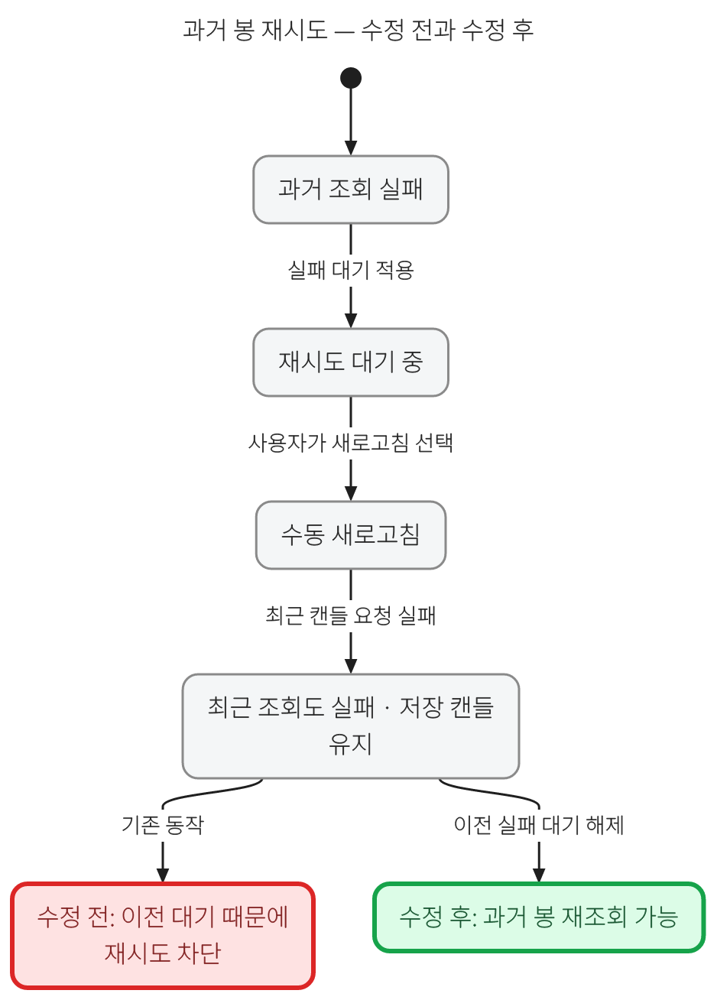

# 전체 성능·수학·상태·반응형 화면 심층 감사 — v1.27.1

## 결과와 소스 범위

실제 실행으로 재현한 계산 경계, 입력 처리, 재시도, 부팅 및 정기 갱신 회귀를 수정했다. 시장 국면의 반복 계산을 개선했으며, 실제 upstream pstack으로 유한 상태 모델과 한국어 상태전이도를 만들었다. 문서에 적힌 통과와 전체 프로그램의 수학적 증명은 구분한다.

| 대상 | 신원 |
|---|---|
| 최초 감사 main | `1b7c87ce4fe5d44d05560320bb3a270c639e3bbf` |
| 감사 중 반영된 최신 main | `65182efcb9a833b2be091c552a0291d47d50b32c` — PR #32의 하단 안내문 제거 보존 |
| 핵심 제품 수정 커밋 | `c8f9d985a7a99cdee13a5c74eeda37168f1c7ea8` |
| 초기 화면의 태블릿 보완 커밋 | `7f70c2260a634a82ecec633cbc200b6c4b54ae48` |
| 최종 통합에 포함한 최신 main | `53f587bf04f45ea7b3caa639ea88268fa7dca918` — PR #33의 철도 전광판 디자인 보존 |
| 사용한 cursor/plugins pstack | `99b609a72323b70204eab407c622f436e858e112` |
| 최종 버전 | `1.27.1` — 최초 감사 버전 `1.26.5` 뒤 병합된 `1.27.0`을 포함 |

상태·수학·성능 담당을 나누어 병렬 조사하고 서로의 수정을 교차 검토했다. 사용한 실제 pstack 지침은 `swarm`, `tdd`, `benchmark-checklist`, `create-formal-verification-skill`, `maintain-formal-verification-skill`, `statechart`이다. 기존 PR #12의 일부 수정 의도도 현재 코드에서 다시 실패를 재현한 뒤 적용했다. 오래된 브랜치 전체나 그 보고서의 통과 결과를 이번 코드의 근거로 사용하지 않았다.

감사 PR을 만든 뒤 최신 main의 철도 전광판 변경을 발견해 두 부모를 가진 merge로 보존했다. 새 색상·열 너비·44px 모바일 터치 영역·자산군 색·작은 화면 설명창을 유지하면서 고정 제목 보정을 적용했다. 따라서 이전 디자인에서 남긴 재현 캡처와 최종 `v1.27.1` 브라우저 기록은 별도 파일이다. 수치 계산 코드는 이 디자인 통합으로 바뀌지 않았다.

## 재현한 결함과 변경

| 영역 | 변경 전 증거 | 수정과 검증 |
|---|---|---|
| 계산 병목 | 매 관측마다 이동 창을 잘라 로그 평균·고저·분산을 다시 계산하는 O(NW) 작업 | 보정 이동 합, 단조 큐, 두 스택 Welford 집계로 분할상환 O(N). 독립 창 계산과 극단값 회귀로 수치 보존 확인 |
| 가격 단위와 국면 | `[1,4,2]`의 마지막 가격은 기하평균과 같지만 단위 ×1/×10/×100에 따라 `pullback/rebound/transition`으로 달라짐 | 무차원 로그 좌표와 명시적 반올림 동률 정책으로 통일. 독립적인 여러 단위·경로 비교 |
| 과거 기준일의 인과 경계 | `asOf` 이후 가격의 NaN·Infinity·0·음수 때문에 유효한 과거 계산도 실패 | 날짜 범위를 먼저 정하고 그 범위의 가격을 검증. 전체 행 구조·날짜·순서 검증은 유지. sparse slot을 건너뛰는 중간 수정도 교차 검토에서 발견해 보완 |
| 자산표 판단 경계 | 정확히 20%인 과거 평균과 올해 변화가 각각 `20.000000000000004`, `19.999999999999996`이 되어 다른 매도 단계로 분기 | 비율 계산의 소거 오차를 줄이고 `8 × EPSILON × max(절댓값, 경계의 절댓값)` 이내만 동률로 처리. 정확한 경계 16개와 양옆 24개, 실제 코드 변이 16개 검사 |
| 상세 전망 기본 API | 마지막 완료 관측은 10월 23일인데 기본 발행일은 10월 22일이어서 정상 기본 호출 실패 | 기본 발행일을 최신 완료 관측 다음으로 이동. 명시한 잘못된 날짜는 계속 거부. 발행일을 이미 명시하던 UI 전체가 실패했다고 확대하지 않음 |
| 과거 캔들 재시도 | 과거 조회 실패 → 수동 새로고침도 실패 → 같은 과거 조회가 이전 30초 대기에 계속 묶임. HTTP 호출 수 2에서 정지 | 명시적 새로고침이 이전 실패 대기를 해제. 일반 탐색의 대기·속도 제한은 유지. BTC·ETH 실제 공개 함수에서 세 번째 조회의 성공 확인 |
| 선택적 글꼴과 시작 | Google 글꼴을 필수 stylesheet의 `@import`로 읽어 글꼴 차단만으로 boot error | 선택적 link로 분리하고 필수 오류 수집에서 정확히 그 link만 제외. 늦은 글꼴 로드 때 reader 재배치. 다운로드 HTML에서는 외부 글꼴 link와 활성화 코드 제거 |
| 터치 추적 작업량 | 같은 frame의 32회 이동에 초기 표시를 포함하여 미리보기 33회 | 원시 접점은 유지하고 표시만 frame당 최신 한 번으로 합침. 손을 뗀 최종 좌표는 즉시 반영. 취소·pinch·숨김 뒤 예약 작업 제거 |
| 창·상세 패널 조절 | 마지막 move와 release가 다르면 최종 크기 누락. 분석 창 440px 대신 490px, reader 370px 대신 420px이어야 함. 두 번째 포인터의 개입도 가능 | 최초 포인터 소유권과 release 좌표를 반영. 닫기·숨김·접기·키보드·blur·capture 상실 뒤 늦은 입력 무시 |
| 정기 자료 갱신 | 날짜가 늘어난 정상 자료를 고정 latest-date 기대와 이미 존재하는 “미래” 날짜 때문에 테스트가 거부 | 고정 과거 witness를 명시적 cutoff에 묶고 미래 시험 날짜는 실제 archive 다음 날로 계산. 원자료 검증을 완화하거나 합성 자료를 공개 자료에 추가하지 않음 |
| 태블릿 표의 제목 정렬 | 768px 화면에서 오른쪽으로 이동하면 고정 BTC 셀 위에 평균 낙폭 제목이 표시됨. 본문의 종목명만 고정되고 병합 제목은 함께 스크롤됨 | 기존 개별 열 제목을 모든 크기에서 사용하고 종목명 제목을 정확히 같은 너비로 고정. 색·열 너비·자료 순서는 유지. 실제 브라우저에서 시작·중간·끝 위치의 좌표와 겹침 순서 검사 |

수학·회귀별 상세 근거는 [수학 감사](audit-2026-10-26/math-audit.md), [성능·입력 감사](audit-2026-10-26/performance-audit.md), [최종 통합 실행 기록](audit-2026-10-26/integration/verification.json)에 있다.

### 정기 갱신 실패를 별도로 확인한 이유

[기존 GitHub Actions 실행](https://github.com/twoimo/bitcoin-cycle-atlas/actions/runs/40232721164)의 job `121287683272`는 자료 갱신 뒤 테스트 단계에서 실패했다. 고정된 최신 날짜 기대와 ETH 미래 관측의 중복 날짜가 실제 로그에 나타났다.

별도 기준선 checkout에 검사용 BTC·ETH 10월 24일 관측을 하나씩 추가하여 두 실패를 다시 만들었다. 같은 자료에서 영향을 받는 테스트만 수정한 뒤 14개 TAP 사례와 자산 비교 검사가 통과했다. [수정 전](audit-2026-10-26/integration/refresh-before.log)·[수정 후](audit-2026-10-26/integration/refresh-after.log) 기록을 함께 보존했다. 이것은 재현 가능한 growing-data 회귀 검증이며 이후 실제 예약 실행이 완료되었다는 주장은 아니다.

## 성능 측정과 수치 보존

주된 측정 결과는 **운영과 같은 128개 경로 장기 예측 계산의 중앙값 234.76ms → 172.67ms, 약 26.45% 감소**다.

| 동일 입력의 계산 | 변경 전 중앙값 | 변경 후 중앙값 | 변경 전 / 후 범위 |
|---|---:|---:|---|
| 14,777행 시장 국면 계산 | 79.38ms | 27.87ms | 66.54–87.09 / 25.63–41.31ms |
| 128경로 장기 예측 전체 | 234.76ms | 172.67ms | 223.24–298.47 / 147.41–200.04ms |

양측 2회 워밍업 뒤 5회씩 A/B 교대로 실행했다. 기준선의 동일한 의존 모듈, 실제 BTC 5,942행, 같은 seed와 28일 block을 사용하고 개선 모듈 하나만 바꾸어 비교했다. Node의 순수 계산 시간이며 네트워크, DOM, 브라우저 paint, 입력 지연 또는 실물 장치 FPS를 포함하지 않는다.

5,856,956개 수치 비교가 절대 또는 상대 허용오차 `1e-11` 안에 있었고 비수치 필드는 같았다. 경제적 가격 경로·전환점·anchor의 내용 해시도 같았다. 프로파일은 별도 실행해 시간 표에 섞지 않았다. [원시 표본·환경·입력 및 소스 해시](audit-2026-10-26/rolling-performance.json)와 [프로파일 집계](audit-2026-10-26/rolling-profile-summary.json)를 보존했다.

이후 `asOf` 입력의 sparse slot 검증을 보강했다. 측정 호출은 명시적 `asOf`를 전달하지 않아 그 수정 분기를 실행하지 않는다. 측정한 파일의 해시와 최종 파일의 해시는 별도로 기록했으며, 최종 제품 전체를 다시 측정한 것으로 이름을 바꾸지 않았다.

이동 계산을 구현한 담당자와 다른 담당자가 매 창을 직접 다시 계산하는 oracle로 검토했다. 200행 경로 80개 × 네 단위의 320개 국면 벡터가 일치했고, 극소·극대 상수 창도 유지됐다. 독립 창 평균의 최대 상대 차이는 `4.44e-16`, 표본 표준편차는 `6.66e-16`이었다. 이는 명시한 유한 사례의 검증이며 모든 IEEE-754 입력의 정리는 아니다. [독립 검사와 소스 대응](audit-2026-10-26/math-cross-review.json)

## 형식 검증과 상태전이도

핵심 재시도 규칙은 다음과 같다.

> 수동 새로고침이 끝난 뒤에는 이전 과거 조회 실패의 대기 상태가 같은 기간의 새 요청을 막지 않아야 한다.



이 그림은 실제 반례를 설명하는 도식이다. pstack으로 생성한 [반례 상태차트](formal-state/review-2026-10-26/history-retry/bug-1.png), [통과한 모델의 요약 그림](formal-state/review-2026-10-26/fixed.png), [전체 설명·재실행 방법](formal-state/review-2026-10-26/stories-ko.md)을 함께 제공한다. 요약 그림에 생략한 전이는 JSON에 명시되어 있다.

| 모델 | 조사한 서로 다른 상태 | 실제 코드 연결 |
|---|---:|---|
| 시장 요청 소유권 | 2,081 | 32개 회귀 사례. 취소된 저장 응답의 소유권 방어를 제거하면 예상한 assertion 실패 |
| 수동 새로고침과 과거 조회 재시도 | 15 | BTC·ETH 공개 함수. retry 초기화를 제거하면 재조회 assertion 실패 |
| ETH 초기화·자료 소유권 | 2,243 | 초기화 17개 사례와 실제 코드 변이 9개 |
| MSTR·BMNR 초기화·자료 소유권 | 46,252 | 초기화 28개 사례와 실제 코드 변이 7개 |

TLC 1.7.4는 해시를 고정했다. 원본과 복원한 코드가 통과하고, 의도적으로 깨뜨린 모델·코드가 의도한 규칙에서 실패해야 검증이 통과한다. 실제 테스트가 실행됐는지 TAP의 pass/fail/cancel/skip/todo 집계도 검사한다. 기존 stale-response 방어의 negative control은 현재 코드에서 새 경쟁 오류를 발견한 것으로 세지 않았다.

요청 소유권 모델의 범위는 요청 세대 3개·대표 기간 2개다. 재시도 모델은 단일 기간의 대기 여부를 추상화하며 실제 30초 시계나 무한한 요청 수를 증명하지 않는다. 두 모델은 별도로 검사했으므로 결합된 전체 프로그램 증명도 아니다. 네트워크 요청이 결국 완료된다는 liveness, 모든 브라우저의 입력 중재, 가격 예측력은 이 범위 밖이다.

기존 pstack 매핑의 0부터 시작하는 tuple 참조도 현재 upstream의 1부터 시작하는 TLA tuple 규칙에 맞췄다. 이 변경은 상태차트 도구 호환성 수정이며 제품의 새로운 상태 오류로 세지 않는다.

## 데스크톱·휴대폰·태블릿 검증

`scripts/audit-interface.mjs`는 실제 Chromium `156.0.8078.47`에서 브라우저를 열고 페이지 동작을 확인한다.

철도 전광판을 포함한 최종 `v1.27.1`에서 **일반 사이트 23개·독립 실행 HTML 4개 사례가 모두 통과**했다. [최종 브라우저 실행 기록](audit-2026-10-26/browser-v1-27-1/interface.json)과 [최종 다운로드 HTML 실행 기록](audit-2026-10-26/browser-v1-27-1/standalone.json)에 검사별 결과·소스 해시·차단한 외부 호스트가 있다. 자산표는 시작·중간·끝 위치에서 종목명 제목과 셀의 좌표 및 겹침 순서까지 검사한다. 이전 디자인의 23+4 기록은 `browser/`에 남겼고, 태블릿 결함의 별도 [수정 전](audit-2026-10-26/asset-header-before.json)·[수정 후](audit-2026-10-26/asset-header-after.json) 근거도 보존했다.

| 화면 | 검증 해상도와 동작 |
|---|---|
| BTC | 1440×900, 390×844, 844×390, 768×1024, 1024×768. reader mouse 조절·키보드 초기화, 휴대폰 native CDP touch hold·12회 이동·release |
| ETH·MSTR·BMNR | 각각 데스크톱·휴대폰·태블릿 세로·가로 |
| 자산 비교표 | 데스크톱·휴대폰 세로·가로·태블릿 세로·가로. 18개 종목, BTC 첫 행, 간결한 header, 설명창, 판단 상세, 새로고침, 내부 가로 이동 |
| 독립 실행 HTML | `file://`로 직접 열어 데스크톱·휴대폰·태블릿 BTC·자산표 확인 |

외부 HTTP 요청을 차단하여 저장 snapshot으로 결정적으로 실행했다. 이 조건에서 Google 글꼴 실패가 이전 버전의 boot error를 만드는 것을 확인했고 수정 뒤 시작한다. 별도의 성공 사례는 선택적 글꼴 CSS에 빈 정상 응답을 주어 활성화 경로를 검사한다. 한국어 글리프는 공식 Noto Sans KR의 로컬 fallback으로 그렸으며 실제 Google 네트워크의 가용성을 검증한 것은 아니다.

페이지 전체의 가로 넘침, 잡히지 않은 브라우저 예외, 로컬 리소스 404가 없어야 통과한다. 자산표 내부 가로 스크롤은 의도한 동작이다. 기존 다크 화면·18종목·한 줄 상단·숨겨진 안내문과 PR #32의 하단 제거도 유지한다. 실제 iPad/iPhone 하드웨어나 Safari/WebKit·Firefox를 실행했다고 주장하지 않는다.

## 통합 검증과 재실행

철도 전광판과 태블릿 보완까지 포함한 최종 `v1.27.1`에서 Node `v24.22.1`의 전체 테스트 **1,049개가 통과**했다. 실패·취소·건너뜀·todo는 모두 0이다. 이전 감사 버전의 1,046개에 새 main의 화면 회귀 3개를 보존했다. 수치, 연구 자료, ETH 사건, 재무 경로, cycle, 성능 gate는 핵심 제품에서 통과했고 해당 계산 코드는 이후 바뀌지 않았다. 정적 경로와 standalone 검증은 최종 통합 뒤 다시 통과했다. [최종 실행 로그와 코드 대응](audit-2026-10-26/integration/v1-27-1-verification.json) · [이전 통합 실행 기록](audit-2026-10-26/integration/verification.json)

보존한 형식 검증 영수증의 직접 실행 커밋은 `c8f9d98`이다. 뒤따른 태블릿·철도 화면 통합에서도 컨트롤러와 실제 inline boot 코드는 같고, ETH·주식 초기화 모듈은 import 캐시 질의만 달라졌음을 바이트 비교로 확인했다. 검증한 소스의 해시를 바꾸지 않고 이 대응을 [상태차트 manifest](formal-state/review-2026-10-26/chart-manifest.json)에 추가했다. 통합 PR의 CI는 형식 검증을 포함한 전체 gate를 새 커밋에서 다시 실행한다.

```sh
npm test
npm run verify:numerics
npm run verify:research
npm run verify:eth-events
npm run verify:treasury-paths
npm run verify:cycle
npm run verify:performance
npm run verify:formal
npm run verify:static
npm run build:standalone
node scripts/verify-static.mjs --standalone build/Bitcoin_Cycles_Comparison.html
```

선택적 실제 브라우저 검사는 설치된 Playwright와 Chromium 경로를 지정해 실행한다. 일반 제품 실행과 기본 테스트에는 이 의존성이 필요하지 않다.

```sh
ATLAS_PLAYWRIGHT_MODULE=/absolute/path/to/playwright/index.mjs \
ATLAS_BROWSER_PATH=/absolute/path/to/chrome-headless-shell \
node scripts/audit-interface.mjs . /tmp/atlas-browser-audit

# 같은 환경에서 다운로드 HTML도 확인
node scripts/audit-interface.mjs . /tmp/atlas-standalone-audit --standalone
```

릴리스 포장은 증거와 검증 파일까지 커밋해 작업 트리가 깨끗해진 뒤 `npm run release:package -- --tag v1.27.1`로 실행한다. GitHub CI·배포 결과는 [감사 PR #34](https://github.com/twoimo/bitcoin-cycle-atlas/pull/34)에서 별도로 확인해야 하며 로컬 통과가 배포 완료를 뜻하지 않는다.

## 수학적·경제적 해석에서 유지하는 경계

회계 항등식과 입력 경계가 맞는지, 시간순 최대 낙폭을 계산하는지, 기준일 이후 관측이 과거 결과를 바꾸는지, 모델의 경우를 실제 관측으로 잘못 표시하는지를 검사했다. 기존 유한 열거·독립 oracle·코드 변이 gate도 다시 실행했다.

다만 아래 명제들은 이번 공학적 검증으로 입증되지 않는다.

- 4년 주기가 미래 가격을 발생시키거나 특정 날짜의 고점·저점을 보장한다는 명제.
- 시나리오의 최솟값·최댓값이 신뢰구간, 예측구간, 손실의 절대 한계라는 명제.
- 과거 평균에 따른 매수·매도 단계가 미래에 수익을 낸다는 명제.
- 명시된 회계식 밖의 유동성·세금·조달 가능성·공시의 최신성까지 확보됐다는 명제.
- 모델을 나중에 만들고 과거 cutoff로 계산한 결과가 당시 이용 가능했던 자료만의 historical-vintage backtest라는 명제.

따라서 계산의 일관성·인과 경계·실패 복구와 예측력의 검증을 구분하고, 기존 조건부 전망과 연구 자료의 한계 표시는 유지했다.
