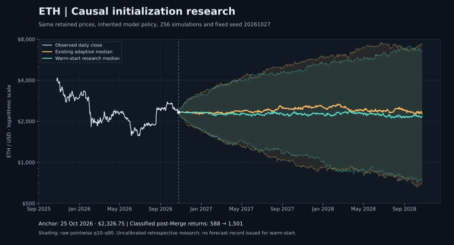

# ETH 기존 모형 후속: 상태 초기화, 단순 비교 기준, 남은 증거

> **완료한 실행:** 응용·검증 소스 `a1ecdcea2ed181835af65f0db6b712ba8c3ee273`, tree `aa09ec9b42a48535647efc11b2ce325173ab76fb`. 일반 1,511개·집중 378개·브라우저 35개가 통과했고 181 PNG를 보존했다. Hallmark는 0 FAIL / 0 REFLEX다. 수치 표의 입력 기준일은 `2026-10-25`이며 완료된 CI와 일치함을 별도로 대조했다. 이 문서를 추가한 후속 commit을 위 실행 소스로 소급하지 않는다. [실행 요약](eth-candidate-evidence/20261027-initialization/execution-summary.json), [증거 목록](eth-candidate-evidence/20261027-initialization/README.md), [문서 수치 대조](eth-candidate-evidence/20261027-initialization/document-value-verification.json).

## 확인한 결과

기존 adaptive는 Merge 이후 관측 1,502개에서 만들 수 있는 일간 수익률 1,501개 중 588개만 상태별 추정에 사용했다. Merge 날짜에서 상태 탐지기를 새로 시작해 처음 913개 수익률의 상태가 미확정으로 남았기 때문이다. 이전 가격으로 인과적 탐지기를 초기화하는 별도 연구 후보는 이 913개를 복원해 1,501개 전부를 분류했다. 이는 없는 가격을 채우거나 미래 상태를 과거에 붙인 결과가 아니다. 각 원점까지 이미 관측한 연속 가격을 사용하고, 수익률을 배정할 상태는 전일 종가까지 확정된 것만 허용한다. [warm-start 구현](../dist/ethereum-warm-start-model.js), [검증](../tests/ethereum-warm-start-model.test.mjs).

그러나 분류 가능한 자료가 늘었다고 예측력이 좋아졌다고 결론내릴 수는 없다. 같은 원점에서 warm-start의 평균 절대 로그오차를 기존 adaptive와 비교한 개선율은 30일 **−2.4017%**, 90일 **+0.6176%**, 180일 **+4.9272%**다. 비중첩 평가 원점은 각각 **9·4·2개**이며, pooled와의 별도 공통 원점에서는 세 기간 모두 악화됐다. 단순 Gaussian 구간과 비교해도 warm-start의 구간점수는 세 기간 모두 더 컸다. 이번 결과는 초기화·표본 구성의 민감도를 드러내며, 새 후보의 우월성이나 고정된 3년 상승·1년 하락을 입증하지 않는다. [별도 연구 평가기](../scripts/evaluate-ethereum-warm-start.mjs).

계산과 보고의 결함도 분리해 수정했다. BTC 연동 가격에서 중간 지수값만 표현 범위를 벗어나는 경우를 복구하고, 경제 입력의 단순 제공 개수와 실제 정의·시각 조건을 통과한 개수를 구분했다. 기존 adaptive/pooled의 가격 과정·기본값·기발행 기록은 유지한다. 새 warm-start 후보는 전향 발행 **0개**, 전향 평가 **0개**이며 운영 채택되지 않았다.

그림의 기준 가격은 보존 archive의 2026-10-25 종가 $2,326.75다. 동일한 정책과 seed로 계산한 연구 경로이며, q10–q90를 검증된 80% 예측구간이나 새로 발행한 목표가격으로 해석하지 않는다.

## 1. 이번 비교의 범위와 식별자

이번 작업은 [이전 심층 결과](ETH_MODEL_DEPTH_20261027.md)에 추가하는 후속 연구다. 이미 발행된 adaptive/pooled 기록의 소스와 수치를 덮어쓰지 않고 별도 후보를 평가한다. 가격 archive의 평가 기준일은 2026-10-25이며, 이전 원장의 실제 신규 수집 기준일 2026-10-26과 합치지 않는다.

| 대상 | 역할 | 이번 변경의 범위 |
|---|---|---|
| 기존 adaptive `eth-adaptive-research-1` | 확정 상태·위험 연령·상태별 수익률 과정 | 원래 정책과 결과 보존 |
| 기존 pooled | 상태 구분을 통합한 가격 과정 | 원래 정책과 결과 보존 |
| warm-start `eth-warm-start-initialization-research-1` | 과거 가격을 통한 탐지기 초기화 민감도 | 새 모듈·별도 평가기, 선택적 연구 API |
| Gaussian `eth-gaussian-interval-control-1` | 최근 변동성만 사용하는 단순 분포 비교 기준 | 새 구간 기준, 생산용 보정·승격 없음 |
| flat / shrunkenTrend의 경험적 오차 구간 | 기존 단순 가격 예측에 원점 당시의 오차 구간 결합 | 기존 출력에 12개 비교 행 추가 |

warm-start는 기존 40% 하락·20% 반등·14일 확인 규칙, 약한 평균 수익률, 연령별 전환위험, 변동성 재귀식, 28일 잔차 블록, 기본 256회 모의와 seed `20261027`을 계승한다. 새 버전은 초기화 이력을 정확히 표시하며 기존 simulator를 재사용했다는 사실도 별도로 기록한다. 초기화 변경은 상태 판정과 사용 가능한 자료를 함께 바꾸므로, 특정 전환위험식 하나의 효과만 식별한 실험이라고 부르지 않는다.

## 2. 913개 수익률이 빠진 이유와 복원 방법

### 실제 자료 계수

| 항목 | 기존 adaptive | warm-start |
|---|---:|---:|
| 추정 시대의 첫 가격 관측 | 2022-09-15 | 2022-09-15 |
| 추정 시대 가격 관측 수 | 1,502 | 1,502 |
| 가능한 일간 수익률 수 | 1,501 | 1,501 |
| 상태가 분류된 수익률 | 588 | 1,501 |
| 상태가 미확정인 수익률 | 913 | 0 |
| `up`에 배정된 수익률 | 469 | 1,382 |
| `down`에 배정된 수익률 | 119 | 119 |
| 추정에 들어간 Merge 이전 수익률·위험노출 일수 | 0·0 | 0·0 |

원래 미분류 913개는 가격 결측 913개가 아니다. 자료는 존재하지만, Merge 경계에서 이전 탐지기 이력을 버렸기 때문에 상태가 아직 정해지지 않았다. warm-start는 각 원점 안의 마지막 연속 가격 구간으로 탐지기를 실행한다. 현재 보존 archive에서는 이 구간이 2016-05-23부터 시작한다. Merge 이전 가격 2,306개와 경계 가격까지 합친 2,307개 관측에서, 2022-09-15 당시 `up` 상태가 이미 2022-07-27에 확정됐고 연령이 50일임을 알 수 있다.

이전 가격이 제공하는 정보는 마지막 상태와 연령에 한정되지 않는다. **누적 고점·저점, 진행 중인 확인 연속일 수, 확정 상태와 연령을 포함한 탐지기 전체 이력**이 이어진다. 그 이력은 Merge 이후에 상태가 확정되는 시점에도 영향을 줄 수 있다. 따라서 “Merge 이전 자료는 평균 수익률에 들어가지 않는다”는 말은 맞지만, “Merge 이후 상태 판정에 아무 영향도 주지 않는다”는 말은 틀리다.

### 수익률과 상태를 연결하는 시간 규칙

추정 수익률은 두 종가가 모두 2022-09-15 이후에 있는 구간만 사용한다. 최초 수익률은 2022-09-15 종가에서 2022-09-16 종가까지다. 날짜 `t`의 수익률은 `t−1`까지 확정된 상태에 배정하고, `t`에서 새로 확인된 상태는 해당 수익률을 배정한 다음 적용한다. 같은 날의 반등을 본 뒤 그 반등 수익률을 새 상태에 소급 배정하지 않는다.

Merge의 실제 날짜는 2022-09-15이지만, 날짜 라벨 자체를 “24시간 전체가 PoS였던 첫날”로 해석하지 않는다. 이 연구의 추정 경계는 가격 관측에 적용하는 명시적 정책이다. [Ethereum 공식 Merge 설명](https://ethereum.org/roadmap/merge/).

연속 가격 이력에 결측이 있으면 그 결측을 넘어 상태를 전달하지 않는다. 경계 이전에 확정 상태가 없는 합성·다른 입력에서는 `unknown`을 유지하고 실제 확인 이후부터만 수익률을 분류한다. 이번 자료의 미분류 수가 0이라는 결과를 모든 입력에서 보장하지 않는다.

### 왼쪽 절단과 현재 구간의 우측 검열

상태가 추정 시작일보다 먼저 시작됐다는 사실과, 그 이전 기간을 추정에 포함한다는 것은 다르다. 최초 `up` 구간의 연령은 50일부터 이어가되, Merge 이전 50일은 위험노출 분모에 넣지 않는다. 이를 **왼쪽 절단(left truncation)**으로 명시한다.

| 최초 관측 상태 구간의 항목 | 값 | 추정상 의미 |
|---|---|---|
| 상태 확인 시점 | 2022-07-27 | 당시까지 알려진 `knownAt` |
| 관측 위험노출 시작 경계 | 2022-09-15 | 이후 수익률만 추정 |
| 진입 시 상태 연령 | 50일 | 첫 추정 위험 연령은 51일 |
| 구간 종료 확인 | 2025-03-16 | 종료일까지 이전 상태 수익률 배정 |
| 종료 시 전체 연령 | 963일 | 시작부터 끝까지의 연령 |
| 실제 추정에 쓴 위험노출 | 913일 | 963일을 전부 관측한 것처럼 계산하지 않음 |
| 완전히 관측된 완료 기간 목록 포함 여부 | 제외 | 왼쪽 절단 구간으로 별도 보존 |

현재 `up` 구간은 2026-04-20에 확인됐고 기준일에 연령 188일이다. 아직 끝나지 않았으므로 **우측 검열(right censoring)**로 기록한다. 관측된 188일은 위험노출에 들어가지만 완료 사건이나 완결된 기간 표본으로 추가하지 않는다. [구간 기록과 연령 계산](../dist/ethereum-warm-start-model.js), [절단·검열 검증](../tests/ethereum-warm-start-model.test.mjs).

초기화를 복원하면 `up` 위험 연령대별 관측도 바뀐다. 아래는 연령 구간별 실제 위험노출 일수다.

| 상태 연령 | 기존 adaptive | warm-start |
|---|---:|---:|
| 1–30일 | 60 | 60 |
| 31–90일 | 120 | 160 |
| 91–180일 | 180 | 270 |
| 181–365일 | 109 | 294 |
| 366–730일 | 0 | 365 |
| 731일 이상 | 0 | 233 |

기존의 오래 지속된 상태에 관한 빈 관측 구간이 채워졌지만, 완료 사건 자체가 충분해진 것은 아니다. warm-start의 완전히 관측된 `up` 완료 구간은 여전히 1개이며, 913일 관측 부분은 별도 왼쪽 절단 완료 구간이다. 수백 개 일간 수익률을 수백 개 독립 시장 주기로 세지 않는다.

### `up`·`down`은 사후 고점·저점 구간 이름이 아니다

이 탐지기의 `down`은 충분히 큰 하락을 확인한 뒤 시작하므로, 이후 반등 수익률이 포함될 수 있다. 이번 실제 추정에서 `down`의 일평균 로그수익률은 약 `0.00117019`, warm-start `up`은 약 `0.00023020`다. 상태 이름 때문에 `down` 평균을 강제로 음수로 바꾸지 않았다. 이 숫자는 각 확인 규칙이 만든 표본의 평균이지 향후 일간 기대수익률의 검증값이 아니다.

따라서 상태 지속일을 그대로 “3년 강세장·1년 약세장”의 실측치로 사용할 수 없다. 완료된 상태 구간 수가 적고, 확인 지연·사전값·초기화가 모두 기간 추정에 관여한다. Coinbase Institutional·Glassnode의 2026년 2분기 보고서도 ETH의 과거 몇 차례 구간을 비교하면서 현재 구간의 차이를 다루며, 일정한 4년 법칙을 증명하지 않는다. [Charting Crypto Q2 2026, 13쪽](https://assets.ctfassets.net/k3n74unfin40/6T2gPNDvHvBpf246ziwYTW/81039d2975a8c36c9e475c06a24a4455/Charting_Crypto_2Q26.pdf).

## 3. 같은 원점의 점예측 결과

각 예측은 해당 원점까지의 가격만 사용해 다시 적합한다. 완료된 CI의 평가기는 기존 격자의 원점 111개를 검사했고, 그중 warm-start 후보가 사용 가능한 원점은 21개다. 검사한 111개 전부에서 예측을 만들었다고 세지 않는다. 양쪽 후보가 모두 있는 성숙 원점의 교집합을 먼저 만든 뒤, 기존 규칙으로 목표 기간이 겹치지 않는 원점을 선택한다. 먼저 각 후보를 따로 줄인 뒤 교집합을 만드는 방식은 쓰지 않는다. 미래 실제값이나 누락 정답은 평가에 넣지 않는다. [원점·평가 구현](../dist/ethereum-model-comparison.js), [별도 warm-start 평가](../scripts/evaluate-ethereum-warm-start.mjs), [실제 실행 수치](eth-candidate-evidence/20261027-initialization/warm-start-receipt.json).

주 점수는 평균 절대 로그오차다. 표의 개선율은 다음과 같고, **양수가 warm-start의 오차가 작다는 뜻**이다.

$$
\operatorname{skill}
=1-\frac{\operatorname{MALE}_{\mathrm{warm}}}
{\operatorname{MALE}_{\mathrm{comparison}}},\qquad
\operatorname{MALE}=\frac1n\sum_i\left|\log\widehat P_i-\log P_i\right|.
$$

| 비교 대상 | 기간 | 공통 성숙 원점 | 비중첩 원점 `n` | warm-start MALE | 비교 대상 MALE | warm-start 개선율 |
|---|---:|---:|---:|---:|---:|---:|
| adaptive | 30일 | 17 | 9 | 0.157241 | 0.153553 | **−2.4017%** |
| adaptive | 90일 | 15 | 4 | 0.325585 | 0.327608 | **+0.6176%** |
| adaptive | 180일 | 12 | 2 | 0.329128 | 0.346186 | **+4.9272%** |
| pooled | 30일 | 19 | 10 | 0.191195 | 0.187622 | **−1.9043%** |
| pooled | 90일 | 17 | 5 | 0.408929 | 0.394442 | **−3.6730%** |
| pooled | 180일 | 14 | 2 | 0.824598 | 0.774822 | **−6.4242%** |

표의 개선율은 투자 수익률·적중 확률·신뢰구간이 아니다. `n`도 독립 시장 국면의 개수를 뜻하지 않는다. 인접한 비중첩 창은 경계 가격을 공유할 수 있고 변동성·시장 환경의 의존성도 남는다. 과거 자료를 현재 보존 판본으로 재실행했으므로, 당시 실제 취득할 수 있었던 원문 판본을 검증한 전향 성과도 아니다.

같은 `n=2`라도 표본은 다를 수 있다. 180일 warm/adaptive 비교 원점은 **2025-06-11·2025-12-24**, warm/pooled 비교 원점은 **2025-04-16·2025-10-29**다. 두 표의 warm-start 오차 `0.329128`과 `0.824598`은 서로 다른 정답을 평가한 값이다. 이를 후보가 두 번 계산되며 성능이 바뀐 것으로 해석하거나, 그 차이로 세 후보의 전체 순위를 만들지 않는다.

이 연구는 기존 정책·기본 seed의 회고적 민감도 비교다. 같은 seed 번호가 두 후보에서 같은 잔차 충격을 뜻하지는 않는다. 복원된 자료가 잔차 집합과 소비 순서를 바꾸기 때문이다. [이전 8-seed·256/1,024회 패널](ETH_MODEL_DEPTH_20261027.md)에서 작은 개선의 부호가 바뀌었던 사실도 유지한다. 그 검증을 새 warm-start 후보의 반복 모의 검증이 이미 끝난 것으로 대체하지 않는다.

## 4. 구간을 평가하기 위한 두 가지 단순 비교 기준

구간이 넓으면 관측값을 많이 포함할 수 있으므로 coverage만으로 평가하지 않는다. 폭이 지나치게 넓은 경우와 실제값을 놓친 경우를 함께 벌점으로 계산한다. 이번 주 표는 로그 가격 좌표의 interval score를 사용한다. `L`, `U`, `y`를 각각 로그 하한·로그 상한·로그 실제값, `α=0.2`로 두면 다음과 같다.

$$
IS_\alpha(L,U,y)=(U-L)+\frac{2}{\alpha}(L-y)\mathbf1(y<L)
+\frac{2}{\alpha}(y-U)\mathbf1(y>U).
$$

점수가 작을수록 선언된 손실 기준에서 좋다. 달러 좌표의 점수도 별도 보존하지만 로그 점수와 합치지 않는다. 캐시된 점수 필드를 믿지 않고 원래 구간 경계와 실제값으로 다시 계산한다. [구간 점수·동일 원점 검증](../tests/ethereum-interval-comparison.test.mjs). 시간 순서를 지키는 원점 평가와 단순 기준 비교는 [Forecasting: Principles and Practice의 예측 평가 방법](https://otexts.com/fpp3/toolbox.html)에 따른다.

### 4.1 최근 180일 변동성의 Gaussian 로그 확률보행

각 원점에서 완료 종가 181개로 만든 일간 로그수익률 180개만 쓴다. 표본 평균은 분산 계산에서만 빼고, 분모는 179다. 미래 로그 드리프트는 0이며 중앙값은 원점 가격이다.

$$
\log P_{t+h}=\log P_t+s_{180}\sqrt h\,Z,\quad Z\sim N(0,1),
$$

$$
[L_h,U_h]=P_t\exp\left(\pm1.2815515655\,s_{180}\sqrt h\right).
$$

독립 정규 수익률·일정한 미래 분산은 이 비교 기준의 가정이다. ETH에서 실제로 성립한다고 검증한 것이 아니다. 로그 드리프트 0은 가격의 기댓값이 현재 가격이라는 뜻도 아니다. 모수 추정의 불확실성은 이 단순 구간에 포함하지 않는다. 결측이 있는 원점은 보간하지 않고 사용 불가로 둔다. [Gaussian 구현](../dist/ethereum-interval-benchmark.js), [12개 검증](../tests/ethereum-interval-benchmark.test.mjs).

아래 값은 각 후보와 Gaussian이 함께 평가 가능한 원점만 사용한 로그 interval score다. **각 행 안에서만** 두 점수를 비교한다.

| 후보 | 기간 | 비중첩 `n` | 후보 점수 | Gaussian 점수 | 후보 포함 수 | Gaussian 포함 수 |
|---|---:|---:|---:|---:|---:|---:|
| adaptive | 30일 | 9 | 0.847892 | 0.768861 | 6/9 | 7/9 |
| adaptive | 90일 | 4 | 1.070022 | 0.924669 | 3/4 | 4/4 |
| adaptive | 180일 | 2 | 1.652412 | 1.350688 | 1/2 | 2/2 |
| pooled | 30일 | 20 | 0.809339 | 0.807079 | 13/20 | 14/20 |
| pooled | 90일 | 10 | 1.497481 | 1.350538 | 3/10 | 4/10 |
| pooled | 180일 | 5 | 1.743957 | 1.924594 | 4/5 | 4/5 |
| warm-start | 30일 | 10 | 0.994274 | 0.936369 | 7/10 | 7/10 |
| warm-start | 90일 | 5 | 1.704939 | 1.440854 | 2/5 | 2/5 |
| warm-start | 180일 | 2 | 3.697030 | 2.773252 | 0/2 | 1/2 |

adaptive와 warm-start는 이 패널의 세 기간에서 모두 Gaussian보다 큰 점수를 기록했다. pooled는 30·90일에서 더 크고 180일에서 더 작다. 표본이 적은 이 결과를 미래 우월성이나 유의성으로 확장하지 않는다. 포함 비율 2/2 또는 4/5도 모형의 명목 80% 구간이 보정됐다는 증거가 아니다. [기존 후보와 구간 기준 평가기](../scripts/evaluate-ethereum-interval-controls.mjs), [warm-start의 별도 Gaussian 비교](../scripts/evaluate-ethereum-warm-start.mjs).

### 4.2 원점 당시에 구성한 경험적 오차 구간

flat과 shrunkenTrend의 기존 경험적 구간은 각 원점까지 이미 성숙한 같은 horizon의 절대 로그오차만 사용한다. 비중첩 보정 표본 최소 12개·최대 64개를 유지하고, 유한표본 순위 `ceil((n+1)(1−α))`를 적용한다. 평가가 끝난 뒤 전체 결과를 보고 과거 구간을 다시 넓히지 않는다. 새 비교기는 이 원래 구간과 adaptive/pooled의 모의 q10–q90를 대조한다.

추가한 비교는 `2개 후보 × 2개 단순 기준 × 3개 기간 = 12행`이다. 기존 9행의 내용과 순서를 보존한 뒤 붙여 총 21행이 된다. 미래 정답을 매우 크게 바꾸거나 NaN으로 바꿔도 과거 원점의 보정은 바뀌지 않는지, 캐시 점수를 변조해도 경계값에서 다시 계산하는지, 실제 구간 경계 변조는 점수에 반영되는지를 검사한다. [비교 구현](../dist/ethereum-model-comparison.js), [원점 보정·경계 재계산 테스트](../tests/ethereum-interval-comparison.test.mjs).

| 후보 | 기간 | 경험적 flat/trend와의 각각의 `n` | Gaussian과의 `n` |
|---|---:|---:|---:|
| adaptive | 30일 | 9 | 9 |
| adaptive | 90일 | 4 | 4 |
| adaptive | 180일 | 2 | 2 |
| pooled | 30일 | 20 | 20 |
| pooled | 90일 | 10 | 10 |
| pooled | 180일 | **3** | **5** |

예를 들어 pooled 180일은 경험적 flat 구간과 비교할 때 3개 원점에서 pooled 점수 `1.042733`, flat 점수 `2.444622`다. Gaussian과 비교할 때는 5개 원점에서 pooled 점수 `1.743957`, Gaussian 점수 `1.924594`다. pooled 점수 자체가 달라진 이유는 평가 원점이 다르기 때문이다. 첫 비교의 `1.042733`과 두 번째의 `1.743957`을 같은 자료에서 나온 개선·악화로 설명하지 않는다. 향후 세 기준의 직접 순위가 필요하면 세 쪽 모두의 교집합을 별도로 고정해야 한다.

## 5. BTC 연동 가격의 중간 지수 범위 수정

BTC 연동 예측은 기존에 `anchor × exp(logChange)`를 계산했다. `anchor`가 매우 작거나 클 때 최종 가격은 유한한 양수인데 중간 `exp(logChange)`만 무한대나 0이 될 수 있다. 정상 범위에서는 기존 계산 순서와 숫자를 그대로 유지하고, 그 결과가 유한 양수가 아닐 때만 `exp(log(anchor) + logChange)`로 다시 계산한다.

실제 함수에 합성 유한 입력을 넣은 재현에서는 양의 지수 약 853.98 때문에 중간 지수가 무한대가 됐지만, 작은 ETH 기준 가격과 결합한 최종 가격 약 `7.57055 × 10^70`은 표현 가능했다. 반대 방향의 중간 underflow도 검증했다. 이 값은 계산 경계용 합성 예이며 시장 가격 예측이 아니다.

최종 가격 자체가 표현 불가능하면 계속 사용 불가다. beta를 임의 범위로 잘라 예측을 만들지 않는다. ETH/BTC 비율 기준값도 별도로 양수·유한값이어야 하며 USD 지수 복구가 비율 검증을 우회하지 않는다. [변경 함수](../dist/ethereum-model-comparison.js), [네 가지 범위 검증](../tests/ethereum-btc-link-range.test.mjs).

## 6. 경제 입력: 시각 진단과 준비 상태 계수

### 현재 원문으로 확인할 수 있는 시각

Coin Metrics 자료는 실제 보존 원문과 수집 영수증에 묶어 분석했다. 제공자 저장소 commit의 시각, 계산 완료 시각, 실제 공개 시각, 이번 수집 시각은 서로 다른 필드로 유지한다. [보존 원문](../research-data/eth-economic-captures/20261026T121240869Z-coinmetrics/eth.csv), [수집 영수증](../research-data/eth-economic-captures/20261026T121240869Z-coinmetrics/receipt.json), [분석기](../scripts/analyze-ethereum-source-timing.mjs).

| 항목 | 확인 값 |
|---|---|
| 제공자 원문 | `coinmetrics/data`, `csv/eth.csv` |
| 제공자 commit | `f1a36afb962731c387bb03982758ab0103063da5` |
| 원문 SHA-256 | `46b18f3df967405374b1f6ee8a3d11ee1b7a5b176ac9fb4342caf6bf8648f2cc` |
| 원문 크기 | 2,121,732 bytes |
| 저장소 commit 시각 | 2026-05-24T13:37:39Z |
| 이번 실제 수집 완료 | 2026-10-26T12:12:40.869Z, 한국 시각 21:12:40.869 |
| 최초 공개 시각 | 미확인, `publishedAt=null` |

전체 3,952행 중 Merge 날짜를 포함한 시대에 1,348행이 있고, 분석 대상 지표가 모두 있는 행은 1,347개다. 가장 최근 완전한 행은 2026-05-23으로 평가 기준일보다 155일 오래됐다. Merge 당일을 포함한 이 행 수를 전부 “완전한 PoS 하루”의 개수라고 표현하지 않는다.

완료 지연은 행의 UTC 날짜가 시작하는 순간이 아니라 **그 일간 관측이 끝나는 다음 UTC 자정**부터 계산했다. 1,347개 행 중 91개가 1일 초과, 16개가 30일 초과였다. 가장 큰 지연은 2025-05-07 관측에서 발생했다. 관측 종료는 2025-05-08T00:00Z, 제공자 계산 완료는 2025-06-21T23:05:44Z로 **44.9623일** 차이다. 따라서 모든 과거 행을 일률적으로 다음 날 사용할 수 있었다는 가정은 이 자료에서 지지되지 않는다.

제공자 계산 완료 필드는 실제 대외 공개 시각을 보증하지 않는다. 이번 원문을 2026-10-26에 수집했다는 사실로 각 과거 행의 당시 취득을 소급 인증하지도 않는다. 이 진단은 경제 가격예측을 만들지 않고, 지표 정의·공개 판본 조건을 완화하지 않는다. 총발행량·총수수료·제공자 공급량 몇 개가 있다는 사실만으로 기존 full 모형의 25개 지표 계약을 충족하지 않는다.

### 제공 개수와 적격 개수를 분리

준비 상태 보고서의 `providedSnapshots`는 입력으로 제공된 개수다. `eligibleFullSnapshots`는 실제 정의·시각 검사 결과인 `definitionAndTimeQualifiedSnapshots`를 사용하도록 수정했다. 검사하지 못했거나 입력이 잘못돼 적격성을 확정할 수 없으면 `null`을 유지하며 제공 개수를 대신 넣지 않는다. [준비 상태 보고서](../scripts/build-ethereum-model-readiness.mjs), [적격성 검증](../tests/ethereum-economic-readiness.test.mjs).

현재 실제 비교의 제공 snapshot은 **0**, 정의·시각 적격 snapshot도 **0**이며 `modelReady=false`다. 미래 공개·수집 시각의 입력을 제공 개수에는 셀 수 있어도 해당 cutoff의 적격 개수에는 넣지 않는다. 중복 원문도 제공 2개를 독립 적격 2개로 만들지 않는다. 최신 구조상 적격 입력 하나가 생겨도 충분한 성숙 학습 정답이나 역사 판본 진위를 확보했다는 뜻은 아니다.

경제 모형의 최소 16개 학습 정답과 지표·기간·계층·중복 제거 계약은 그대로다. 최소 12개 성숙 비중첩 오차는 비교기의 실험적 구간 보정 조건이며, 경제 ridge 자체가 확률구간을 제공한다는 뜻이 아니다. [기존 남은 조건](ETH_REMAINING_CONDITIONS.md)의 90·180일 자료 상한과 과거 판본 문제도 이번 가격 상태 초기화로 해소되지 않는다.

### 같은 날짜 문자열의 가격을 그대로 합치지 않는다

보존 CSV의 `PriceUSD[d]`는 d일의 완료 종가를, `ReferenceRate[d]`는 d일 00:00 UTC의 시점을 나타낸다. 원문에서 값이 겹치는 작은 구간을 실제 대조했다. 같은 날짜끼리 비교할 수 있는 6쌍은 모두 달랐고, 다음 날짜의 ReferenceRate와 비교할 수 있는 7쌍은 모두 일치했다. ReferenceRate가 있는 교집합만 확인한 결과이며 1,347행 전체의 교차 검증이라고 확대하지 않는다.

| 원문 값 | USD/ETH |
|---|---:|
| 2026-05-23 PriceUSD | 2,116.16834102864 |
| 2026-05-23 ReferenceRate | 2,066.76720977206 |
| 2026-05-24 ReferenceRate | 2,116.16834102864 |

이것은 행을 잘못 옮겨 붙여 관측 종료 전에 가격을 사용하는 일을 막기 위한 점검이다. 날짜별 가격 정의를 먼저 맞춘 뒤 공개·수집 시각의 적격성도 별도로 확인해야 한다. [PriceUSD 정의](https://coverage.coinmetrics.io/asset-metrics/PriceUSD), [시장 자료의 시각 설명](https://github.com/coinmetrics/docs-website/blob/master/market-data/market-data-faqs.md).

### 실제 계산 가능한 마지막 28일 부분 관측

보존 CSV의 마지막 완결 28일 창은 **2026-04-26 00:00 UTC부터 2026-05-24 00:00 UTC 직전까지**다. ETH 금액은 소수점 18자리의 정수 연산으로 합산하고 원래 숫자 문자열을 보존했다. 필요한 날짜나 값이 빠지면 이 집계를 만들지 않는다.

| 지표 | 이 창의 실제 값 | full 모형에 바로 넣을 수 없는 이유 |
|---|---:|---|
| 총수수료 | 9,122.065722414916226531 ETH | execution base·priority·blob 포함. 전부 소각된 금액이 아니며 execution과 blob 분리가 필요 |
| 총발행 | 78,672.726006681 ETH | gross 발행. consensus net 발행 및 예치금과 정의를 맞춰야 함 |
| 제공자 시작 공급 | 121,646,198.312885754802307137 ETH | 공급 계열의 실행·합의 계층 범위와 회계 정의를 정산해야 함 |
| 제공자 종료 공급 | 121,721,391.228685875456586931 ETH | 위와 동일 |
| 제공자 공급 변화 | +75,192.915800120654279794 ETH | 약 +0.0618128%. 검증된 현시점 전체 ETH 순발행으로 대신하지 않음 |

해당 창의 가장 늦은 provider 계산 완료는 2026-05-24T02:44:08Z다. 수집 시각은 이보다 훨씬 뒤인 2026-10-26이다. 이 과거 창의 양의 공급 변화를 지금의 순발행이나 향후 가격 방향으로 확장하지 않는다. [수수료 정의](https://gitbook-docs.coinmetrics.io/network-data/network-data-overview/fees-and-revenue/fees), [발행 정의](https://gitbook-docs.coinmetrics.io/network-data/network-data-overview/supply/supply-issuance), [공급 정의](https://gitbook-docs.coinmetrics.io/network-data/network-data-overview/supply/current-supply), [정확한 분석 영수증](eth-candidate-evidence/20261027-initialization/source-timing-receipt.json).

### 기관 보유·스테이킹·AI 이용의 해석 경계

BitMine의 2026-10-26 발표는 10월 25일 14:00 ET 기준 총보유 **6,051,933 ETH**, 그중 스테이킹 **5,227,037 ETH**를 제시한다. 두 수를 독립 재고처럼 더해 유통 공급에서 차감하면 같은 ETH가 중복된다. 회사가 보고한 보유·스테이킹 시점의 수치이며, 독립 감사 결과나 UTC 하루의 전체 시장 집계로 바꾸지 않는다. 스테이킹된 ETH의 경제적 유동성은 거래 가능한 청구권과 실제 호가·깊이·상환 조건도 필요하다. [발행사의 원문 발표](https://www.prnewswire.com/in/news-releases/bitmine-immersion-technologies-bmnr-announces-eth-holdings-reach-6-05-million-tokens-and-total-crypto-and-total-cash--marketable-securities-holdings-of-15-billion-302919315.html).

AI 에이전트의 결제·인증 사용량도 ETH 가격과 일대일로 연결하지 않는다. [ERC-8004](https://eips.ethereum.org/EIPS/eip-8004)는 현재 Draft로 에이전트 발견·신뢰를 다루며 결제를 별도 문제로 취급한다. [x402](https://x402.org/)는 네트워크 중립적인 결제 구조다. 실제 ETH 수요의 설명변수로 쓰려면 어떤 네트워크에서 얼마나 사용됐는지, ETH로 귀속되는 실행·blob 수수료와 소각이 얼마인지, 반복 거래가 가격에 영향을 줄 만큼 보유 수요를 만드는지를 측정해야 한다. 거래 건수 증가 자체를 같은 크기의 ETH 가치 증가로 놓지 않는다.

[미래에셋 원문 PDF](https://securities.miraeasset.com/bbs/download/2142940.pdf?attachmentId=2142940)의 누적 예치금을 활성 스테이킹으로 해석한 수치 정정은 [앞선 연구](ETH_REMODELING_RESEARCH_20261027.md)의 사실 정정으로 유지한다. 현재 PDF의 수정 문구를 표지 날짜 당시 존재했던 판본으로 소급하지 않는다. 기관의 시나리오 목표는 가정에 따른 계산이며, 새 후보의 성과 정답이나 미래 가격 법칙으로 사용하지 않는다.

## 7. 검증 상태와 실패 이력

검증은 초기화·분포 가정의 수학적 구현과 증거 보존을 확인한다. 시장 예측력을 보증하거나 운영 채택 권한을 대신하지 않는다. 다음 검사를 추가했다.

| 검사 묶음 | 직접 확인하는 성질 |
|---|---|
| warm-start | 전일에 알려진 상태 배정, 미래 가격 교란 불변, Merge 이전 수익률·위험노출 제외, 진입 연령·왼쪽 절단·우측 검열, 결측 경계, 알려지지 않은 초기 상태, 새 버전 표시, 기존 출력 불변 |
| Gaussian 비교 기준 | 180개 수익률·분모 179, 원점 밖 가격 불변, 결측 처리, 공통 원점을 먼저 선택, 원문 실제값 일치, 점수 재계산, 0분산·표현 범위 |
| 경험적 구간 비교 | 원점 당시 성숙 자료만 보정, 비교 교집합 이후 비중첩 선택, 원래 경계에서 점수 재계산, 명목 구간 질량·기간 일치 |
| BTC 수치 범위 | 중간 overflow·underflow 복구, 정상 산술 불변, 최종 범위 실패와 비율 실패 유지 |
| 경제 준비 상태 | 제공·적격 개수 구분, 미래·중복·오래된·충돌 판본 처리, 현재 입력과 학습 준비 상태 분리 |

중간 실행을 삭제하거나 최종 성공으로 이름을 바꾸지 않는다. [중간 실행 영수증](eth-candidate-evidence/20261027-initialization/intermediate-executions.json)에 다음 이력을 보존했다.

| 소스 | 일반 검사 | 집중 검사 | 실제 결과 |
|---|---|---|---|
| `3cc94928ae93462e9e47ce83b8f61d95d57461cf` | 1,510/1,511 통과 | 377/378 통과 | 기존 테스트가 구간 비교 9행만 기대해 실패. 기존 9행 보존과 추가 12행을 함께 확인하도록 수정 |
| `0e3e4409d5db05ff72ede8e01388b7dd766abd95` | 1,511/1,511 통과 | 378/378 통과 | warm-start JSON 작성 뒤 CLI 영수증 출력에서 `asOf is not defined`; evidence job 실패 |

`0e3e4409…`의 Hallmark는 0 FAIL·0 REFLEX였으나, 실패한 evidence job의 후속 native browser·readiness 단계는 실행되지 않았다. 해당 단계까지 완료했다고 쓰지 않는다. 영수증 오류의 수정 commit은 `a1ecdcea2ed181835af65f0db6b712ba8c3ee273`이며, 출력 필드를 `asOf: report.asOf`로 연결했다. 이 수정 자체가 최종 재실행 성공을 뜻하지는 않는다.

후속 `a1ecdcea…`의 source tree는 `aa09ec9b42a48535647efc11b2ce325173ab76fb`다. [일반 CI 40476026510](https://github.com/twoimo/bitcoin-cycle-atlas/actions/runs/40476026510)은 합성 merge `136f36106e2ca6932831aa32f1f010619ced0a11`에서 실행했다. 그 merge tree는 `5b071381229362f33b08a2f4946a996a2c8fc9ee`, 부모는 main `5dd11c99faa1fe4a1a9adf56bc4775d35c9a41e4`와 직접 PR head `a1ecdcea…`다. 집중·브라우저·Hallmark가 실행한 직접 PR tree와 구분한다.

| 최종 검사 | 실제 결과 | 근거 |
|---|---|---|
| 일반 CI | **1,511 pass / 0 fail / 0 skipped**, 수치 assertion 318,010, negative control 16/16 | [실행 40476026510](https://github.com/twoimo/bitcoin-cycle-atlas/actions/runs/40476026510), [실행 요약](eth-candidate-evidence/20261027-initialization/execution-summary.json) |
| 별도 일반 검사 | 요청 소유권 32/32, 일별 시계 28/28, 정적 자원 17/17 | 위 실행 요약 |
| 직접 ETH 검사 | **378 pass / 0 fail / 0 skipped**, 연구 CLI와 readiness까지 정상 종료 | [실행 40476026537](https://github.com/twoimo/bitcoin-cycle-atlas/actions/runs/40476026537) |
| Chromium 화면·입력 검증 | **35/35**, PNG 181개, runtime 0 / unexpected resource 0 | [원본 브라우저 영수증](eth-candidate-evidence/20261027-initialization/browser-receipt.json) |
| 의도한 offline 갱신 실패 | resource 오류 원문 15개 보존, 안내·자료 유지·재시도 검증 | 위 브라우저 영수증의 resourceErrors / expectedOfflineRefresh |
| Hallmark | **0 FAIL / 0 REFLEX**, integrity errors 0, static WARN 36 / render WARN 17, waiver·dismissal 0 | [실행 40476026561](https://github.com/twoimo/bitcoin-cycle-atlas/actions/runs/40476026561), [원문 진단](eth-candidate-evidence/20261027-initialization/hallmark-current-findings.json) |

기존 adaptive 경로 **731점**, 이전 모델 요약 **27행**, 기존 pairwise **45행**이 같은 입력에서 정확히 유지됐다. [보존 검사 영수증](eth-candidate-evidence/20261027-initialization/pooled-preservation-receipt.json). 기존 자산 원장 9개·snapshot 3개는 현재 입력이 오래되어 새 발행하지 않고 무결성을 확인했다. 별도의 실제 adaptive/pooled 후보 원장은 **새 발행 0 / 기존 2개 재사용**, **고유 원점 1 / pending 6 / scored 0**이다. 네트워크 없는 별도 프로세스에서 원래 입력으로 두 모형의 각 731점을 다시 계산해 기록 ID·수치와 일치함을 확인했다. [발행 영수증](eth-candidate-evidence/20261027-initialization/prospective-receipt.json), [실제 재생 영수증](eth-candidate-evidence/20261027-initialization/prospective-replay-receipt.json).

첫 후보 목표 관측 종료는 30/90/180일 순서로 **2026-11-26 / 2027-01-25 / 2027-04-25, 각 한국 시각 09:00**이다. 이번 warm-start는 이 기존 발행본과 별개이며 발행 0·성숙 평가 0 상태다. [최종 준비 상태](eth-candidate-evidence/20261027-initialization/model-readiness-receipt.json)는 완전 경제 snapshot 0과 모형 비활성도 확인한다.

실행 환경은 GitHub Actions의 Chromium이다. 실제 휴대전화·Safari·미래 시장 성능 검증이라고 부르지 않는다. 새 warm-start 연구 계산은 원점 111개에서 약 **489ms**, 기존 후보의 Gaussian 비교는 약 **39ms**였다. 이는 해당 runner에서 기록한 수치이며 화면 반응속도나 물리 모바일 지연으로 확대하지 않는다.

source-book은 **279 seeds / 400 entries / 314 parts / 56,450,426 bytes**, unresolved 0이다. 60,000,000-byte 한도를 변경하지 않았다. [원본 manifest](eth-candidate-evidence/20261027-initialization/review-source-manifest.json)의 묶음 SHA-256은 `d0896af938fb5f91d28d1029cb2a36c29d939ed937825274d70ebf9acd0a2c23`다. 원본 generator의 `externalReview.pending`은 그대로 보존하고, 현재 사용자 지시인 Gemini/후속 역검토 `omitted-by-user`는 실행 요약에서 구분한다.

[전체 실행 artifact](https://github.com/twoimo/bitcoin-cycle-atlas/actions/runs/40476026537/artifacts/12721297261)는 전체 보고서·source-book·원문 수집·181 PNG를 포함한다. GitHub가 보고한 ZIP SHA-256은 `db7cf5e468301922b7bfd2126c3071dc4ac86661fa4658e67f500d6efa132f0b`, 보존 기한은 **2026-11-26 17:55 KST**다. 이 문서 폴더에는 실제 로그의 JSON 영수증·manifest·실패 이력과 핵심 수치를 별도로 남긴다. 영수증 JSON과 artifact 안의 전체 보고서는 내용 범위가 다르며 원본 보고서의 정확한 byte 수와 hash는 [증거 목록](eth-candidate-evidence/20261027-initialization/README.md)에서 확인한다.

로컬에서 작성한 수치 표의 점예측·구간 점수·Gaussian 및 경험적 비교·초기화 상태·28일 집계는 완료된 CI 영수증과 정확히 일치했다. 관련 모듈·평가기·ETH 입력 8개 파일의 SHA-256도 실행 manifest와 대조했다. [문서 수치 대조 기록](eth-candidate-evidence/20261027-initialization/document-value-verification.json). 이 일치는 수치 재현성의 근거이며 예측력의 증거를 늘리지 않는다.

## 8. 남은 조건과 이번 작업의 의미

| 질문 | 현재 답 | 다음에 필요한 증거 |
|---|---|---|
| 초기 상태를 몰라 버린 913개 수익률을 인과적으로 분류할 수 있는가? | 현재 archive에서는 가능. 새 후보의 분류 1,501개, 사전 시대 수익률·위험노출 0개 | 새 자료·결측·상태 미확정 입력에서도 명시한 시간 규칙 유지 |
| warm-start가 기존 후보보다 우수한가? | adaptive 대비 혼합, pooled 대비 세 기간 악화 | 고정된 공통 원점·손실·정책의 추가 검증과 전향 성숙 결과 |
| ETH의 3년 상승·1년 하락이 입증됐는가? | 아니다. 확인 상태와 사후 시장 구간의 의미가 다르며 독립 주기도 적다 | 기간 정의를 먼저 고정한 충분한 독립 역사·전향 근거 |
| q10–q90가 실제 80% 구간인가? | 모의 또는 가정에 따른 명목 구간이며 coverage 보장 없음 | 별도 보정·검증 자료, 폭과 누락을 함께 평가한 구간점수, 충분한 성숙 원점 |
| 단순 기준 대비 안정적 개선이 있는가? | 현재 결과로 확정할 수 없음 | 후보별 전체 교집합·여러 seed의 수치 민감도·미리 고정한 전향 평가 |
| 경제 입력을 활성화할 수 있는가? | 실제 적격 full snapshot 0, `modelReady=false` | 정의를 맞춘 원문, 당시 공개·수집 판본, 충분한 같은 기간 학습 정답 |
| 새 후보의 전향 기록이 생겼는가? | warm-start 발행 0, 평가 0 | 별도로 고정·발행된 이후 실제 만기가 지난 관측. 기존 v1 발행본을 새 버전 실적으로 옮기지 않음 |
| 이번 변경을 main에 채택했는가? | 아니다. 연구 후보·기존 기본값 유지 | 연구 결과와 별개의 명시적 릴리스 판단 |

이번에 얻은 가장 확실한 개선은 **추정에 어떤 자료가 들어갔는지와 비교 점수가 어떤 원점을 평가했는지를 더 정확히 설명할 수 있게 된 것**이다. 상태 초기화는 수정 가능한 모델 선택이며, 단순 확률보행·기존 경험적 구간과의 비교는 추가 복잡성이 실제 점수로 보상되는지 확인하게 한다. 현재 결과는 그 보상을 확정하지 못한다.

기존 adaptive/pooled 발행 기록·가격 기본값·main은 보존한다. PR의 연구 상태와 `releaseAuthorized=false`를 유지한다. 사용자 지시에 따른 Gemini 반대 검토 및 후속 역검토의 `omitted-by-user`도 유지하며, 이번 남은 조건에 다시 필수 단계로 추가하지 않는다.
