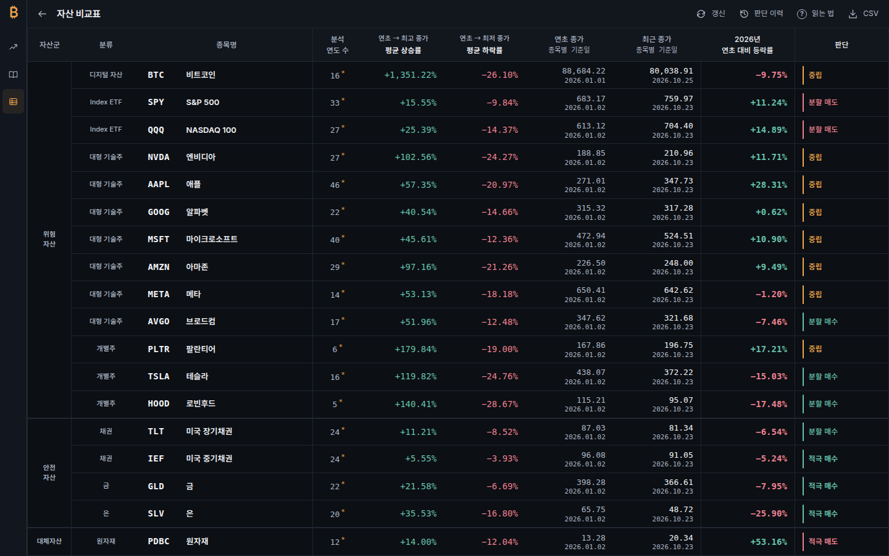

# Hallmark 전체 앱 적용 결과

> **2026-10-27 최신 결과:** 실제 소스 **39d380d5a05295f5180088ccfe0190ebc3b21e0d**에서 고정 Hallmark app 검사 **0 FAIL / 0 REFLEX**, integrity errors0을 확인했다. static36/render17 WARN은 그대로 남는다. [최신 결과·해결 방식·남는 경고](ETH_UI_PROTOCOL_FOLLOWUP_20261027.md)와 [원본 진단](eth-candidate-evidence/20261027-ui-protocol/hallmark-records.json)을 참조한다. 아래 df0bc76의 6/3과 당시 소스·화면 평가는 보존된 이전 실행 기록이다. 현재 Gemini 반대 검토·후속 역검토는 사용자 지시에 따라 omitted-by-user이며 통과로 간주하지 않는다.

검증 대상 응용 소스: `df0bc769b3cb9a65654c2874673e04612c8880df`. 이 문서를 저장한 후속 문서 커밋과 실제 실행 소스를 구분한다. 사용자 요청에 따라 [Nutlope/hallmark v2.0.0](https://github.com/Nutlope/hallmark/tree/7ec868225c6caa040558c321ee0fefa0e73f83a8)의 app 범위를 기존 전체 앱에 적용했다.

## 바뀐 사용자 동작

- **빈 하단 없는 작업 화면:** 비교표가 실제 viewport와 헤더 높이에서 남은 공간을 계산해 18개 본문 행에 배분한다. 큰 화면은 끝까지 채우고, 작은 화면에서는 최소 행 높이와 내부 스크롤을 유지한다. BTC가 첫 행이며 현재 표시명은 **비트코인**이다.
- **일관된 다크 화면:** 24개 CSS와 두 HTML에 공통 색상 역할·포커스·입력 경계·글자·간격을 적용했다. 연구 원문 읽기창, 정보창, 도구, 발행 기록, 비어 있는 결과와 오류·로딩 화면도 포함한다. 관측선, 조건부 경로, 수익·손실 색의 의미와 원자료는 보존한다.
- **모바일 작업 공간:** 금융 도구막대는 한 줄을 유지하며 44px 터치 영역과 내부 가로 이동을 제공한다. 연구 화면은 머리글·필터·본문·페이지 이동을 네 행으로 나눠 필터가 표 높이를 차지하지 않도록 했다. 직접 진입한 연구 화면에서 차트로 돌아갈 수 있다.
- **실제 키보드와 창 소유권:** 종목 선택 이동 시 활성 항목을 보이게 하고, 빈 측정 기록의 Tab 이동과 명령창에서 연구 발행본을 여는 동작을 교정했다. 저장본의 네이티브 close/재열기와 지연 요청 소유권 계약을 보존한다.
- **차트 가독성:** ETH 범례의 실제 높이와 여유 공간을 계산해 가격 영역과 분리한다. 펼친 지표 목록은 불투명한 배경을 가져 뒤의 사건 글자가 비치지 않는다. 비교 차트는 같은 문서의 폭 변화에 맞춰 SVG를 다시 그리고, 연대표는 실제 그려지는 폭에 맞는 좌표를 쓴다.
- **기기 미리보기:** 선택한 기기 치수의 1:1 iframe을 유지하고, 부모 영역에서 오른쪽·아래쪽 끝까지 이동할 수 있다. 키보드가 iframe 안에 있을 때 부모에서 포커스 표시가 보인다. 로딩·오류 예시는 실제 로딩 시간과 구분한다.
- **보존 원문:** 정보창의 실제 JSON 자료와 18자산 비교 화면의 목적을 구분했다. 오프라인 보존 자료는 사용자 클릭 시 내장된 원래 JSON을 내려받는다. 현재 표시명 변경은 과거 저장 판본·심볼 ID·원문 해시를 변경하지 않는다.

## 적용 범위와 원본 도구

| 항목 | 범위 |
| --- | --- |
| 정적 입력 | 전체 `dist`의 CSS 24개 + HTML 2개 |
| 실제 화면 | BTC, ETH, BMNR, MSTR, 자산 비교, 연구 근거, 기존 내부 구조 비교, 기기 미리보기 |
| 폭 관찰 | 원본 renderer의 320/375/414/768/1024/1280/1440/1920px |
| 화면 기록 | 동일 baseline의 40장 + current의 40장; 각 8경로의 375px 전체·1440×900 비교 32장을 검토용으로 전송 |
| 실제 동작 | 기존 자산·저장본 검사와 표 높이/동일 문서 리사이즈, 모바일 터치, 메뉴·모달·빈 결과·오류·포커스를 포함한 34 사례 |
| 제품 디자인 | 기존 Atlas의 어두운 금융 작업 화면, 전체 높이 차트·표, 한 줄 기본 도구막대 |

원본 `sloplint.mjs`, `sloplint-render.mjs`, MIT LICENSE는 고정 upstream의 Git blob과 바이트를 일치시켰다. 실행 시 생성 복사본에만 CI Chrome 인수와 실제 관측 화면 준비 대기의 두 패치를 적용한다. 원본·중간·최종 blob, 정확한 치환 문자열은 [provenance](../tools/hallmark/provenance.json)에 있다. 실행 의존성은 CI에만 있으며 제품 런타임에는 추가되지 않는다. 정의되지 않은 화면·부족한 캡처·내부 오류·보존 비교 누락은 불완전 상태로 실패한다.

정적 검사는 JavaScript 모듈 그래프를 따라가지 않고, URL 검사는 모든 상호작용을 자동으로 열지 않는다. 그 부분은 기존 일반·모델 검사와 실제 브라우저 상태 검사로 검증했다. 화면 검사를 모델 정확도나 투자 성과로 해석하지 않는다.

## 대표 화면

아래 이미지는 실제 Actions 캡처다. [데스크톱 차트](hallmark-evidence/20261026/btc-desktop.png), [비교표 전체 높이](hallmark-evidence/20261026/asset-table-desktop.png), [모바일 비교 차트](hallmark-evidence/20261026/compare-mobile.png)를 원본 크기로 볼 수 있다.

## 정확한 실행

| 실행 | 실제 checkout | 결과 |
| --- | --- | --- |
| [일반 CI 40355131708](https://github.com/twoimo/bitcoin-cycle-atlas/actions/runs/40355131708) | main `5b9246a` + PR `df0bc76`의 합성 merge `e8b2ead` | 주 테스트 **1,350/1,350**, fail/skip/cancel 0; 수치 assertion **318,010**; negative control **16/16** 거부 |
| [직접 head evidence 40355131704](https://github.com/twoimo/bitcoin-cycle-atlas/actions/runs/40355131704) | `df0bc769b3cb9a65654c2874673e04612c8880df` | 집중 **208/208**, Chromium **34/34**, runtime/resource error **0/0** |
| [Hallmark 40355131740](https://github.com/twoimo/bitcoin-cycle-atlas/actions/runs/40355131740) | 같은 직접 head | 정적·실제 8경로 완료, source integrity **PASS**; 원문 디자인 판정 **FAIL 6 / REFLEX 3** |

일반 CI의 합성 merge tree `6c70c7a9f12f6a4894c3f7d34b3d04c0175019c4`는 PR head tree `4fa3f2fdb74ae17afb63245a59bc13f97f5a79d1`와 다르다. 일반 CI를 직접 head 실행이라고 표현하지 않는다. 실제 응용 화면과 후보·경제·원장 검증은 직접 head evidence가 식별한다.

- 비교표 **1620×1008와 1920×1440**에서 마지막 행과 내부 viewport 끝의 차이는 **0.25px**다. 18행·BTC 첫 행·비트코인 표시를 확인했다. 320×568/900×430에서는 마지막 행까지 내부 스크롤하고 헤더를 고정한다.
- 비교 차트와 연대표의 **320→1440→320**, **1440→375→1440** 리사이즈가 같은 문서에서 완료됐다. 두 SVG의 실제 배율은 **1**, 화면에 그려진 최소 글씨는 **11px**다.
- 320px의 ETH/BMNR/MSTR 도구막대는 실제 터치 이동으로 뒤쪽 작업에 접근했다. 헤더 높이 48px·문서 가로 넘침 없음·실제 44×44px 작업 영역을 확인했다.
- 연구 화면은 320×900에서 필터 100px/본문 700px/완전히 보이는 9행이다. 더 짧은 375×800 Hallmark 화면과 행 수를 혼동하지 않는다.
- 1:1 미리보기는 실제 준비 완료 후 오른쪽·아래쪽 끝까지 이동해 footer를 확인했다. iframe 내부 Tab 진입 시 부모에 2px outline을 확인했다. 부모로 돌아가는 모든 포커스 전이와 물리 Safari의 검증으로 확대하지 않는다.

최종 native 실행은 **161개 PNG**를 생성하고 대표 **17개**를 로그로 전송했다. 전체 artifact ID `12666400086`, SHA-256 `sha256:412abde71101b61832a638d860fc8130edfcc03bace5e91b0184c40b4bab0cf8`, 만료 예정 `2026-11-25T16:05:47Z`다. Hallmark artifact ID `12665508252`, SHA-256 `sha256:c49ba59a08ffe590662a495dc3869fbebced2a90c1c2ca87bcc3ac93a56c5242`, 만료 예정 `2026-11-25T16:04:28Z`다. 대표 캡처와 원본 진단·영수증은 이 폴더에도 별도로 보존한다.

## 원본 Hallmark 진단과 남는 항목

| 같은 실행 계약의 진단 | 적용 전 FAIL / REFLEX / WARN | 적용 후 FAIL / REFLEX / WARN |
| --- | ---: | ---: |
| 정적 26파일 | 1214 / 1347 / 37 | **2 / 0 / 36** |
| CSS 1개 + 실제 8경로 | 53 / 211 / 13 | **4 / 3 / 16** |

원본 links **7/7**, script hooks **11/11**을 보존했다. 실제 화면의 links **30/30**, fields **72/72**, figures **209/209**를 보존했으며 heading 비교는 **52/54, 별도 기록된 변경 1개**다. 나머지 heading WARN의 정확한 원문 쌍은 아래에 설명한다. baseline/current 입력 blob은 실행 전후 일치했고 **integrity errors 0**이다. [전체 raw 진단](hallmark-evidence/20261026/hallmark-findings.json)을 그대로 저장했다.

원본 검사를 완화하거나 결과를 통과로 바꾸지 않았다. Floor를 면제한 항목은 없다. 적용 후의 raw FAIL 또는 REFLEX가 하나라도 있으면 디자인 workflow는 계속 exit 1이다.

| 원본 진단 | 실제 맥락과 처리 |
| --- | --- |
| 47a: `.analysis-window-controls` | 스크린샷 모방 브라우저 장식이 아니라 실제 지표의 매개변수 조작 영역이다. 실행 중인 컨트롤을 삭제하거나 이름만 바꿔 회피하지 않았다. |
| 56: 정적 sticky 개수 | 파일 전체의 반응형 재선언과 서로 다른 스크롤 소유자의 sticky 요소를 한데 센다. 중복으로 겹치던 분석 창 제목의 sticky는 실제 제거했다. 표 헤더와 식별 열의 필요한 고정은 유지한다. |
| 56: 네 화면의 rendered sticky | DOM 전체에 존재하지만 다른 경로에서 숨겨진 연구 thead와 자산 식별 th도 계산한다. 실제 화면·내부 스크롤 검증을 함께 기록하며 원문 FAIL을 유지한다. |
| 49b: 긴 학술 출처 링크 | 320/375px에서 완전한 제목·출처가 2~3줄로 흐른다. 원문의 정체성과 읽기 위해 줄바꿈을 유지한다. 작은 글씨·생략·강제 가로 넘침으로 진단을 감추지 않는다. |
| kept heading WARN | “고점 · 저점 · 다음 사이클”의 가운데점이 upstream의 stamp 구분자로 파싱되어 완전한 reworded 쌍으로 인식되지 않는다. “고점과 저점, 다음 사이클”로 수정한 원문 쌍은 [전체 변경 기록](hallmark-copy-rewords.json)에 보존한다. |

같은 실행 방식으로 측정한 전후 수치를 사용했다. render 입력은 `styles.css`와 여덟 URL이며, 그 CSS의 정적 진단도 render 합계에 포함한다. 과거 URL만 넣었던 실행과 합계를 직접 비교하지 않는다.

## 별도 화면 검토

고정 upstream의 review-finish와 app 예외를 독립적으로 읽은 별도 에이전트가 최종 소스의 **32개 전후 경로 PNG와 17개 네이티브 상태 PNG**를 실제로 열어 검토했다. 제한된 앱 화면 마무리 판정은 **ship**이며, 추가로 막아야 할 시각적 결함은 관찰하지 않았다. 초기 검토에서 발견한 모바일 연구 본문 축소·ETH 범례 충돌·터치 접근·미리보기 끝 도달·지표 목록 뒤 비침·기존 SVG 축소 문제는 실제 후속 수정과 재촬영으로 확인했다.

이 판정은 **같은 모델의 분리된 디자인 검토**이며 실제 Gemini 반대 검토나 자동 Hallmark 통과가 아니다. 원본 디자인 gate의 **6 FAIL/3 REFLEX, 0 waiver/0 dismissal**을 유지한다. 큰 터치 영역으로 인해 휴대폰 도구막대의 뒤쪽 버튼은 가로 이동이 필요한 가시성 tradeoff가 있으며, 실제 터치 제스처로 도달함을 확인했다. [최종 검토 원문](hallmark-evidence/20261026/visual-review.md)과 범위는 별도로 보존한다.

## 제한과 다음 승인 조건

이 작업은 PR #39의 응용 화면·검사 도구 적용이다. 실제 공개 운영 채택이나 기본 금융 모형 승격을 뜻하지 않는다. 실기기 Safari는 이번 Chromium 증거에 포함하지 않는다. 원본의 작은 금융 SVG 라벨을 모두 본문 크기로 바꾼 것은 아니며, 연대표는 좁은 화면에서 가로 이동이 필요하다. 큰 터치 영역으로 인해 휴대폰 도구의 끝부분은 한 번의 가로 이동으로 접근한다.

적격 경제 입력 계약과 완전한 경제 snapshot, 성숙한 전향 결과, 실제 Gemini 반대 검토 및 그 원문에 대한 ChatGPT 역검토는 별도의 잔여 조건이다. 현재 증거와 제한은 [ETH 잔여 조건](ETH_REMAINING_CONDITIONS.md)에 이어 기록한다. 동일 모델의 별도 디자인 검토를 Gemini 실행으로 세지 않는다. `releaseAuthorized=false`를 유지한다.
