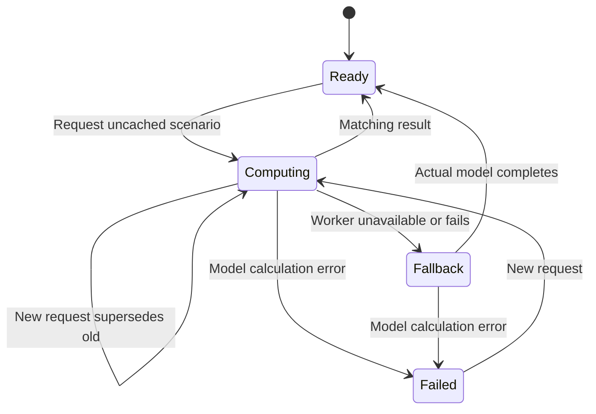

# Performance evolution — 2026-10-26

## Final integration measurement: faster in the tested paths

This timing run preceded the later comparison-table theme change and the PR37/data refresh integration. The later changes have separate responsive and functional evidence in [the theme audit](evolution-2026-10-26/ui/tradingview-theme/README.md). The timing values below identify the measured snapshot, not an additional speedup caused by the new CSS or a fresh benchmark of the final release tree.

**The measured implementation is faster for the data-table startup, BTC first chart, and an uncached BTC scenario change under the tested browser conditions.** The table no longer initializes its hidden chart/research/export graph. Expensive forecast computation runs in a module Worker when HTTP(S) and Worker support are available; the actual synchronous model remains the explicit fallback. A hidden volume indicator no longer fits and projects a volume forecast.

The final measurements below compare exact baseline commit `35300332a629ead03f6f365a32fda4669390f72f` with a newly frozen copy of all **675 `dist` files after the PR35/PR36 upstream integration**, global cache-version update, CLS lifecycle correction, and journal/equity UI fixes. The worktree HEAD at capture was `7261c1807028e1b69bf9cd9be0d269a64f88acc0`; the full file manifest identifies the measured worktree, including changes beyond that commit. Five alternating samples per side and route were run in real Chromium 156.0.8078.47, with fresh contexts, a 390 × 844 touch viewport, 4× CPU throttling, local uncompressed static responses, external network requests blocked, and the same Korean font fixture. This is **mobile emulation**, not a physical-phone, Safari, production-network, or field Core Web Vitals result.

The timed paths are the data table, initial BTC chart, and a BTC scenario change; the journal dialog and equity dialogs are not opened in those timings. Their presence in the source snapshot does not make their interactions measured performance claims. The BTC and comparison input hashes exactly match the baseline. Generated `publication.json` is explicitly marked **modified-preview metadata** and excluded from the runtime-only source identity; it is included in the complete byte manifest for reproducibility and is not presented as clean deployment provenance. [Final context and source identity](performance-evolution-2026-10-26/final/measurement-context.json)

| End-to-end custom measure | Before median, range | After median, range | Median change |
| --- | ---: | ---: | ---: |
| Data-table navigation start → ready event + two frames | 1,327.5 ms; 1,253.7–1,512.8 | 913.8 ms; 879.5–982.3 | −31.2% |
| BTC navigation start → first chart ready + two frames | 2,140.8 ms; 2,081.2–2,220.3 | 1,631.6 ms; 1,620.5–1,709.3 | −23.8% |
| BTC base → uncached stress scenario + two frames | 1,074.6 ms; 941.0–1,216.3 | 670.4 ms; 648.9–733.1 | −37.6% |

All three before/after ranges are disjoint in this run. Each median uses five samples; no significance or population-wide percentile claim is made. All 20 timed runs have zero uncaught page errors and zero missing local-resource responses, while checking populated chart output or all 18 table rows with BTC first. Two animation frames establish a reproducible application checkpoint, not a physical display presentation measurement. The scenario timing includes Playwright command round trips. [Final raw samples and assertions](performance-evolution-2026-10-26/final/report.json)

The final data route requested 87 → 19 JavaScript resources and 2,266,949 → 303,583 response-body bytes (−86.6%). These are Resource Timing `encodedBodySize` values from a server with no compression, not network transfer bytes including headers. BTC startup requested 87 → 96 resources and 2,266,949 → 2,488,423 bytes: the Worker loads its computation graph in a separate context, so this change trades additional BTC startup bytes/context work for a more available main thread. The table avoids that work entirely. [Final resource lists](performance-evolution-2026-10-26/final/report.json)

The earlier 660-file implementation measurement remains preserved in the parent evidence directory, including its separate CPU profiles and original raw samples. It measured the implementation before the final upstream/UI integration; its 1,317.3 → 912.8 ms table result and 1,129.1 → 666.5 ms scenario result are historical evidence, not the final release-integration numbers above. [Earlier measurement](performance-evolution-2026-10-26/report.json)

## Implemented behavior

### Local diagnostics with explicit metric limits

`performance-diagnostics.js` records a bounded history of application actions and exposes `window.AtlasPerformance.snapshot()` and `.download()`. The journal uses the exported `performanceSnapshot()` and `downloadPerformanceDiagnostics()` functions. Nothing is sent to a server or persisted as analytics. Completed actions are limited to 200, pending actions to 40, event and long-task samples to 200; metadata uses a small allowlist.

The recorder distinguishes unsupported observation APIs, no observations, provisional values, and completed observations. LCP observations are limited to the period before the first trusted pointer/keyboard input or first hidden state. CLS uses maximum session windows with a 1-second gap and a 5-second maximum window, excluding shifts with recent input and shifts after first hidden. The final lifecycle correction drains queued pre-hidden shifts before disconnecting the observer, so a late callback cannot incorrectly return the status to provisional. Tabs that start hidden retain `null` with `not-observed-started-hidden` because no visible session was observed. Focused regressions failed before those corrections and pass after them.

`interactionToNextPaint.valueMs` remains `null` with status `not-computed`. Event Timing samples are explicitly labeled diagnostic durations. Neither an average event duration nor custom scenario latency is reported as INP. This bounded observer is not a full `web-vitals` lifecycle implementation for prerender activation or back/forward-cache restoration; it is a local current-navigation diagnostic.

Application actions cover initial readiness, route readiness, forecast computation, chart/workspace rendering, hidden-versus-visible volume projection, and chart gestures. The entry-script `first-view` action starts when the entry module initializes; it is different from the benchmark's navigation-clock startup measure. Pages that are never opened do not invent completion measurements.

### Lazy chart and research initialization

`app.js` now imports and initializes the viewport, lab, and evidence controllers only when the selected route needs them. A direct `?page=data` opening does not load the lab module or create its annotation/workbench controller, and it does not independently fetch the BTC chart dataset. The existing comparison table still loads all 18 rows, with BTC first.

The promise-backed workspace initialization remains shared across later navigation. Going from the table to the chart, back to the table, and to the chart again creates one chart controller. Dataset loading happens when a chart/research route requests it and propagates to the controller whether data or controller initialization completes first. The table emits the same page-ready contract used by other routes.

The actual browser regression journey fails on the baseline with `The table must not initialize the hidden chart controller` (`actual: 1`, `expected: 0`). It passes on the measured implementation with zero table-time controllers and one after opening the chart. This verifies removal of real initialization work, rather than a faster empty screen.

### Latest-request forecast ownership and offline fallback

`forecast-computation.js` assigns each request an ID and dataset revision. New work terminates the superseded Worker and resolves the old request as superseded. A response must match both ID and revision and still own the active request before it can publish. The lab also checks the requested scenario and dataset identity, plus the returned model's scenario and `asOf`.

The requested scenario is separate from the displayed scenario. While an uncached computation is pending, the existing chart remains usable and continues to describe its existing model. Only a matching complete result atomically changes the displayed model. Undo restores a requested scenario through the same request path. Cached results cancel pending work and publish immediately.



This is an implementation state model, not a claim of an exhaustive formal proof. Request ownership, wrong-revision rejection, cancellation, calculation errors, and exact numerical fallback equivalence are executable tests.

Worker construction, startup/runtime errors, message errors, and timeout explicitly select the synchronous fallback. A calculation error reported by a working Worker remains an error; it is not renamed as a successful fallback. `file://` deliberately uses the same in-process model because module Worker packaging is unavailable there. The fallback preserves functionality and numerical output; it does not promise the main-thread responsiveness achieved by the Worker.

## Limiter and remaining cost

Four separate CDP CPU profiles were captured **after the earlier implementation timing run**. No profiler ran during the final integration measurement, and profile timings are not mixed into its medians. These profiles identify the earlier implementation's limiter; they are not claimed to be exact profiles of the final merged tree. The baseline BTC profile spends substantial main-thread time in date conversion, forecast projection/simulation, market-structure preparation, and volume projection even when volume is hidden. The earlier after profile removes the hidden volume forecast and moves model computation away from the profiled main thread. It still contains expensive response handling, date conversion, chart geometry, HUD/overlay layout, and viewport work. [Earlier BTC profile summary](performance-evolution-2026-10-26/after-btc-profile-summary.json) · [Baseline BTC summary](performance-evolution-2026-10-26/before-btc-profile-summary.json)

For the table, comparison dataset validation, date handling, asset coverage/annual-period analysis, and table rendering remain. Those costs explain why removing most requested JavaScript body bytes does not remove the same share of startup time. The local server also makes network latency a small part of these measurements. The final merged table additionally includes the preserved asset-judgment history entry graph. [Earlier table profile before](performance-evolution-2026-10-26/before-data-profile-summary.json) · [Earlier table profile after](performance-evolution-2026-10-26/after-data-profile-summary.json)

Across the five **final integration** scenario changes, the median longest observed main-thread task fell from 971 ms (range 848–1,097) to 181 ms (range 166–217). This measures main-thread availability in the tested path, not INP or a frame-rate score. **Long tasks remain**, so this is not a claim that all interaction jank is solved. No Worker CPU or total-energy reduction was measured. The earlier implementation journey's heartbeat result is retained only as a functional indication that other tasks could run during Worker computation. [Final long-task samples](performance-evolution-2026-10-26/final/report.json) · [Earlier functional journey](performance-evolution-2026-10-26/workspace-journeys.json)

The final timed phase used an explicitly coordinated quiet CPU window after the test suite completed. Host load average was 1.91, 1.15, 0.72 with 9 available cores; a process check showed no remaining compute jobs and a highest visible process CPU of 0.2%, so the load average reflected the preceding tests. Other agents held numerical/browser work until the 20 runs completed. Alternating samples reduce drift bias; this shared host is not an isolated hardware laboratory. [Final measurement context](performance-evolution-2026-10-26/final/measurement-context.json)

## Bounded Canvas experiment: not adopted

The nonshipping `experiment-price-renderers.mjs` prototype compares four batched SVG price paths with Canvas `Path2D` using the same 5,548 saved Bitstamp OHLC rows, complete candle geometry, selected-source OHLC readout, viewport, and ten changing views per sample. Both sides use two animation frames after each draw. Five alternating samples per renderer followed an excluded warmup. Assertions verify all source bodies, selected close, actual SVG paths, and nontransparent Canvas pixels.

| Prototype, 10 redraws per sample | Median | Range |
| --- | ---: | ---: |
| SVG | 328.8 ms | 325.3–333.5 ms |
| Canvas | 333.2 ms | 333.1–333.3 ms |

The ranges overlap and frame waiting dominates this bounded experiment. It does not establish a Canvas advantage, nor does it establish that Canvas is generally slower. The prototype also does not implement full Atlas parity for research overlays, annotation hit testing, accessible interaction, SVG export, or offline packaging. **Canvas is not adopted.** The production SVG renderer and its complete behavior remain in place. No large rendering dependency was added. [Raw renderer experiment](performance-evolution-2026-10-26/renderer-experiment.json)

## Correctness and device journeys

The following Chromium journeys were **rerun after final timing and passed** against the final frozen HTTP snapshot: desktop 1440 × 900, phone-sized touch 390 × 844, tablet split-width touch 540 × 900, and a blocked-Worker 390 × 844 route. The freshly regenerated `build/Bitcoin_Cycles_Comparison.html` also passed at 390 × 844 under `file://`. Its 18,097,915 bytes have SHA-256 `1ffd7b9ce84da6840bbdbf3d9d407dba31000fe3cfae3f16e1b1fedc9c25360e`; its runtime matches the timed snapshot excluding regenerated publication metadata. A stale pre-PR36 standalone found during preparation was explicitly excluded and never used as the final offline verification artifact.

Final Korean-font phone and tablet screenshots were inspected; the compact dark chart and collapsed indicator controls were preserved. The final five-case report and screenshots have their own SHA-256 output manifest. These functional checks ran after the quiet timing window, without CPU throttling, and make no performance claims about the concurrently active host. [Final journey report](performance-evolution-2026-10-26/final/workspace-journeys.json) · [Output hashes](performance-evolution-2026-10-26/final/functional-output-manifest.json) · [Phone](performance-evolution-2026-10-26/final/phone.png) · [Tablet split width](performance-evolution-2026-10-26/final/tablet-split.png) · [Desktop](performance-evolution-2026-10-26/final/desktop.png) · [Standalone](performance-evolution-2026-10-26/final/standalone.png)

Each journey checks 18 initial rows with BTC first; zero hidden chart controllers on the table; one controller after opening/reopening; no hidden volume forecast; rapid stress → accelerated → wait requests publishing only the final wait result; a simultaneous frequency change; undo back to base; no horizontal document overflow; no uncaught page error; and no missing local resource. The return-to-data step programmatically clicks the existing route control hidden by the compact chart layout, so that step is a controller-navigation check, not proof of a visible accessible affordance. Separate product UI/a11y validation is required for that affordance and the integrated journal.

Implementation unit/regression coverage includes exact seeded real-model fallback output, wrong-generation/revision rejection, cancellation, errors, bounded diagnostics, hidden-page observer lifecycle, unchanged comparison/viewport URL behavior, chart gaps/selection/geometry, data-table reuse, market-structure cache invalidation, and undo history. During implementation, the combined targeted suite passed 37 tests before the additional unsupported-observer and initially-hidden guard tests; the diagnostics-only suite then passed all 7 tests. These guards ensure hiding a page cannot convert unsupported metrics into observed zeroes or claim a visible session for a tab that started hidden. The final performance task reran the actual browser journeys; the repository-wide release test gate is recorded separately.

## Reproduction and evidence identity

Run the scripts using an installed Playwright package and Chromium executable. They add no application dependency. `ATLAS_PLAYWRIGHT_MODULE` may be an absolute module path, and `ATLAS_BROWSER_PATH` may point to a provisioned executable. `FONTCONFIG_FILE` can select an equivalent Korean font fixture for both sides.

```bash
ATLAS_BENCH_PROFILE=1 node scripts/benchmark-workspace.mjs BEFORE_ROOT AFTER_ROOT OUTPUT_DIR
node scripts/verify-workspace-evolution.mjs AFTER_ROOT OUTPUT_DIR --standalone=FILE.html
node scripts/experiment-price-renderers.mjs AFTER_ROOT OUTPUT_DIR
node --test tests/forecast-computation.test.mjs tests/performance-diagnostics.test.mjs tests/app-workspace-url.test.mjs tests/structure-view-performance.test.mjs tests/chart-performance.test.mjs tests/daily-data-performance.test.mjs tests/workspace-history.test.mjs
```

The **final integrated full-source map** is [final/measured-source-manifest.json](performance-evolution-2026-10-26/final/measured-source-manifest.json). Its file SHA-256 is `a471b5bafba5b75bdb706edba3415e6421dd82d3c7aed654824c07ef6d04dd32`. The 674-file runtime map excluding generated preview `publication.json` has SHA-256 `1f75ec1ecd96fee6e430c65bbb67522c236b9b59beaef02f9094353d54328619`; its canonical JSON serialization is specified in the [final context](performance-evolution-2026-10-26/final/measurement-context.json). This makes a later publication-manifest regeneration distinguishable from a runtime change.

The earlier 660-file map remains [measured-source-manifest.json](performance-evolution-2026-10-26/measured-source-manifest.json), with file SHA-256 `a589d6f52eb05ce96633862ff3eba2f781bb35e368a578971ccc5ae60e45f90e`. Its snapshot tag was `4a742f9774bfa0e4b069998c1b4cc0f0aa1226501edcb63f602a23c7f986eb00`, calculated over UTF-8 `json.dumps(manifest, sort_keys=True)`. [Earlier context and script hashes](performance-evolution-2026-10-26/measurement-context.json) retain that distinct measurement identity. Earlier raw `.cpuprofile` files remain alongside their JSON summaries.

The pstack `benchmark-checklist` and `tdd` skills guided the work: a real failing baseline journey, focused failing diagnostics lifecycle test, same-input alternating browser measurements, separately profiled limiter, verified nonempty correct output, explicit failure counts, and a bounded renderer adoption decision. No Node microbenchmark is presented as a browser improvement.

## Publication transport after measurement

After the frozen measurements, the journal replaced a GitHub link to a local-only generation commit with its full original commit text and model source hash. The measured startup/scenario paths do not open or load this lazy journal module. Original commits are preserved in the verified [Git bundle and provenance guide](evolution-2026-10-26/SOURCE_PROVENANCE.md); API publication uses the identical final file tree with a distinct public commit object. Timing evidence retains its original measured hashes. This small journal-only change is not silently substituted into the frozen runtime manifest.
