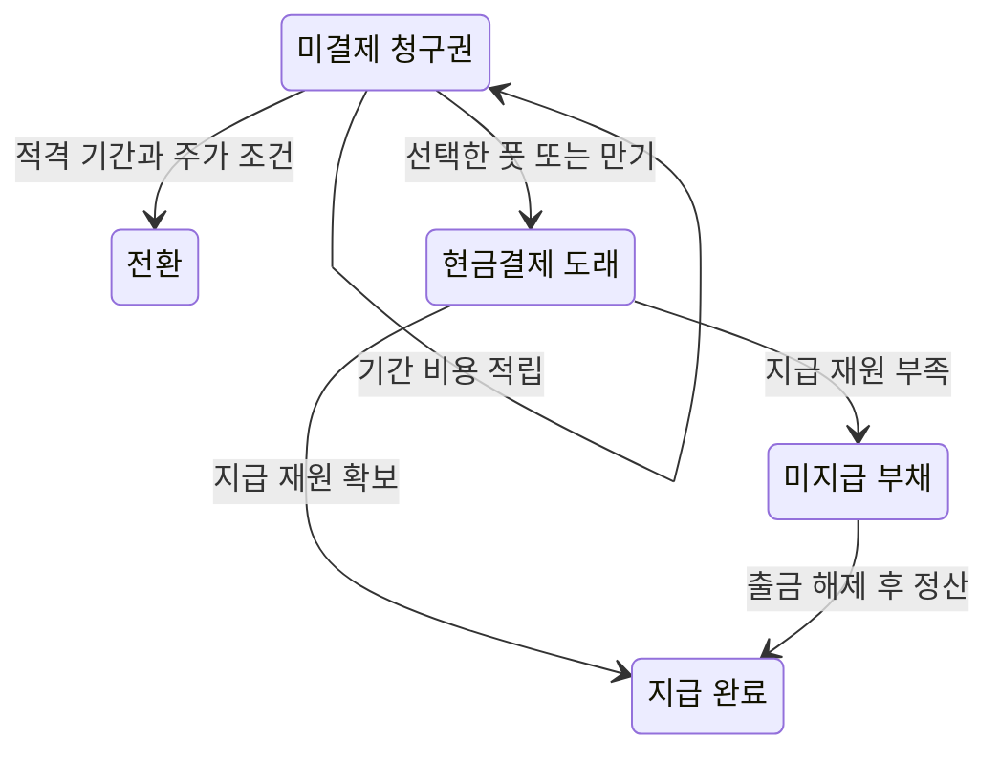
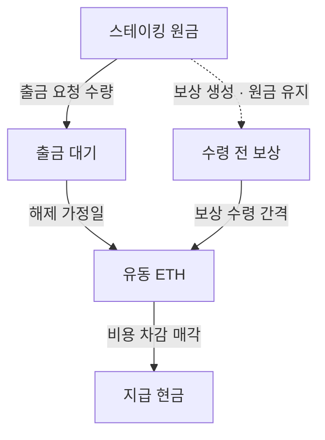

# 금융상품 생애주기와 ETH 유동성

검토일: 2026-10-26 · 적용: v1.29.0. 이 확장은 과거 재무구조 민감도 계산을 개선한다. 현재 NAV, 실제 미래 전환·상환, ETH 네트워크 출금 대기시간을 재구성한 모델이 아니다. 기존 관측 OHLC 파일은 바꾸지 않는다.

## 1. 실제 화면에서 달라지는 동작

MSTR의 **미래 전망과 근거** 창에서 `최초 풋 현금 상환 / 풋 미행사·만기 상환 / 풋 미행사·적격 기간 전환`을 선택한다. 금융상품별 잔여 청구권·쿠폰·상태와 실제 모형 전이 기록이 같은 창에 표시된다. 선택한 날짜의 계산에는 누적 금융비용과 전환주식 수가 추가된다. 해당 입력에서 이미 계산한 정책은 최대 3개 묶음까지 재사용하며 가격 원자료를 다시 조회하지 않는다.

BMNR의 같은 창에서는 **출금 지연**을 조건 기본값 또는 7·30·90일로 바꾼다. 기본값은 스트레스 90일, 나머지 7일이다. 선택한 날짜마다 유동 ETH, 스테이킹 원금, 출금 대기, 수령 전 보상, 미지급금이 따로 표시된다. 지연은 회사 공시나 네트워크 관측에서 추정한 사실이 아니라 앱의 민감도 가정이다.

ETHUSD에는 미래 가정 아이콘을 추가했다. 일봉·주봉의 실제 선·캔들과 미래 점선을 함께 표시한다. `stress / base / bull`은 경제 조건이며 확률이 아니다. 미래 OHLC·거래량은 생성하지 않는다. 표시를 끄면 기존 관측 범위로 돌아간다. 분·시간봉은 실제 관측만 표시한다. ETH·주식 출처 창의 **자료 상태·공통 기준시각**은 통합 자료 상태를 연다.

## 2. 확인한 계약 정보와 모르는 정보

### MSTR

원금은 최초 발행액이 아니라 [Strategy 2026-06-30 10-Q](https://www.sec.gov/Archives/edgar/data/1050446/000105044626000044/mstr-20260630.htm)의 잔여 원금이다. 아래 표는 해당 공시의 채무 주석과 잠재 전환주식 수를 옮긴 것이다. 재무일, 출처 ID, 원금 합계가 현재 catalog와 일치할 때만 이 검토 조건을 적용한다.

| 채무 | 잔여 원금 USD | 연 쿠폰 | 최초 풋 | 만기 | 무조건 전환기간 시작 | 공시 잠재 전환주식 |
|---|---:|---:|---|---|---|---:|
| 2028 notes | 1,010,000,000 | 0.625% | 2027-09-15 | 2028-09-15 | 2028-03-15 | 5,513,489 |
| 2029 notes | 1,500,000,000 | 0% | 2028-06-01 | 2029-12-01 | 2029-06-01 | 2,230,800 |
| 2030A notes | 800,000,000 | 0.625% | 2028-09-15 | 2030-03-15 | 2029-09-15 | 5,341,600 |
| 2030B notes | 2,000,000,000 | 0% | 2028-03-01 | 2030-03-01 | 2029-12-03 | 4,614,400 |
| 2031 notes | 603,659,000 | 0.875% | 2028-09-15 | 2031-03-15 | 2030-09-15 | 2,593,923 |
| 2032 notes | 800,000,000 | 2.25% | 2029-06-15 | 2032-06-15 | 2031-12-15 | 3,915,200 |

원금 합계는 **$6,713,659,000**, 최초 알려진 연 쿠폰 합계는 **$34,594,516.25**다. 기존 연 금융비용 대용치 $1.76bn에서 이 합계를 뺀 **$1,725,405,483.75**는 미분해 비용 대용치로 남는다. 상환된 채무의 알려진 쿠폰은 중단하고, 개별 조건을 확인하지 못한 우선주 비용까지 함께 없어지는 것으로 처리하지 않는다. MSTR 우선주의 개별 리셋·콜·누적·전환 조건을 만들어 채우지 않는다.

전환 비율은 `해당 공시에 표시된 잠재 전환주식 / 같은 날짜의 잔여 원금`을 사용한다. 최초 발행 당시 반올림 비율과 이후 일부 상환된 원금을 섞지 않는다. 이는 미래 반희석·make-whole 조정을 예측한 비율이 아니다.

`convert-at-window`는 풋을 행사하지 않는다는 모형 정책이다. 검토한 무조건 전환기간에 들어가고 `모의 보통주 가격 × 원금 1달러당 전환주식 ≥ 1`일 때 전액 주식 결제를 가정한다. 회사의 현금·주식 혼합 선택, 조기 20/30 거래일 가격조건, 회사 콜, 미래 조정은 구현하지 않는다. 구간 끝의 주가로 조건이 성립해도 전환일을 과거의 기간 시작일로 소급하지 않는다.

**만기 30일 전 이후의 전환 제외는 보수적인 앱의 모형 제한이다.** 계약상 만기 2영업일 전 종료 조건을 정확히 계산한 날짜가 아니다. 거래소·영업일 달력을 근거 없이 만들어 법적 행사일처럼 표시하지 않도록, 지원하는 시뮬레이션 구간을 더 일찍 닫는다. 코드에는 `conversion.modelWindowEnd`, 설명에는 `instrumentConventions.conversion`으로 남긴다. 이 제한 때문에 말기에만 전환 유인이 생기는 경우 모델은 전환을 선택하지 않을 수 있다.

### BMNR / BMNP

[BMNP 최초 발행 투자설명서](https://www.sec.gov/Archives/edgar/data/1829311/000149315226027521/form424b5.htm)의 최초 3.5m주, 주당 $100 기준 청구권, 연 9.5% 기본 누적 배당을 사용한다. 최초 발행 최소 청구권은 $350m, 기본 연 배당은 $33.25m이다. 실제 $80 발행가와 $100 청구권을 혼동하지 않는다. catalog의 공시 후 최초 발행 조정에 이 청구권을 다시 더하지 않는다.

BMNP를 보통주로 전환시키지 않으며 발행자의 임의 상환도 자동 행사하지 않는다. 시점별 상환 프리미엄, 변동 청산우선권, 주별 연체 가산·복리, 이후 추가 발행·환매는 현재 모델에서 추정하지 않는다. 따라서 $350m은 현재 총 청구권 추정이 아니라 **확인된 최초 발행분의 최소 조건**이다. 미지급 배당은 일반 미지급 부채로 남지만 계약상 연체 벌칙을 완전하게 재현하지 않는다.

풋이 만기보다 늦거나 전환 기간이 만기를 넘는 모순된 계약 날짜도 거부한다. 그 밖의 입력에서 쿠폰이 모르면 `null`, 조건은 `unresolved`로 남는다. `0%`는 알려진 무이자 채무에만 사용한다. 미래 발표일, 중복 식별자, 불일치하는 원금 합계, 출처 없는 전환 조건은 입력 경계에서 거부한다.

## 3. 채무 상태와 비용 보존

금융상품 원장의 직접 상태는 `outstanding`, `converted`, `cash-due`다. 원금 현금결제 도래와 실제 지급 성공은 다르므로 `cash-due`를 “상환 완료”로 표시하지 않는다. 미지급분의 정산 상태는 별도의 현금·부채 원장에서 보존한다.



전환은 같은 전이에서 원금 청구권을 제거하고 전환주식을 추가한다. 같은 채무를 차감하면서 전환주식을 중복으로 분모에 더하지 않는다. 현금결제 시 원금이 줄지만 지급하지 못한 원금은 기타부채로 옮기므로 공짜로 채무가 소멸하지 않는다. 각 상품은 한 번만 결제 상태로 전이한다.

알려진 비용은 살아 있는 기간에만 적립한다.

$$
C_{known}=\sum_i D_i r_i\,\frac{\text{해당 구간의 미결제 일수}}{365.25}.
$$

이 식은 비용의 달력일 배분이다. 계약별 반기·주별 쿠폰 지급일, 이자 일수 관행, 연체 벌칙을 정확히 복원한 현금 달력이 아니다. 알려진 쿠폰이 0이 된 뒤에도 미분해 비용 대용치는 계속 남을 수 있다.

## 4. ETH 네 풀과 지급 능력

실제 Ethereum의 출금은 검증자 상태·자격 증명·네트워크 대기에 영향을 받는다. [Ethereum 공식 출금 설명](https://ethereum.org/staking/withdrawals/)을 근거로 유동성의 구분을 채택했지만 현재 네트워크 대기열이나 BMNR의 실제 검증자 구성을 추정하지 않는다.

| 풀 | 가치 계산 | 당일 매각 | 모델 내 이동 |
|---|---|---|---|
| `liquidUnits` | 포함 | 가능 | 비용 지급·보유 상한 처분 |
| `stakedUnits` | 포함 | 불가 | 출금 요청 또는 보상 생성 |
| `exitQueue` | 포함 | 불가 | `availableAt` 도달 후 유동 풀 |
| `rewardUnits` | 포함 | 불가 | 정한 수령 간격 이후 유동 풀 |



보존식은 `총 ETH = 유동 + 스테이킹 + 출금 대기 + 수령 전 보상`이다. 공통 `treasuryResidual` 경계는 풀의 유한 비음수 수량·일정·합계와 미지급금의 부채 포함을 확인한다. 서로 다른 총 ETH와 풀 잔고가 입력되면 거래 전에 거부한다. 출금 요청 자체는 총 자산을 바꾸지 않는다. 이미 대기 중인 물량을 부족액에서 차감하므로 같은 부족을 반복해서 출금 요청하지 않는다. 새 매입은 기존 80% 배분 가정으로 나누고, 출금 대기 물량에는 보상을 주지 않는다. 보상은 자동 재스테이킹하지 않는다.

스테이킹 원금 `S`, 총보상 입력 `y`, 자문료 `a`, 추가 보상 비용 `b`, 경과 달력일수에 대해 `S × expm1(log1p(y(1-a)(1-b)) / 365.25) × 경과일수`를 수령 전 보상에 적립한다. 기본 7일은 수령 묶음의 간격이다. 묶음 안에서 나중에 발생한 보상까지 개별 7일 잠금을 갖는다는 뜻은 아니다. 일별 환산율을 고정한 현금 보상 적립이며 긴 구간 내부의 수령 주기도 처리한다. 같은 원금·수익률·시간 범위에서는 1회 계산과 일별 계산의 총보상·유동량·대기보상·다음수령일이 일치한다. 원문의 단기 연율을 장기 유지하고 이 방식으로 일별 환산하는 것은 모형 가정이다. 비용·매각·발행이 이루어지는 계산주기 차이까지 없어진다는 뜻은 아니다.

금융비용·운영비·상환은 현금을 먼저 쓰고 다음으로 **유동 ETH만** 매각한다. 부족액은 부채로 남으며 순자산이 양수여도 지급 불능이 발생할 수 있다. 출금 해제 후 다음 계산에서 미지급금을 정산한다. 스트레스의 5% 슬래싱은 스테이킹·대기 원금에 적용하며 이미 유동인 ETH나 수령 전 보상에 일괄 적용하지 않는다. 슬래싱 비율·시점은 앱의 충격 가정이다.

### 발견한 수치 오류: 완납 뒤 가짜 미지급

실제 경로를 살펴보는 동안 `필요액 − (필요액 / 순매도가격) × 순매도가격`의 부동소수점 왕복 오차가 약 $2.91e-11의 미지급금을 만들고, 첫 유동성 부족 경고와 먼지 수량의 출금 요청을 발생시키는 경우를 발견했다.

단순히 작은 부채를 없애는 금액 epsilon을 넣지 않았다. 요청 코인 수량이 처분 가능 수량 이내면 완납한 것으로 판정하고, 부족한 경우에만 잔여 청구권을 계산한다. 충분한 풀의 $2.03 가격·연 $83.25m 일할 지급 사례는 수정 전 실패·수정 후 통과했다. 독립 검토가 발견한 총량 10 ETH/풀 100 ETH 불일치와 만기 뒤 풋 입력도 각각 재현 후 경계에서 차단했다. 실제 자산이 없는 $1e-12 부족은 여전히 부채로 보존한다. 수정 전의 2034-03-13 유동성 경고는 잘못된 상태이며 검증 결과에서 폐기했다.

## 5. ETH 차트와 BMNR가 공유하는 경로

[ethereum-forecast.js](../dist/ethereum-forecast.js)는 이전 BMNR용 ETH 경로 생성 코드를 분리한 것이다. 같은 `asOf`, 입력 관측, `seed`에서는 일별 가격과 기준선이 완전히 일치한다. 공통 관측 경계는 정확한 날짜의 완료 종가를 요구하고, 미래 관측은 학습에 사용하지 않는다. Merge 이후 연속 관측이 366개 미만이거나 비정상 자료면 미래 계산을 거부하면서 실제 관측 차트는 유지한다.

[VanEck 2024-06-05 연구](https://www.vaneck.com/us/en/blogs/digital-assets/matthew-sigel-eth-2030-price-target/)에서 $360·$22,000 조건을 선택했다. 원문의 $22,000 기준 조건을 앱의 “채택 확대” 사례로 사용하며, 앱의 기본 조건은 현재 가격 유지다. 원문 전체 평가 모형이나 전체 시나리오를 재현한 것이 아니다. 2030년 뒤 기준선 유지, 28일 블록, 최근 90일 변동성 유지, 잔차 730일 반감기는 앱 모형 설정이다. 목표는 기준선 조건이며 모의 종착점으로 강제하지 않는다.

ETH 자체는 2026-10-25 UTC 완료 일봉 $2,326.75에서 시작하고, 현재 MSTR·BMNR는 2026-10-23 뉴욕 세션과 같은 날짜의 코인 관측을 사용했다. 두 날짜가 다르므로 ETH 화면과 BMNR 입력의 현재 결과가 숫자로 일치할 필요는 없다. 공통 날짜로 비교하면 일치한다. 이 구분은 상세 창과 테스트에서 확인한다.

미래 날짜의 `low/high`는 세 경제 조건 가격의 최솟값·최댓값이다. 미래 봉의 고가·저가나 확률 구간이 아니다. `pathMode=crypto-conditional-daily`는 주식의 평일 모의 경로봉 생성을 차단하며, 주말도 빠짐없이 점선으로 표시한다. 2030년 원형 표식은 평가 조건이고 사건 예측이나 실제 고저점이라는 주장을 하지 않는다.

## 6. 의도적으로 바뀐 결과와 한계

| 항목 | 이전 처리 | v1.29.0 처리·이유 |
|---|---|---|
| 확인된 채권 비용 | 상환 뒤에도 연 비용 고정 | 원금 결제·전환 뒤 해당 쿠폰 중단 |
| MSTR 정책 | 최초 풋 현금 결제 | 풋·만기·제한된 전환 정책을 UI에서 비교 |
| ETH 비용 지급 | 총 보유량을 즉시 처분 가능 | 유동 풀만 매각하고 부족액·대기를 보존 |
| 스테이킹 보상 | 전체 보유량에 유효 연율 복리 | 활성 스테이킹 원금에만 적립, 수령 이후 유동 풀 |
| 슬래싱 스트레스 | 총 ETH 수량에 적용 | 스테이킹·출금 대기 원금만 위험 수량 |
| ETH 자체 화면 | 관측만 | 같은 BMNR 엔진의 명시적 미래 조건선 |

기존 금융자산·보통주·채무의 시작 잔고와 실제 주가 앵커는 유지한다. 미래 코인 경로의 분리 자체는 같은 입력의 수치를 바꾸지 않는다. 미래 재무 결과는 비용 중단·유동성·보상 배치·선택 정책 때문에 바뀔 수 있다. 과거 모형의 정적 결과표는 당시 실행 기록으로 남기고 현재 결과로 소개하지 않는다.

같은 재무일의 장부를 사용하는 원칙, 현재 NAV 아님, 회계적 잔여가치 소진 이후 가격 0의 흡수 상태, 실제 자금조달 가능성 미검증은 유지한다. 흡수 상태 이후에는 운영·원장 전이를 멈추며 재구조화·회복을 계산하지 않는다. BMNP 연체 벌칙, MSTR 우선주 개별 조건, 거래소 달력의 정확한 계약 말기, 실제 출금 대기열, 세금·시장 충격은 여전히 충분히 확인되지 않았다.

## 7. 현재 입력 검산과 재현

[정책별 현재 스냅숏](data/treasury-evolution-2026-10-26.json)은 입력 SHA-256, 가격·재무 기준일, 21개 재무 조건 조합, ETH 3조건을 기록한다. 이 파일은 정책 민감도 결과이며 정확도 검증이나 가격 전망 성적표가 아니다.

현재 MSTR의 적격 전환 정책은 기준 조건에서 21,978,612주, 확대 조건에서 24,209,412주의 전환을 실행한다. 스트레스 조건에서는 전환 가격조건을 만족하지 않아 전환 0주다. 실제 검토된 잠재 주식 수와 같은 채무 제거를 날짜별로 검산했다. 기본 풋 상환 정책은 세 조건 모두 6건의 결제 도래 후 알려진 채무 쿠폰이 0이 된다.

[독립 장기 검산](data/treasury-path-verification-2026-10-26.json)은 현재 입력의 MSTR·BMNR 각각 세 조건을 2050년까지 확인한다. 6 × 8,836 = **53,016개 날짜별 상태**, 그중 44,994개 운영 전이와 8,016개 흡수 후 전이를 점검한다. 현금·코인·선순위 청구권·발행·네 유동성 풀·실제 소스 수익률로부터의 ETH 잔차를 검산한다.

수치 경계 수정 후 BMNR 스트레스의 최초 실제 유동성 부족은 **2036-06-05**, 잔여가치 소진은 **2039-03-29**다. 현재 UI의 2035 종료 범위 안에는 그 유동성 부족이 발생하지 않는다. 이는 seed 20261022의 해당 모의 경로 결과이고 미래 날짜 예측이 아니다. 양의 순자산과 당일 지급 능력이 다르다는 성질은 별도의 잠긴 자산 회귀 사례에서도 확인했다.

```bash
node --test tests/treasury*.test.mjs tests/eth*.test.mjs tests/equity*.test.mjs
node scripts/verify-treasury-paths.mjs
node scripts/report-treasury-evolution.mjs
```

[최종 관련 테스트 실행 로그](evolution-2026-10-26/treasury-tests.log)는 실제 개별 테스트 **242개 통과, 0개 실패**를 기록한다. 파일 하나를 테스트 하나로 센 결과가 아니다.

핵심 회귀는 잠긴 ETH 즉시 매각 방지, 실제 작은 미지급금 보존과 반올림 가짜 미지급 방지, 쿠폰 중단, 전환 전후 청구권·주식 중복 금지, 미래 출처 배제, 세 정책의 실제 MSTR 경로, UI 가정 변경, 320·768·1440 폭에서 실제 ETH OHLC 보존이다. pstack `tdd`와 `principle-model-the-domain`의 상태·입력 경계 구분을 적용했다. 실행 테스트와 독립 수치 검산은 무한한 모든 시장 경로에 대한 수학적 증명이나 예측력 검증을 뜻하지 않는다.
