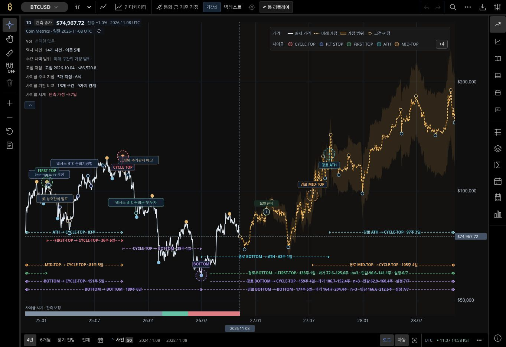

# R0 — ETF 루트 딥링크 수정 · 브라우저 검증 승인 대기

## 현재 판정

R0 코드와 회귀 테스트는 원격 브랜치에 반영했다. **R0 완료 판정은 아직 하지 않는다.** 요청한 6개 뷰포트의 수정 후 실제 렌더 검증이 실행되지 않았기 때문이다. 사용자의 순차 처리 지시에 따라 R1–R6는 착수하지 않았다.

- 작업 브랜치: `fix/r0-r6-chart-checklist-20261109`
- 시작 main: `ff772757d49805a543f4a84edcb8a9c859777cf8`
- R0 코드 커밋: `851ddef68ab98d6157b582ae4164a556ee953cf7`
- 코드 트리: `0d99ce6efd00ed4b633e4f59a3e94d13fce225f0`
- 확인한 운영 배포: `f798b21f79ed8835c48c3c43067ba42c28dbeceb`
- 운영 반영·main 병합: 미실행

## 원인과 변경

`site-entry.js`는 루트 `?symbol=`에서 BTC/ETH/MSTR/BMNR의 네이티브 차트만 초기화했다. ETF catalog와 데이터가 존재해도 TQQQ/SOXL/233740은 BTC fallback으로 시작했다. `canonicalWorkspaceChartEntry()`를 추가해 알려진 hosted 종목을 기존 `/market-lab/charts/` 경로로 부팅 전에 정규화한다.

기존 MSTR/BMNR의 반대 방향 정규화, 명시적인 다른 페이지, 프로젝트 하위 경로, query/hash와 알 수 없는 종목의 기존 처리 경계를 보존했다. `233740.KS` 별칭도 검사한다. 데이터·계산식·금지 커밋·기존 범례/리플레이/BMNR T3 동작은 수정하지 않았다. 새 JS/CSS를 `dist/` 최상위에 추가하지 않았다.

## 수정 전 실제 운영 관측과 수정 후 상태

아래 수정 전 수치는 클라우드 브라우저 **1363×936 CSS px**에서 직접 읽었다. 요청한 6개 크기의 before/after 매트릭스를 대신하지 않는다. 종목별 숫자는 화면의 실제 활성 SVG에 기록된 관측 수이며 전체 원천 자료 개수가 아니다.

| 요청 종목 | 수정 전 활성 종목 | 수정 전 화면 관측 수 | 수정 후 dispatcher 회귀 | 수정 후 실제 렌더 |
| --- | --- | ---: | --- | --- |
| BTCUSD | BTCUSD | 731 | 네이티브 BTC, 통과 | 미실행 |
| ETHUSD | ETHUSD | 914 | 네이티브 ETH, 통과 | 미실행 |
| MSTR | MSTR | 1,004 | 네이티브 MSTR, 통과 | 미실행 |
| TQQQ | BTCUSD | 731 | TQQQ hosted 경로, 통과 | 미실행 |
| SOXL | BTCUSD | 731 | SOXL hosted 경로, 통과 | 미실행 |
| 233740 | BTCUSD | 731 | 233740 hosted 경로, 통과 | 미실행 |

실제 운영의 종목 일치: **3/6**. 수정된 entry dispatcher의 6종 회귀: **6/6**. 두 값은 서로 다른 검증 종류이며 수정 후 화면 통과율로 합치지 않는다.

[원본 운영 관측 JSON](evidence/r0-production-before.json)

### 수정 전 스크린샷

`?symbol=TQQQ`로 열었지만 BTCUSD와 BTC 가격이 표시되는 운영 화면이다. 수정 후 스크린샷이 아니다.



## 검증

| 검증 | 상태 | 증거 |
| --- | --- | --- |
| 4개 관련 테스트 파일 | 31/31 통과, skipped 0 | [로그](evidence/r0-focused-tests.log) |
| `npm run verify:static` | 통과, 936 files / 976 references | [로그](evidence/r0-static.log) |
| 전체 `npm test -- --test-concurrency=2` | **3,172/3,172 통과, fail 0, skipped 0** | [실행 결과](evidence/r0-npm-test-receipt.json) · [전체 로그 gzip](evidence/r0-npm-test.log.gz) |
| 두 검증 스크립트 `node --check` | 통과 | `verify.mjs`, `cloudflare.mjs` |
| 요청한 6종 × 6뷰포트 native suite | 브라우저 시작 전 차단, 실행 사례 0 | [실패 원본](evidence/r0-local-browser-blocked.json) |
| 새 Cloudflare diagnostic CI | 트리거 생성 자동 승인 거절, 실행 안 됨 | [승인 대기 범위](evidence/r0-verification-approval.json) |
| 운영 배포 | 기존 `f798b21` 유지 | 이번 수정 배포 안 됨 |

로컬 환경은 정확한 Node v24.22.2, Chrome for Testing 157.0.8103.38, 한국어 폰트를 확인했지만 Chrome이 `socket() failed: Operation not permitted`로 시작 전에 종료됐다. 브라우저 실패를 코드 실패나 통과로 바꾸어 기록하지 않는다.

## 승인 후 실행할 구체적인 검증

```sh
node scripts/chart-checklist/cloudflare.mjs --item R0 --baseline ff772757d49805a543f4a84edcb8a9c859777cf8
```

커밋된 wrapper는 기존 pinned runtime 준비 후 정확한 baseline와 현재 source를 각각 36건 검사한다. 390×844, 320×740, 768×1024, 1024×768, 1440×900, 1920×1080에서 6종 모두 루트 `/?symbol=`로 시작한다. 제목·활성 소유자·실제 원천 응답 해시·종가·관측일·시리즈를 대조하고 PNG/report/source manifest를 SHA-256과 함께 기록한다. 이 검증은 full release CI나 실제 배포를 대체하지 않는다.

자동 승인 검토는 기존 build token과 repository connection을 사용하는 **새로운 지속적 build trigger** 생성을 별도 사용자 승인 대상으로 판단했다. 생성 요청은 거절됐고 trigger/검증 build는 만들어지지 않았다. 기존 production/review trigger는 변경하지 않았다. 이름만 준비한 `bitcoin-cycle-atlas-checklist-20261109` Worker metadata는 코드 미배포이며 public subdomain과 preview URL이 꺼져 있다.

필요한 승인은 이번 브랜치에 한정한 검증용 trigger의 생성·사용과 체크리스트 검증 후 제거이다. deploy command는 `node --version`이며 제품 배포 명령은 실행하지 않는다. 승인 후 R0 실제 before/after 표와 스크린샷을 추가하고 그 항목을 종료한 다음 R1로 진행한다.
