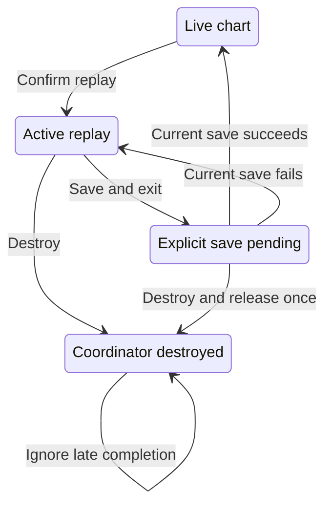

# 2026-11-05 후속 심층 점검

이 작업은 [11월 4일 심층 점검](../deep-audit-2026-11-04/README.md)과 [PR #61](https://github.com/twoimo/bitcoin-cycle-atlas/pull/61)을 이어서 수행했습니다. 후속 작업의 기준 커밋은 `4dc877ad0fdeabf7f01057e7f64ac11f9a8cbedc`입니다. 이전 날짜의 실행 기록을 새 코드의 통과 기록으로 바꾸지 않았습니다.

요청한 pstack의 `swarm`, `principle-fix-root-causes`, `create-formal-verification-skill`, `statechart` 절차에 따라 데이터·수학, 화면·성능, 리플레이·형식 검증을 병렬로 분담했습니다. 같은 모델의 별도 작업자들이 재현과 교차 검토를 수행했으며, 이를 여러 모델에 의한 독립 인증으로 표현하지 않습니다.

## 이전 CI에서 실제로 실패한 부분

[ETH candidate evidence 실행 41795371676](https://github.com/twoimo/bitcoin-cycle-atlas/actions/runs/41795371676)은 완료 후 **실패**했습니다. 수치 계산, 자료 확보 및 시계 확인, 보존 예측 재실행 단계는 통과했고, native browser 단계에서 46개 중 16개가 실패했습니다. 후속 증거 결합 단계는 실행되지 않았습니다. 이전 PR 본문의 “진행 중” 상태는 완료 결과로 대체해야 합니다.

원본 artifact `13305864387`은 62,141,126 bytes이며, 다운로드한 ZIP의 SHA-256은 GitHub가 기록한 digest와 일치합니다.

```text
b9930d3cee196b3caaab01fcf238585ae00487f6751a710d161fe1d240d8ff91
```

원본의 16개 실패는 데이터 화면 9개, BTC 지표 목록 3개, 연구 화면 2개, 기기 미리보기 2개였습니다. 실제 결함과 현재 화면 계약을 잘못 검사하던 검증기 오류를 구분해서 수정했습니다. 원본 실패·출처·재현은 [연구 화면 기록](evidence/research-native.json), [데이터 화면 원본 실패](evidence/data-board-original-failures.json), 미리보기 기록에 남아 있습니다.

## 재현한 제품 결함과 수정

### 저장 중 리플레이 해제

공개 coordinator API에서 **리플레이 시작 → 명시적 저장/종료가 저장 lock을 기다림 → `destroy()` 호출**을 재현했습니다. 기존 `destroy()`는 일반 `exit()`를 호출했지만, `exit()`의 `saving` guard가 즉시 반환했습니다. 컨트롤은 제거되는데 `isActive`, 문서/SVG의 리플레이 표식, 원래 화면의 `inert` 상태가 남았습니다.

일반 종료와 최종 해제를 분리했습니다. 일반 종료는 저장 대기를 유지하고, `destroy()`는 먼저 종료 상태를 확정한 뒤 동기 cleanup을 한 번 수행합니다. 늦게 성공하거나 실패한 저장 작업은 소유권을 다시 확인하므로 저장본이나 이미 제거한 컨트롤을 변경하지 않습니다. 해제 전에 이미 성공한 저장을 소급 취소하지는 않습니다.

실제 source를 사용하는 회귀는 수정 전 실패했고, 저장 callback의 재개와 거절 두 순서에서 수정 후 통과했습니다. 이 결함은 **현재 production 호출자가 확인되지 않은 공개 수명주기 API 결함**입니다. 실제 사용자가 해당 경로에서 장애를 겪었다고 주장하지 않습니다. 자세한 경계와 로그는 [리플레이 해제 기록](replay-destroy.md)에 있습니다.

### 자산 비교표의 직접 진입과 차트 내부 진입

직접 여는 데이터 화면에서는 모바일 버튼 폭이 32px로 줄고, 터치 도구막대 높이가 69px로 늘어나 있었습니다. 네 개의 실제 액션에 44×44px 최소 크기를 주고 도구막대의 세로 여백을 조정했습니다. 터치 화면은 61px, 일반 데스크톱은 49px의 한 줄 도구막대가 됩니다. BTC를 첫 행에 두는 18개 자산, 비트코인 표기, 판단 값, 고정 자산 열, 두 축 스크롤과 방법론 대화상자를 유지합니다.

차트 안에서 여는 비교표는 다른 경로였습니다. embedded 문서는 dashboard shell을 만들지 않는데 이전 고정 도구막대의 `max-width: calc(100% - 430px)`가 적용돼, 320px 화면에서 헤더가 8px로 눌렸습니다. iframe 안의 네 버튼이 실제 표시 영역을 벗어났습니다. embedded 데이터 화면에만 상대 배치의 전체 폭 액션 행을 적용해 288×53px 영역 안에서 네 버튼을 사용할 수 있도록 했습니다.

추가한 실제 진입 검사에서는 최초 메뉴 탐색도 실패했습니다. 320px 화면의 메뉴 버튼은 x=298–338, 폭 40px이어서 22px만 표시됐고, 종목 버튼은 5px까지 줄었습니다. 이전 자동 `scrollIntoView`가 메뉴 버튼을 노출하려고 외곽 stage를 18px 이동시켰습니다. 이동은 iframe의 대화상자 때문이 아니었습니다. 900×430에서는 오른쪽 rail의 아래 탐색 항목으로 휠 이동할 수 없었습니다.

모바일 도구막대에 가로 스크롤을 배정하고 메뉴 버튼 44px, 종목 버튼 최소 80px를 유지했습니다. 그래프용 SVG의 `touch-action: pan-y`가 도구막대 아이콘에도 적용돼 가로 터치를 취소하던 규칙은 도구막대 아이콘에만 좁게 보정했습니다. 오른쪽 rail은 기존 38px 폭에서 세로 스크롤을 소유합니다. 중앙 도구 사용 중 외곽 stage는 `overflow: clip`으로 고정하고 내부 표와 대화상자는 각자의 스크롤을 유지합니다.

새 3개 native 진입 시나리오는 실제 터치·휠·포인터로 비교표 진입, child 방법론의 끝까지 스크롤과 닫기, 원래 차트 복귀를 수행합니다. 네 외곽 영역의 위치와 크기, stage의 두 scroll offset 0, 원래 BTC 가격·날짜·출처를 확인합니다. 기존 기간선 메뉴도 별도 320px native 회귀에서 가로 터치, 실제 toggle 변경/복원, 내부 세로 스크롤, 마지막 disclosure와 Escape/Enter를 확인했습니다. 그 [9개 관측 상태](evidence/cycle-menu-native/report.json)는 전체 49개와 별도의 추가 검사이며, 외곽 이동이나 runtime error가 없었습니다.

### 연구 목록의 공간 배분과 키보드 접근

Dashboard가 중복 모바일 제목을 숨긴 뒤에도 연구 grid가 제목 행을 예약했습니다. 표에는 작은 높이가 배정되고 페이지 이동 영역이 남은 공간을 차지했습니다. Dashboard에서는 필터·표·페이지 이동의 세 행으로 배치하고, 모바일 필터는 가로로 이동하는 한 줄을 유지합니다.

| 320×900에서 측정한 항목 | 수정 전 | 수정 후 |
| --- | ---: | ---: |
| 필터 영역 높이 | 172px | 52px |
| 표 높이 | 150.14px | 673px |
| 완전히 보이는 자료 행 | 1 | 9 |

CSS 수정 직후의 중간 검증에서는 Tab으로 선택한 필터 오른쪽 3px가 잘린 채 남았습니다. 가로 overflow가 있을 때 포커스가 들어온 필터를 가장 가까운 위치로 노출하고 4px 여백을 유지했습니다. 실제 Tab → 종목 → 분류 → 초기화, Enter 초기화, URL 검색 조건 제거, 긴 reader의 끝까지 스크롤·닫기·원래 버튼으로 포커스 복귀를 확인했습니다. 데스크톱은 필터 48px, 표 649px, 자료 10행을 유지합니다.

### 좁은 화면의 지표 목록 배경

기존 사용자 요구는 지표 manager와 목록의 투명 배경입니다. 일반 manager에는 반영돼 있었지만 compact layout의 list가 `background: var(--surface)`로 다시 덮고 있었습니다. 이 한 가지 override를 투명 배경으로 바꾸고, 버튼의 hover·focus 표시와 값 자체의 읽기용 배경은 유지했습니다.

모바일의 목록은 기존 계약대로 접힌 상태이며 지표 메뉴로 관리합니다. 데스크톱과 낮은 화면에서는 실제 포인터와 키보드로 접힘/펼침을 확인합니다. 투명한 RGB 색상값도 alpha가 0이면 정상으로 인정하고, 불투명한 list나 투명하게 사라진 label은 실패로 검사합니다.

## 검증기의 잘못된 가정 수정

### DOM 조상과 실제 clipping은 다릅니다

기존 helper는 모든 DOM 조상의 overflow 영역을 교차했습니다. 이 방식은 native modal의 top layer와 viewport를 기준으로 하는 고정 사이드바를 잘못 자릅니다. 실제로 보이는 연구 reader의 닫기 버튼과 고정된 돌아가기 버튼을 실패로 판정했습니다.

현재 helper는 native `IntersectionObserver`의 `boundingClientRect`와 `intersectionRect`를 이용합니다. 대상 전체가 표시되는지, viewport 안에 있는지, CSS로 숨겨지지 않았는지, 실제 중심 hit-test가 해당 컨트롤을 가리키는지 계속 확인합니다. 5초 안에 native 교차 영역을 얻지 못하면 실패합니다. 검사 결과에 맞추기 위해 실제 reader 위치를 바꾸지 않았습니다.

[실제 helper의 native 대조 실험](evidence/click-modal-negative-control.json)은 정상 modal과 고정 컨트롤을 허용하면서, modal 내부 clipping, 일반 clipping, 가림, 변환된 containing block 아래의 fixed clipping, viewport clipping, CSS로 숨긴 컨트롤을 거부합니다. 이전 modal만 처리하던 중간 결과도 별도로 보존했습니다. 이 해석은 [CSS overflow의 containing block 규칙](https://www.w3.org/TR/CSS22/visufx.html#overflow-clipping) 및 [top layer의 배치 규칙](https://www.w3.org/TR/2025/WD-css-position-4-20251007/#top-layer-styling)에 근거합니다.

### 화면 골격 표시와 접근성 상태 문구는 다른 검사 대상입니다

미리보기의 `atlas-boot-status`는 의도적으로 시각적 영역 밖에 둔 live status입니다. 기존 검사는 이 문구를 눈에 보이는 로딩 패널로 간주해 실패했습니다. 현재는 실제 중립 skeleton bar가 표시되는지 검사하고, 상태 문구의 role·live·busy·텍스트와 CSS 접근 가능성을 별도로 확인합니다. 오류 상태의 alert와 retry도 별도로 검증합니다. 원본 `dist/index.html`은 수정하지 않았습니다.

검사 수정 자체에도 반례를 넣었습니다. 첫 구현은 CSS로 숨긴 status를 놓쳤고, 다음 구현은 `rgba(255, 0, 0, 0)`인 골격 표시를 놓쳤습니다. 두 반례를 보존한 뒤 CSS 가용성과 alpha 의미를 검사하도록 보강했습니다.

최종 독립 probe는 미리보기 손상 24개와 지표 손상 10개를 모두 거부하고, 각각 원복한 정상 상태도 다시 통과했습니다. 이는 같은 assertion을 무조건 느슨하게 만든 결과가 아닙니다. [최종 alpha·지표 기록](evidence/alpha-and-indicator-verification.json), [미리보기 24개 반례](evidence/preview-negative-alpha/report.json), [지표 10개 반례](evidence/indicator-negative/report.json)에 실제 source hash와 화면을 보존했습니다.

## 리플레이 상태전이와 증명의 범위

전체 선택·준비·재생 상태전이는 [기존 statechart와 대응표](../replay-state/README.md)에 있습니다. 아래는 이번에 수정한 저장과 해제 경계만 표시한 작은 투영입니다.



저장 실패 후에는 리플레이와 명시적 오류/종료 선택을 유지합니다. 해제 후 controller가 idle인 것과 coordinator를 다시 열 수 있다는 것은 다릅니다. Destroyed는 다시 열리지 않습니다. 이 그림은 TLA+/TLC 결과가 아닌 실제 구현의 설명용 투영입니다.

실제 JavaScript 검증은 10,000개의 길이 4 재생 trace와 259개의 길이 0–3 선택 trace를 계속 실행합니다. 관측 가능한 상태/edge는 각각 52/380과 24/78입니다. 이번 수정으로 저장 중 해제와 늦은 종료 continuation 두 mutation을 추가해 **10개의 의도한 결함을 모두 거부**합니다. 집중 UI/controller/snapshot 회귀는 **60개 통과**입니다.

이 결과는 무한한 이벤트 순서, 모든 저장소 interleaving, 모든 실수에 대한 정확 산술, 실제 예측의 우월성을 증명하지 않습니다. 수정한 로컬 formal-verification skill, source hash, 검증기, 회귀와 [현재 receipt](replay-state-verification.json)를 함께 Git에 보존합니다.

## 통합·출처 기록

원래 native 46개 시나리오는 제거하지 않습니다. 별도 경로에서 발견한 결함을 반복해서 검증하도록 차트 → embedded 비교표 → 방법론 → 차트 복귀 시나리오를 세 크기에 추가합니다. 전체 scope는 49개이며, 좁은 실행은 receipt에 선택 scope와 실제 실행 수를 기록합니다. 검사 중 파일 hash가 바뀌면 전체 통과로 결합하지 않습니다.

실행별 원본 로그, 미완료/실패한 실행, 집중 회귀, 생성된 Pages 검사는 [통합 검증 기록](verification.json)과 `evidence/`에 구분해 기록합니다. 로컬 기본 실행 환경은 Node v24.22.2와 Chromium 143입니다. 이전 원격 native 실행은 Chrome 156이었습니다. 로컬 single-process Chrome이 격리 context를 만들다 종료한 시도는 제품 회귀의 통과 증거로 사용하지 않습니다.

정상 multiprocess 환경에서 격리 context를 유지한 [리플레이 7개 시나리오](evidence/chart-replay-native.json)는 모두 통과했습니다. [차트 내부 비교표 3개 시나리오](evidence/center-data-native.json)도 모두 통과했습니다. 두 실행은 각각 98개 소스가 실행 전후 동일하고 패키징 시점과도 일치함을 확인했습니다. 전체 49개가 한 번에 통과했다고 합산하지 않습니다. 별도의 workspace 회귀 85개와 offline 정책 6개, 생성 Pages 11개 파일·8개 경로 및 정적 참조 803개 검사가 통과했습니다. 최종 커밋의 전체 CI·실제 PostgreSQL·native gate 결과는 [PR #61](https://github.com/twoimo/bitcoin-cycle-atlas/pull/61)의 해당 SHA와 연결합니다.

Hallmark의 기존 raw finding은 유지합니다. 이전 실행은 integrity와 렌더 수집은 통과했으나 design gate는 19 FAIL / 5 REFLEX로 실패했습니다. 그 결과를 문맥 설명만으로 통과라고 바꾸지 않으며, 최종 커밋의 새 결과는 별도로 확인합니다. [이전 원본 finding의 해석](../deep-audit-2026-11-04/hallmark-triage.md)과 pinned upstream은 변경하지 않습니다.

이번 후속 작업은 가격 원자료·고정 예측·발행 시각·수학적 모델을 변경하지 않습니다. 앞서 검증한 RSI 경계 처리와 요청 범위 내 계산 재사용의 성능 개선은 유지합니다. 과거 재구성을 당시 발행 예측으로 바꾸거나, 독립 표본 수·실제 확률 보정·실험 모델 승격 조건을 완화하지 않습니다.
