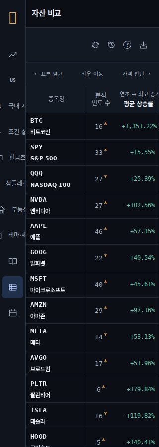
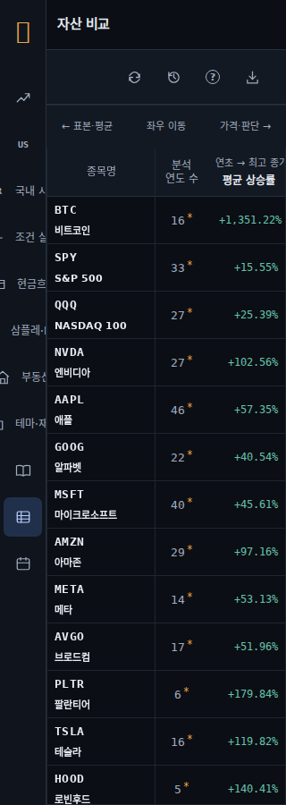
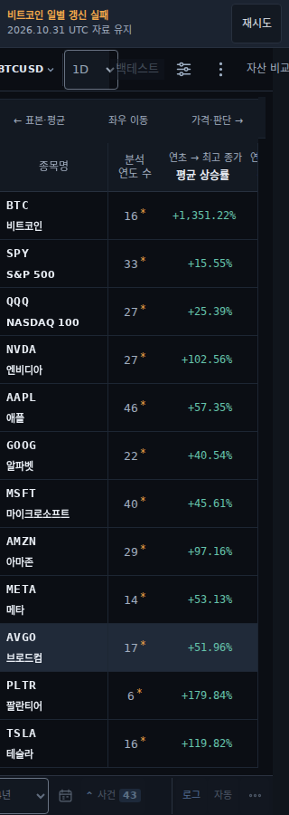
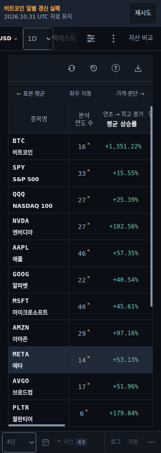
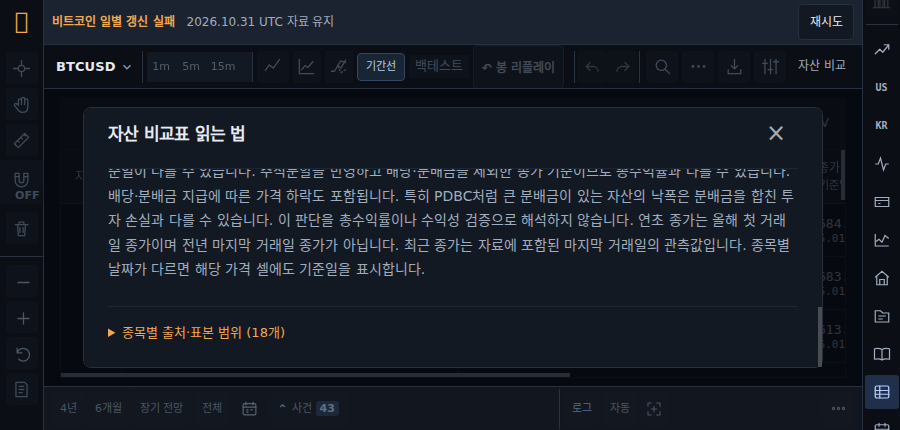
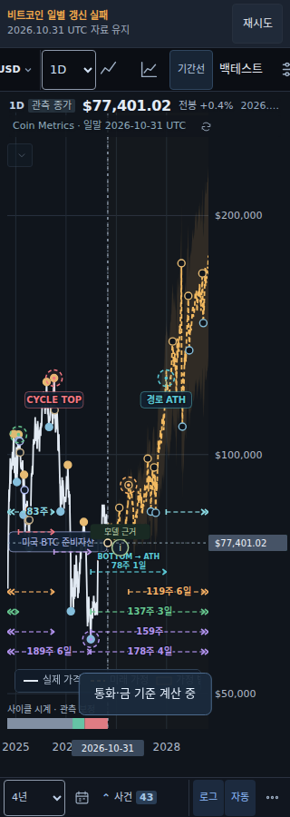

# Data-board reachability and native clipping follow-up

## Scope and result

This follow-up starts at PR #61 commit `4dc877ad0fdeabf7f01057e7f64ac11f9a8cbedc`. It fixes actual data-board control geometry and corrects browser verification where DOM ancestry did not describe the browser's painted clipping boundary. Financial calculations, the 18 source-backed assets, vendor pins and the upstream Hallmark criteria are unchanged.

The direct data-board browser scope passed **9/9 cases** after the data CSS corrections. The actual shared click helper passed **10/10 native positive and negative controls** after adopting the browser's `IntersectionObserver` geometry together with its existing center hit test. These are bounded native results, not a claim that the complete application or the prior Hallmark design gate passed. The original raw Hallmark **19 FAIL / 5 REFLEX** result remains in the November 4 report.

The new embedded-board regression cases retain all original 46 cases and add three, giving **49 declared cases**. Their first run passed the 1440px flow and exposed additional parent navigation defects at 320px and 900×430; those original failures are preserved in [center-data-initial-findings.json](evidence/center-data-initial-findings.json). The final native embedded run passed **3/3 cases** after the parent navigation corrections; [center-data-native.json](evidence/center-data-native.json) records all 98 source hashes unchanged during that run. An initial failure is never counted as a completed pass. The complete 49-case final-head CI remains separate evidence.

## Actual defects and corrections

| Finding | Evidence | Correction |
| --- | --- | --- |
| Phone board actions were 32×44px | Native 320px and 390px rectangles; four adjacent actions all had only 32px width | `daily-data.css` gives the four narrow controls a 44×44px minimum and preserves that width for coarse pointers. |
| Touch toolbar consumed 69px | 44px controls plus 12px block padding on both sides and a 1px rule | The data-only dashboard selector uses 8px block padding. Touch height becomes 61px; desktop height becomes 49px instead of 57px. |
| Compact sidebar return was 43×44px | The sidebar's border reduced its content width by 1px | A data-only narrow/coarse rule keeps the brand return 44px wide. The native guard verifies its entire target fits the actual sidebar client clip. |
| Embedded board lost all four actions | At 320px the old fixed toolbar was only 8px wide at x304–312; its four actions extended to x484 | The embedded data selector restores a relative, full-owner-width row. It preserves the parent's chart perimeter and the child's existing content inset. |
| Parent phone details action was clipped before entry | The initial button occupied x298–338, with only 22px painted inside a 320px viewport; its old width was 40px | The mobile heading owns horizontal touch scrolling and the four compact actions have 44px targets. Actual native touch exposes the complete details action before a physical click. |
| Parent data navigation was unreachable on a short display | Native wheel input could not expose the data navigation item at 900×430 | The right rail owns vertical scrolling. The actual native wheel now exposes the complete target without scrolling the structural chart stage. |

The direct board's older `.daily-back` and H1 are intentionally hidden by the existing shell. The active page title belongs to `.atlas-dashboard-header .atlas-shell-heading`; the chart return belongs to the sidebar brand. The updated data case verifies these named, painted replacement owners and the active data navigation item. It also verifies all four exact action IDs, rather than filtering invisible nodes until an assertion passes.

The embedded defect had a different cause: `initAtlasShell()` exits for `embedded=1`, so the dashboard override never applies. The inherited `market-lab.css` fixed heading still used `max-width:calc(100% - 430px)`. The fix is confined to `body[data-embedded=true] #data-view .daily-heading`.









The initially observed 18px parent shift existed before opening the child method dialog. The older Playwright locator click automatically scrolled the structural stage to expose the already-clipped details control. The replacement regression uses physical pointer input after native heading/rail gestures, with no `scrollIntoView` or DOM scroll assignment. The structural center-stage `overflow:clip` rule keeps perimeter ownership explicit; the passing workload records stage scroll offsets of zero throughout. This evidence does not attribute the earlier shift to an ordinary child dialog click.

## Native clipping is not DOM ancestry clipping

The old click helper intersected every DOM ancestor's rectangle. A native modal belongs to the top layer and can correctly paint above its clipped data-view ancestor. In the actual 900×430 board, the scrolled close action occupied y30.8–74.8 and was the native hit target; the old helper incorrectly rejected it against the dashboard's y64 boundary. A viewport-fixed sidebar above a shifted body exposed the same underlying mistake in a different containing-block chain.

The shared measurement now uses native `IntersectionObserver.boundingClientRect` and `intersectionRect`, a five-second fail-closed observation deadline, `checkVisibility`, and `elementFromPoint`. The click and keyboard-focus guards retain full bounds checks with a 1px tolerance. They do not treat an intersection ratio of one as proof of no occlusion.

[click-modal-negative-control.json](evidence/click-modal-negative-control.json) executes the actual imported native measurement and the exact extracted click helper. It proves:

- The original helper rejects a visible top-layer target; the corrected helper clicks it.
- A genuinely clipped modal child and an ordinary clipped target are still rejected before any click.
- An occluded target is rejected even when its intersection ratio is one.
- A fixed sidebar above a shifted clipped body remains usable.
- A fixed descendant of a transformed, clipped containing block remains subject to that clip.
- A fixed descendant of an untransformed overflow ancestor can escape that ancestor's clip.
- A viewport-clipped target and a CSS-hidden target with nonzero layout bounds are rejected.

The earlier five-case modal-only proof remains [click-modal-intermediate.json](evidence/click-modal-intermediate.json). The independent eight-case browser geometry experiment remains [intersection-clipping-experiment.json](evidence/intersection-clipping-experiment.json). Neither intermediate artifact is relabeled as final application validation.

## Direct-board verification

| Native viewport | Input | Toolbar after correction | Result |
| --- | --- | ---: | --- |
| 320×900 | Coarse | 61px | Pass |
| 390×900 | Coarse | 61px | Pass |
| 768×900 | Fine | 49px | Pass |
| 1024×900 | Fine | 49px | Pass |
| 1440×900 | Fine | 49px | Pass |
| 1620×1008 | Fine, including live resize | 49px | Pass |
| 1920×1440 | Fine | 49px | Pass |
| 900×430 | Coarse | 61px | Pass |
| 320×568 | Coarse | 61px | Pass |

The retained checks cover all 18 unique assets with BTC first and its Korean name, judgment labels, sticky names and headings, both table scroll axes, final row reachability, tall-screen row fill, dark owned surfaces, scrolled method close actions, and cached DOM/model preservation during resize. Added native touch gestures must move the table, and their momentum must settle before independent start/middle/end assertions. No geometry tolerance was loosened to accommodate momentum.

The complete [data-board-native.json](evidence/data-board-native.json) receipt is preserved, including source hashes and every case. Its SHA256 is `cfbd2ac8b363dcfa66918df62d97ca0cf205b9ba331db95c169fce0cef37b023`. [data-board-original-failures.json](evidence/data-board-original-failures.json) contains the exact nine original failures extracted from the recovered 46-case report and binds the complete 5,512,710-byte original report by SHA256. The baseline probe's five relevant source files match the exact `4dc877a` git blobs; see [data-board-manifest.json](evidence/data-board-manifest.json).

The focused controller/performance/domain run passed 36 Node test entries, including the comparison module's 24 internal checks. It did not measure a page speedup and makes no performance claim from these timings.

## Ongoing embedded coverage and reproduction

`verifyEmbeddedDataSurface` is part of the normal native workflow through `workspaceBrowserCases`, with three cases at 320×900, 1440×900 and 900×430. It uses native parent navigation, a child runtime bound to the actual frame ID and URL, mapped physical child input, source identity checks, and the same strict clipping guard. The four parent perimeter regions must stay mounted and unchanged; the outer stage must not scroll. The child must retain all 18 rows and four named, enabled actions, and its method dialog must support actual internal wheel scrolling and closing.

The final three-case run measured the following native paths:

| Viewport | Parent access | Child actions | Result |
| --- | --- | --- | --- |
| 320×900, coarse | Actual heading touch pan, then native pointers | Four 44×44px actions | Pass |
| 1440×900, fine | Native pointers | Four actions at least 32px in each dimension | Pass |
| 900×430, coarse | Actual right-rail wheel scroll, then native pointers | Four actions at least 44px in each dimension | Pass |

All three cases opened the method dialog, scrolled it internally, closed its currently visible header action, returned to the original chart, and retained the original source identity. They recorded two distinct explicitly verified parent refresh failures and no unexpected errors per case. All four perimeter boxes remained unchanged and the outer stage remained at scrollLeft/scrollTop zero. The full receipt SHA256 is `51e8d07e9453837747c9a7d30ce8b5b6366ec2868a472fce72cb057ff199c6da`.





The offline exception remains confined to explicitly verified BTC parent requests. The initial parent failure consumes one exact request ID. After returning, the case checks preserved source/quote identity and triggers a distinct native retry before verifying a second failure. The comparison iframe's requests receive no exception.

### Optional removal experiments and limits

Two HTTP-response-only CSS removal experiments were collected without modifying repository product or harness sources. Their raw outcomes are retained, including unsuccessful proof completion; they are not substitutes for the passing source-bound native receipt.

- Removing the embedded toolbar rule made all three cases fail the exact board-owner geometry assertion. [Raw cases](evidence/data-mutation-embedded-observation.json) and [wrapper summary](evidence/data-mutation-embedded-summary.json) retain the served CSS hash. The native runner exits before its final source-integrity stamp on assertion failure, and the optional wrapper does not add a separate post-failure hash check. Its `complete:false` and `killed:false` therefore remain unchanged. This is a reproduced geometry failure, not an accepted end-to-end mutation proof.
- Removing only the heading SVG `touch-action:auto` rule survived this specific three-case gesture workload. [Raw cases](evidence/data-mutation-heading-observation.json) and [wrapper summary](evidence/data-mutation-heading-summary.json) record 98 unchanged source hashes and `killed:false`. The passing native navigation path does not establish sensitivity to every possible icon-origin gesture.
- Rail-only and stage-only removal experiments were not run. No mutation sensitivity claim is made for them. The separate cycle-menu probe in the main report supplies additional actual navigation coverage, not a replacement for these missing controls.

The optional `browser-css-mutation.cjs` probe preserves the exact experimental implementation, including its fail-closed incomplete status for assertion-failing runs. It is not part of the required 49-case CI workflow. The 10-case actual click-helper positive/negative proof remains a completed, separately source-bound result; its recorded probe/module snapshot predates the final embedded helper additions and is not relabeled as a final-head whole-file test.

Run the existing native harness with a locally available Chromium binary:

```sh
ATLAS_BROWSER_PATH=/path/to/chromium ATLAS_BROWSER_CASE_SCOPE=data node scripts/verify-eth-candidate-browser.mjs
ATLAS_BROWSER_PATH=/path/to/chromium ATLAS_BROWSER_CASE_SCOPE=center-data node scripts/verify-eth-candidate-browser.mjs
```

The independent probes are also preserved. They accept `ATLAS_BROWSER_PATH`, `PLAYWRIGHT_MODULE` (or an installed `playwright` package), optional `ATLAS_REPO_ROOT`, and `ATLAS_PROBE_OUT`. The data probe starts its own local server in the browser process. Run `probes/data-board-probe.cjs candidate`, `probes/click-modal-probe.cjs`, or `probes/intersection-clipping-probe.cjs` from this directory. A missing browser or failed assertion exits unsuccessfully.

Recorded local rendering used Chromium 143.0.7499.0, Node 24 and the installed Korean font. Optional remote fonts and live BTC refresh were blocked deliberately; expected refresh failures retain explicit source clocks and the last verified quote. This does not establish Safari behavior, a physical-device pass, online provider availability, production deployment or model calibration. Source and artifact hashes bind their recorded snapshots, not a later changed working tree; final-head CI is separate evidence.
