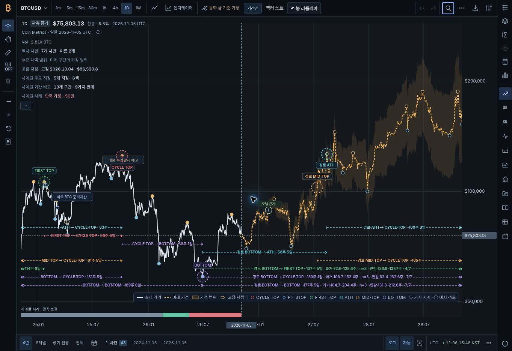

# Bitcoin Cycle Atlas — release closeout, 2026-11-06

## Delivered result

[PR #62](https://github.com/twoimo/bitcoin-cycle-atlas/pull/62) is merged and the [public workbench](https://twoimo.github.io/bitcoin-cycle-atlas/) is deployed and verified. This report records the completed release of the pending design closeout.

| Identity | Recorded value |
| --- | --- |
| Release version | `v1.31.3` |
| Reviewed PR head | `601119796df94dc77b213b73838a9d4a840afe14` |
| Reviewed source/evidence tree | `aa7ed92e075b897bf5f1c73f58a3d8fceab7449f` |
| Actual merge / deployed source | `f7e97e918270539397f8ff76e7f931deb8f320d7` |
| Deployed product tree | `33532c2d59d03a5b6f8f582e528edb855badec4f` |
| Pages publication-manifest identity (SHA-256) | `e3df5384bc148cbac7f2443c3fd1013b8028c3c4878d2e5f4e7b662abed5b331` |
| Prepared product content digest | `4424db3c9999635295f32c53a216b6a1cd2a5bbcd1c0302d5ed41c714bd4b691` |
| Pages workflow | [42207805241](https://github.com/twoimo/bitcoin-cycle-atlas/actions/runs/42207805241) |

The final PR head, its synthetic test merge and the actual merge have the same Git tree. The publication identifies the actual merged source. This evidence branch adds release records without changing the deployed product.

## Behavior repaired

The changes give nested tables and readers their own pointer, wheel and keyboard handling while preserving the chart's surrounding controls. The method reader remains visible in short windows and long dashboards, keeps the chart geometry, and restores focus to the persistent menu trigger. Shared table headers retain their own sticky behavior and asset identity columns; mobile close controls remain reachable.

The comparison page preserves unchanged research text and focused links during resize. RSI loading placeholders share the renderer's real geometry and release their observers when disposed. The ordinary generated Pages build preserves its design contract and asset hashes.

Observed prices, immutable forecast records and offline IPO inputs retain their exact protected bytes: 203 files totaling 45,414,161 bytes. One explicitly recorded metadata exception expands the review source inventory. The earlier design work is preserved in the integrated source history, and failed intermediate evidence remains intact.

## Verification

| Check | Completed result | Evidence |
| --- | --- | --- |
| Model/data CI | 2484/2484 passed; no failures, cancellations or skips | [CI](https://github.com/twoimo/bitcoin-cycle-atlas/actions/runs/42203377592), [receipt](release/ci-cache-final.json) |
| Numerical aggregate | All six programs passed, including 317,745 arithmetic assertions and recorded calendar/causal checks | [Final CI](release/ci-cache-final.json); [detailed arithmetic record](regression/verification-summary.json) |
| State/replay verification | Existing bounded lifecycle, state exploration and negative-control checks passed | [Final CI](release/ci-cache-final.json); [current replay receipt](../replay-state/verification.json) |
| Real service CI | 65 panel, 28 PostgreSQL and 59 market-lab tests passed | [Service CI](https://github.com/twoimo/bitcoin-cycle-atlas/actions/runs/42203377694), [receipt](release/service-cache-final.json) |
| Local original closeout native gate | 49/49 passed on Chromium 143 before the later date patch; 98 source files unchanged during that run | [Native record](browser/final/README.md) |
| Final remote native/evidence gate | 49/49 passed, zero failed/skipped, 98 exact Git source hashes matched on Chrome 156.0.8078.79 | [ETH/native CI](https://github.com/twoimo/bitcoin-cycle-atlas/actions/runs/42203377621), [receipt](release/eth-cache-final.json) |
| Final Hallmark | 0 FAIL / 0 REFLEX; 8 routes before and after, 80 screenshots; integrity passed | [Design CI](https://github.com/twoimo/bitcoin-cycle-atlas/actions/runs/42203377595), [receipt](release/hallmark-cache-final.json) |
| Actual merged-source CI | 2484/2484 passed, with all subsequent checks completed | [main CI](https://github.com/twoimo/bitcoin-cycle-atlas/actions/runs/42207805105), [receipt](release/ci-main-final.json) |
| Release publication | Exact merge/tag, thirteen uploaded assets and twelve workflow checksum results verified | [Release workflow](https://github.com/twoimo/bitcoin-cycle-atlas/actions/runs/42207805286), [scoped receipt](release/release-final.json) |
| Prepared publication | All 788 file identities verified | [Pages receipt](release/pages-final.json) |
| Served publication | Manifest identity and four actual critical HTTP response bodies matched the prepared release | [Pages receipt](release/pages-final.json) |
| Public UI | Displayed merged source; native-keyboard invalid date rejected through Enter and button; chart preserved; Escape restored the workspace-menu trigger | [Public observation](release/public-ui.json) |

Some tests overlap across workflows; the reported counts are not added into a unique grand total.

The local focused browser checks additionally covered 120 renderer comparisons, 18 painted loading geometries, 9 loading kinds, 5 disposal paths, 4 reader viewports, sticky tables, keyboard ownership and the navigation rail. They retain their exact original receipts.

## Replay timeout diagnosis

The first complete local and remote runs both executed all 49 cases and failed only desktop BTC playback at 0.3×. Sixteen real daily updates at the specified 3,000 ms interval require 48 seconds, exceeding the former fixed 45-second wait.

Native observation preserved the state at the original deadline, then observed real completion with all 16 source dates exactly once. The verifier now derives one deadline from the actual source count, requested interval, unchanged upper cadence bound and a named startup/polling allowance. Exact counts, ordered dates and the 0.85–1.3 mean-cadence assertions remain intact. The corrected complete local run measured 2,999.533 ms at 0.3× and passed every case. [Detailed evidence](browser/final/README.md).

## Manual replay dates and concurrent integration

While the packet-only head was being checked, a concurrent commit added the issue #50 manual-date repair. The integrated head preserves both parents and all packet inventory/evidence work. The previous packet-only CI was cancelled; its completed service and Hallmark results remain historical records, not final-head approval.

The date button and Enter now share validation before the nearest-observed-bar path. Empty, malformed, impossible and out-of-range values retain the user's draft and show a correction; they leave the existing cursor, origin, frozen forecast, snapshot and saved bytes unchanged. Editing or cancelling clears the error. Pointer selection, Random and First retain their original behavior.

Two actual-source regression cases cover resumed captures and unconfirmed starts. The bounded replay checker retains its original enumeration and adds an eleventh real-source negative control for bypassing manual-date validation. Its maintained project skill reflects those added checks; all workflow files and Hallmark settings remain unchanged. [Detailed follow-up](replay-date-followup.md), [current finite verification](../replay-state/verification.json) and [integration source review](release/concurrent-date-source-review.json).

The final native run includes actual keyboard entry for both lower and upper bound rejection through both button and Enter, correction within the same field, valid minimum/maximum selection, and restoration of the prior saved capture. All six BTC desktop checks passed: four invalid lower/upper × button/Enter combinations and both valid boundaries. All six preserved the saved-session digest. The 0.3× mean cadence measured 3,000.887 ms. [Native receipt](release/eth-cache-final-native-receipt.json.gz), [upper-bound Enter screenshot](release/date-screenshots/chart-replay-btc-1440x900-native-invalid-date-upper-Enter.png), [lower-bound button screenshot](release/date-screenshots/chart-replay-btc-1440x900-native-invalid-date-lower-button.png).

## Immutable release and version correction

The existing `v1.31.2` tag and its thirteen assets continue to identify their original source. Package release metadata advances to `1.31.3`, and the final cache-synchronization commit updates exactly 53 query tokens across 18 public files, including eight generated route wrappers. Tests, algorithms and protected data remain unchanged by this follow-up.

The metadata-only attempt at `ada2f3c` failed before native execution because its version-bound VM fixtures expected `1.31.3` while asset imports retained `1.31.2`: 125 of 155 cases passed and 30 failed. Its complete failed log is retained. The accepted repair synchronizes current asset tokens with the release version and retains the strict original fixture contract; the exact 155-case gate and bounded eleven-mutation verification were repeated. [Source and focused results](cache-version-sync.md), [original failure](release-version-followup/README.md), [source review](release/cache-sync-source-review.json).

The earlier `c259539` native workflow was cancelled after 42 individual native-case events, without a terminal native receipt or final packet; no final pass is attributed to it.

The Release workflow completed successfully on the actual merge. Tag `v1.31.3` directly identifies `f7e97e918270539397f8ff76e7f931deb8f320d7`. GitHub reports thirteen uploaded assets totaling 207,157,440 bytes; its release UI also lists two automatic source archives. The successful workflow checked all twelve payload entries in `SHA256SUMS.txt`; that checksum file is the thirteenth uploaded asset. API asset identities and digests, the workflow's source checkout, and the prior release's unchanged tag and asset metadata are recorded. [Release](https://github.com/twoimo/bitcoin-cycle-atlas/releases/tag/v1.31.3), [workflow](https://github.com/twoimo/bitcoin-cycle-atlas/actions/runs/42207805286), [receipt](release/release-final.json).

Direct release-payload verification is **BLOCKED**: the first small-file download timed out without returning a file, and the following observation was denied by the browser URL security policy. No workaround or further download attempt was made. The release pass covers the exact workflow/tag identity, its executed checksum checks and GitHub-reported metadata. It does not claim that release payloads were independently downloaded, parsed or hashed. The Release manifest's canonical identity and parsed content digest remain unobserved; the Pages manifest above is a separate identity. GitHub's platform `immutable` flag is false; the recorded previous-release preservation is enforced by the repository workflow and verified metadata comparison.

## Complete evidence packaging

The preceding `aca73b7` ETH workflow passed all 49 native cases, then failed its 100 MB aggregate evidence cap. The downloaded original artifact was checked against its SHA-256 and restored without changing the 335 execution-evidence inputs. A complete measurement established 105,721,764 bytes; the first overflow error had described only the ingested prefix.

The caller now has a finite 128 MB aggregate cap and retains its separate 85 MB per-file cap. The builder, validators, release conditions and omitted-review disposition are unchanged. An additive inventory repair makes every top-level browser source and root stylesheet an explicit seed, adding ten missing payloads. The new regression fails before the scope correction and passes afterward, preserving all six existing dynamic-import offsets.

The exact restored-artifact replay passed with 105,806,852 bytes in 872 entries. All 335 original execution-evidence files remained byte-identical; the book and all 588 parts matched their hashes. The subsequent final-head CI packet completed with 105,945,068 bytes and 871 entries, complete declared source access and zero unresolved imports. Its 589 ordered parts reassemble to the same full-book SHA-256; all 871 payloads, 537 committed blobs and 334 current execution files were verified against the downloaded artifact and exact Git tree.

The current execution count is one lower than the historical reconstruction: the live PoW acquisition needed 50 rather than 51 RPC reads after its finalized anchor advanced. The current receipt declares no `rpc/051.raw.json`; all 53 current raw acquisition files match their own receipt. The complete observation window and boundary blocks remain equal. This is a source-acquisition difference, not an omitted declared file. [Exact inventory difference](release/eth-cache-final-execution-delta.json), [artifact verification](release/eth-cache-final-artifact-verification.json), [source correspondence](release/eth-cache-final-source-verification.json). [Failure, measurement and repair](packet/README.md); [final workflow receipt](release/eth-cache-final.json).

## Retained findings and scope

The pinned checker, original baseline, severities and eight routes remain unchanged. Final Hallmark retains 25 static WARN and 10 rendered WARN. The local full run also retains one fallback-link FAIL: its network-limited baseline used the older October 26 Coin Metrics URL; the verified remote baseline and current data both used November 6. The failed local record was not relabeled. [Reconciliation](hallmark/README.md).

The forced-light error-message pairing has a measured 2.674:1 contrast weakness and remains a prerequisite before exposing that theme. Published entry points and runtime select the dark theme; its measured error contrast is 6.044:1.

The reported checks establish their recorded implementation, arithmetic, finite state, source-preservation and native interaction properties. Prospective forecast performance continues to use the existing mature-case and input-data requirements. No new candidate was activated by this release. [Remaining empirical conditions](regression/remaining-conditions.json).

## Final public interaction checks

The deployed site visibly identified merged source `f7e97e918270`. In the public BTC daily replay start selector, the actual available range was `2025-10-16` through `2026-11-05`. Native arrow and number keys changed the draft from `2026-10-21` to `2027-10-21`. Both Enter and the selection button rejected it with the explicit range message, retained the draft and input focus, left the start unconfirmed, and preserved the observed chart text and `2026-11-05` chart date. The exit control displayed the session-save checkbox disabled and unchecked; exiting restored the normal chart. No storage internals were read for this public smoke check. Saved-session byte preservation is established by the separate source-bound native suite above.

The workspace command menu opened **Models and validation** with focus on its heading. The reader fit the observed 1363 × 936 viewport: x=1005, y=0, width=320, height=936. Escape closed it and returned focus to the persistent `workbench-workspace` button. The resulting chart remained available as the review tab. [Unmodified public observation](release/public-ui.json), [capture correspondence and hashes](release/public-ui-file-preservation.json).

Issue [#50](https://github.com/twoimo/bitcoin-cycle-atlas/issues/50) was already closed as completed at `2026-11-06T11:26:23Z` when its state was refreshed. Its concurrent resolution record and the PR's existing completion notes were preserved; this continuation did not repeat the close action. [Final repository identity](release/final-repository-identity.json).

## Public screen

[Publication identity](release/public-screenshots/publication-identity.jpg) · [Native keyboard date rejection](release/public-screenshots/invalid-date.jpg) · [Model reader](release/public-screenshots/model-reader.jpg)

The screenshot is an unmodified capture of the deployed public site. The visible data-status panel displayed source prefix `f7e97e918270`. The completed Pages workflow separately confirmed the served manifest and four actual HTTP bodies against its prepared publication; no browser JSON export was downloaded. The browser observations and publication verification identify their exact scope; the recorded Chromium/Chrome coverage does not certify Safari, physical devices or assistive screen readers. Same-model workers partitioned the verification tasks; no independent multi-model review is claimed.
