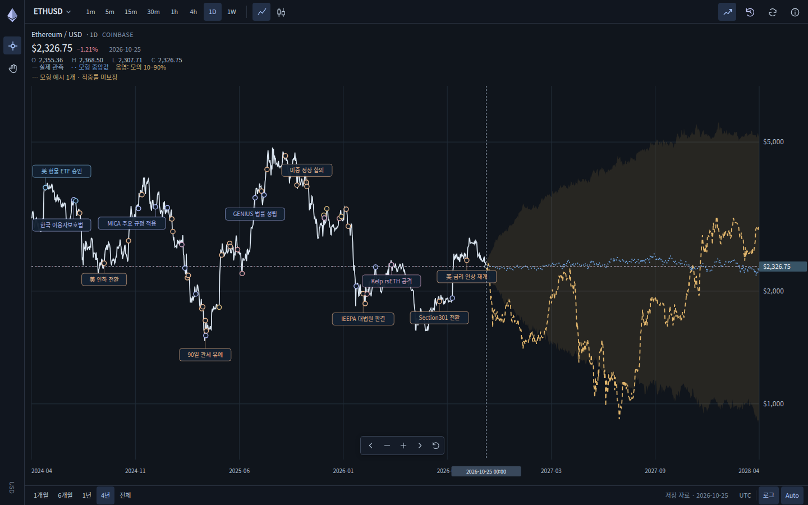

# ETH pooled 후속 실행 증거 — 2026-10-27

[전체 해석과 수학 정책](../../ETH_POOLED_FOLLOWUP_20261027.md) · [남은 조건](../../ETH_REMAINING_CONDITIONS.md) · [Draft PR #39](https://github.com/twoimo/bitcoin-cycle-atlas/pull/39)

기존 adaptive v1 기본값을 유지하면서 Merge 이후 전체 연속 수익률을 쓰는 별도 `pooledEth` 후보를 실제 실행했다. 아래 자료는 이번 실행의 **결과·원자료·실제 화면**이다. Gemini 반대 검토와 후속 역검토는 사용자 지시에 따라 **omitted-by-user**이며 통과 처리하지 않았다. 병합·배포·기본 모형 승격은 수행하지 않았다.

## 실행 소스와 증거 범위

- 직접 실행한 응용·검증 소스: [870cf93d4c2e634dde4d7e5a0429eaaff3c5b1e0](https://github.com/twoimo/bitcoin-cycle-atlas/commit/870cf93d4c2e634dde4d7e5a0429eaaff3c5b1e0)
- 직접 실행 source tree: `c75c727de134e73b704598b94b8a0a68a9fec445`
- 일반 CI의 합성 merge 소스: `3b9fa0a0232de45232cc220e69a5ba1badadadc3`, tree `0bd6fe5e4b45f16b43b8adeb8b51967e27e664e8`
- 기준 가격 입력: **2026-10-25**, ETH **$2,326.75**
- 이 디렉터리는 실행 후 별도 **docs-only commit**으로 보존한다. 증거를 추가한 commit을 응용 코드가 실행된 SHA로 바꾸어 기록하지 않는다.
- JSON은 GitHub Actions가 실제 출력한 구조화 receipt 및 완성된 path transport를 파싱하고 들여쓰기를 붙인 사본이다. 모든 JSON이 전체 build artifact와 byte-for-byte 같은 파일이라는 주장은 하지 않는다.
- 두 `*.raw.json`과 세 PNG는 실제 실행의 base64 transport에서 복구한 원래 bytes다. raw bytes의 크기와 SHA-256은 collector receipt 및 source-book manifest와 대조했다. 선택한 세 PNG는 직접 시각 확인한 첫 실행 이미지와 최종 실행 이미지가 byte-for-byte 같다.
- 전체 artifact는 167개 화면, 전체 후보 보고서, source-book 등을 포함한다. 이 디렉터리는 재검토에 필요한 구조화 결과와 선택 화면을 보존하며 전체 40 MB artifact를 복제하지 않는다.

## 실제 결과

| 검증 | 결과 | 실제 실행 |
|---|---|---|
| 일반 CI | **1,403/1,403**, fail 0, skipped 0; 수치 assertions 318,010; 음성 대조 16/16 | [40451149872](https://github.com/twoimo/bitcoin-cycle-atlas/actions/runs/40451149872) |
| 직접 head evidence | 집중 **270/270**, native **34/34**, **167 PNG** | [40451149941](https://github.com/twoimo/bitcoin-cycle-atlas/actions/runs/40451149941) |
| native 오류 | runtime 0, unexpected resource 0; 실제 offline 실패 **11개 보존 및 문서별 검증** | [browser.json](browser.json) |
| 전체 앱 Hallmark | integrity PASS, 8 routes 전후 80 PNG; 디자인 **6 FAIL / 3 REFLEX**, workflow **failure** | [40451149871](https://github.com/twoimo/bitcoin-cycle-atlas/actions/runs/40451149871) |
| 기존 adaptive v1 | 731 path points, 기존 요약 27행, 기존 pairwise 45행, 기존 현재 후보 9개 및 메타데이터 정확 일치 | [pooled-research.json](pooled-research.json) |
| source-book | 238 seeds, 286 entries, 248 parts, 44,463,149 bytes, unresolved 0 | [source-book-manifest.json](source-book-manifest.json) |

Hallmark 원본 진단을 수정·면제·통과 처리하지 않았다. generic source-book의 `externalReview.status: pending`도 원본대로 남겼으며, 현재 사용자 생략 지시는 [execution.json](execution.json)에 별도로 명시했다.

최초 [92a180e 실행](https://github.com/twoimo/bitcoin-cycle-atlas/actions/runs/40449914791)은 native 25/34로 실패했고, 다음 [0c5d95b 실행](https://github.com/twoimo/bitcoin-cycle-atlas/actions/runs/40450988666)은 hashbang보다 앞선 import 때문에 문법 검사에 실패했다. 두 실패를 [intermediate-runs.json](intermediate-runs.json)에 보존했다. 최종 통과가 과거 실패를 지우지 않는다. 첫 점수 확인 후 모형 정책·seed·학습·모의·점/구간 결과·보정 결과를 변경하지 않았다.

### 모형 해석

현재 학습은 **1,502개 일별 관측 / 1,501개 수익률**이다. 기존 v1에서 상태 미분류로 충격·변동성 추정에서 제외되던 **913개 수익률**도 사용했다. 상태별 조건 제거, 표본 확대, 미래 명시적 log drift 0이 동시에 달라지므로 단일 변경의 인과 효과라고 해석하지 않는다.

| 같은 원점·비중첩 비교 | 30일 | 90일 | 180일 |
|---|---:|---:|---:|
| 공통 표본 수 | 9 | 4 | 2 |
| v1 대비 pooled 점오차 변화 | +0.35% | −5.16% | −4.26% |
| v1 대비 pooled raw interval score 변화 | −5.96% | −23.65% | −32.60% |

장기 공통 표본이 4개·2개로 적다. **pooled의 더 넓은 가용 기간에서는 가격 유지 기준 대비 skill이 30일 +0.085%, 90일 −2.91%, 180일 −6.52%**다. 유리한 공통 표본 결과만으로 우월성을 선언하거나 기본값을 바꾸지 않는다.

현재 pooled의 성숙한 비중첩 보정 오차는 **20/10/5개**다. 최소 12개 정책을 유지하므로 30일만 experimental이고 90·180일은 insufficient다. 화면 음영은 계속 raw q10–q90이다. 80% 미래 포함 보장, 가격 기대수익률 0, 2년 가격 예측 검증을 의미하지 않는다.

### 새 예측 발행과 경제 입력 상태

기존 발행 기록 **9개 / snapshot 3개**를 유지했다. 오래된 ETH/BMNR/MSTR 입력으로 신규 발행이 거부됐고 **새 기록 0 / 새 snapshot 0 / candidateFreezeAt null**이다. 결과 평가는 **27 pending / 0 scored**다. 현재 판본으로 재계산한 연구 경로를 과거 실제 발행이나 새 전향 실적으로 세지 않는다.

throughput은 실제 수집됐지만 엄격 정의 경제 입력은 **0/25**, 완전한 경제 snapshot은 **0**, 가격 모형 연결은 **false**다.

## 원자료와 단위

Source: **growthepie, https://www.growthepie.com.** [CC BY 4.0 데이터 이용 조건](https://www.growthepie.com/data-terms).

| 원본 | 실제 bytes | SHA-256 |
|---|---:|---|
| [master.raw.json](master.raw.json) | 161,766 | `9446f264f0352f4bc4fdd524cdda6e5980a0599ee62b6908825f98a21f037774` |
| [throughput.raw.json](throughput.raw.json) | 192,197 | `f077b58447a27e797f4fbb251833d7f07c483f1401be84f73f0ac84af44d0ccd` |

실제 2,491개 일별 행에서 **2026-09-29–2026-10-26의 연속 28일**을 골랐다. Mgas/s에 86,400×1,000,000을 곱한 합계는 **6,094,027,523,397 gas**다. 원본과 파생 계산을 구분한다. 추가 반올림을 하지 않았지만 `exactIntegerGas: false`이며 독립 node의 정수 gas 재집계는 아니다.

`providerGeneratedAt`은 공급자의 JSON 생성 시각이고 최초 공개 시각이 아니다. `publishedAt: null`, `historicalPointInTimeReady: false`를 유지한다. 마지막 관측일은 가격 anchor보다 하루 뒤이고 실제 수집은 2026-10-27이므로 이 자료를 과거 예측 원점에 소급 주입하지 않는다. 정확한 HTTP·수집 시각·단위·품질 상태는 [throughput-receipt.json](throughput-receipt.json)에 있다.

## 화면 검증의 범위

18종목, BTC 첫 행, **비트코인** 한국어 이름을 유지했다. 1620×1008와 1920×1440 보드의 마지막 행→내부 하단 차이는 각각 **0.25px**다. 320/1440px에서 pooled·valuation·adaptive를 실제 키보드로 전환하고 포커스와 관측 가격을 확인했다.

offline 검증 중 실제 발생한 11개 provider 요청 차단을 원본 오류 배열에서 제거하지 않았다. 정확한 GET/Fetch·URL·실제 UTC 날짜·frame/loader·inspector 차단을 식별하고, 해당 문서에서 실패 title·busy 종료·기존 cutoff 보존을 확인한 경우만 예상된 실패로 분류했다. 숫자 BTC 가격이 표시되는 7개 문서는 실제 **$80,038.91**도 확인했다. 실패 title의 버튼은 숨겨져 있었으므로 **가시적 오류 배너 검증이 아니다**.

### 실제 desktop pooled 차트

### 실제 mobile pooled 차트와 설명 패널

[320px pooled 차트](eth-320-pooled-chart.png) · [320px pooled 설명 패널](eth-320-pooled-model.png)

두 이미지는 실제 실행 화면이며 디자인 mockup이나 합성 미래 가격 캔들이 아니다. 차트의 미래 중앙선과 raw 분위수는 연구 모의 결과다.

## 파일 안내

| 파일 | 내용 |
|---|---|
| [pooled-research.json](pooled-research.json) | 최종 pooled 정책·학습·성능·v1 보존·실행 metadata의 compact receipt |
| [current-pooled-path.json](current-pooled-path.json) | anchor 포함 731점의 실제 현재 모의 경로 |
| [comparison.json](comparison.json) | 10개 후보 비교, 공통 원점 점/구간 결과, 현재 보정 상태 |
| [browser.json](browser.json) | 34개 native 사례, 167개 PNG metadata, 원본/분류된 resource 오류 |
| [source-book-manifest.json](source-book-manifest.json) | 선언한 접근 범위, 입력·소스·검증 기준 해시와 전체 bundle 정보 |
| [throughput-receipt.json](throughput-receipt.json) | 실제 두 HTTP 응답·raw hash·단위 변환·28일 보조 관측 |
| [economic-source-receipt.json](economic-source-receipt.json) | 엄격 정의 경제 자료 0/25 및 완전 snapshot 0 |
| [economic-ablation.json](economic-ablation.json) | 경제 자료 미충족 조건과 비활성화 상태 |
| [forecast-issuance.json](forecast-issuance.json) | 보존 원장과 stale inputs에 따른 신규 발행 거부 |
| [outcomes.json](outcomes.json) | 27 pending / 0 scored 및 원장 불변 |
| [hallmark-summary.json](hallmark-summary.json) | 실제 6 FAIL / 3 REFLEX와 integrity gate |
| [hallmark-findings.json](hallmark-findings.json) | 원본 개별 디자인 진단 |
| [hallmark-phases.json](hallmark-phases.json) | before/after 수집과 실행 단계 |
| [execution.json](execution.json) | 소스 SHA·run/job·검증 수치·artifact digest·사용자 생략 정책 |
| [intermediate-runs.json](intermediate-runs.json) | 두 중간 실패와 최종 성공을 구분한 기록 |
| [first-run-browser.json](first-run-browser.json) | 최초 25/34 실패 원본 receipt |
| [first-run-pooled-research.json](first-run-pooled-research.json) | 최초 계산 결과와 후속 검증 수정 뒤 수학 결과 보존 근거 |

## 전체 artifact 식별자

| artifact | ID / 크기 | SHA-256 | GitHub 만료 예정 |
|---|---|---|---|
| [최종 evidence](https://github.com/twoimo/bitcoin-cycle-atlas/actions/runs/40451149941/artifacts/12710344162) | 12710344162 / 40,237,490 bytes | `9b7b6229c4dd8191e4026e346d181900e55c7d1623b5c48c054c1549eb066d61` | 2026-11-26 04:46:39 UTC |
| [최종 Hallmark](https://github.com/twoimo/bitcoin-cycle-atlas/actions/runs/40451149871/artifacts/12710946329) | 12710946329 / 10,407,814 bytes | `eaa558be7c51cd810ecc8646d99a9c893dd0b9a910d1245b964799a80cbc92dc` | 2026-11-26 04:45:20 UTC |

source-book bundle SHA-256: `63167fcb30572751af574f5f5d15bc3f15ff1003b487c8d1d85912673bdf49ce`. 이 README의 Git 저장 자료는 Actions artifact 만료와 별도로 보존된다.
