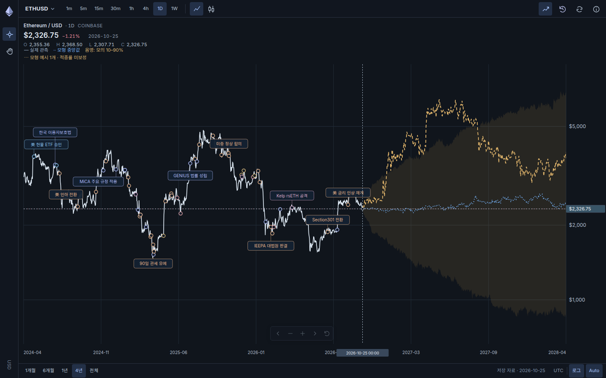
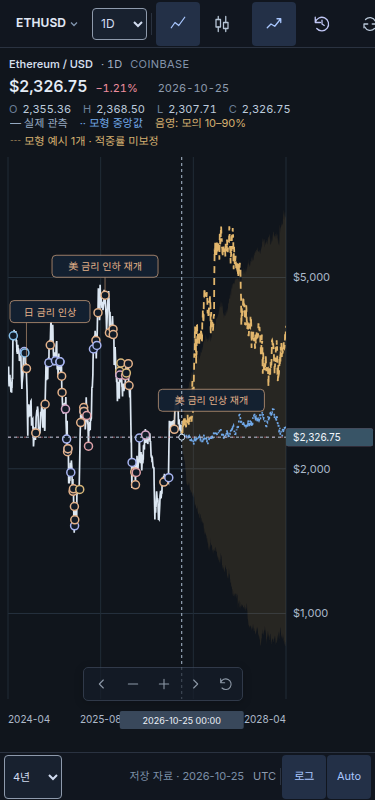

# ETH 재모델링 실행 증거 — 2026-10-27 한국 시간

검증 대상 소스는 **d629bbc0010cf23495414a9cdf102dd59b73e1aa**, tree는 **7a5e01b64ebdd91830a9f7c38dd9067f5d26ea98**다. 이 디렉터리와 연구 보고서를 저장한 후속 문서 커밋의 SHA와 구분한다. 보존된 JSON은 실제 Actions 로그의 구조화된 출력이며, source-book manifest의 일반 필드를 최신 정책에 맞춰 덮어쓰지 않았다.

[전체 연구 보고서](../../ETH_REMODELING_RESEARCH_20261027.md) · [현재 조건](../../ETH_REMAINING_CONDITIONS.md) · [Draft PR #39](https://github.com/twoimo/bitcoin-cycle-atlas/pull/39)

## 결론과 검증 범위

ETH의 확인된 상태 기간과 시간가변 변동성을 쓰는 연구 모형, 현재 입력의 재현 가능한 경로, AI 수요 회계, 원문 47개의 비판적 점검을 구현했다. 미래 3년 상승·1년 하락, 특정 기관 목표가 또는 실제 80% 포함률을 증명했다고 주장하지 않는다.

동일 원점·비중첩 30/90/180일 비교는 9/4/2개다. 새 모형의 평균 절대 로그오차는 0.1536/0.3276/0.3462, 기존 ETH 예시는 0.1769/0.3084/0.3423이다. 30일 개선과 90·180일 악화를 모두 보존한다. 완료된 학습 상태는 상승 1회·하락 2회이고 현재 상태는 우측 검열이다. 새 모형을 실제 과거 발행본으로 소급하지 않는다.

## 실제 실행

| 항목 | 실행 | 실제 결과 |
| --- | --- | --- |
| 일반 CI | [40392624689](https://github.com/twoimo/bitcoin-cycle-atlas/actions/runs/40392624689), job 121817279602 | 1,374/1,374, 수치 assertion 318,010, negative control 16/16 |
| 직접 head evidence | [40392623994](https://github.com/twoimo/bitcoin-cycle-atlas/actions/runs/40392623994), job 121817277037 | 집중 239/239, Chromium 34/34, 163 PNG, runtime/resource 오류 0/0 |
| Hallmark 전체 앱 | [40392623996](https://github.com/twoimo/bitcoin-cycle-atlas/actions/runs/40392623996), job 121817277941 | 8경로 전후 80 PNG, integrity PASS, 디자인 **6 FAIL / 3 REFLEX** |

일반 CI는 직접 PR tree가 아닌 main과의 합성 merge **b3b0da4b2774246f702e8e3d7c50611e31c12e33**, tree **ee15a965f1004b10a214f505be25f5ce3b8dae93**에서 실행됐다. 두 부모는 main 5b9246a55889b79eaedb61e9c183e124167b6ea6과 검증 소스 d629bbc다. 직접 evidence와 Hallmark는 검증 소스를 그대로 checkout했다.

첫 구현에서 34개 native 사례 중 5개 ETH 렌더가 실제 실패했다. 예시 경로가 분위수 밖으로 나갈 수 있는 의미를 공통 렌더러가 허용하지 않았던 결함을 수정했다. 두 번째 구현은 실제 cutoff가 미국 주식 장 마감을 넘어 오래된 BMNR/MSTR 자료의 새 발행이 거부됐다. [중간 실행](intermediate-runs.json)은 이 실패·미완료를 그대로 보존하며 최종 성공으로 덮어쓰지 않는다.

## 영구 보존 파일

| 파일 | 내용 |
| --- | --- |
| [execution.json](execution.json) | 실행 소스·tree·run·checkouts·검토 생략 정책·남은 조건 |
| [research.json](research.json) | ATH·연도 수익률·구간·변동성·상태 표본·모의 민감도·기관 산술·AI 회계 |
| [current-path.json](current-path.json) | anchor 포함 731일의 실제 현재 계산 경로, issued=false |
| [comparison.json](comparison.json) | 9개 모형, 111개 과거 원점, 동일 원점 비교와 실증 제약 |
| [browser.json](browser.json) | 34개 native 사례, 입력·조작·레이아웃·PNG 목록과 원본 hash |
| [hallmark.json](hallmark.json) / [단계](hallmark-phases.json) / [원문 진단](hallmark-findings.json) | 원문 디자인 실패, 무결성 성공, waiver/dismissal 0 |
| [source-book-manifest.json](source-book-manifest.json) | 검증 소스와 증거의 실제 원문 묶음 inventory |
| [issuance-summaries.json](issuance-summaries.json) | 실제 stale 판정과 2번의 보존 전용 호출 |
| [outcome-summaries.json](outcome-summaries.json) | 별도 결과 평가, 기존 발행본 불변, 27 pending/0 scored |
| [economic-source.json](economic-source.json) | 실제 원자료 수집 시계·hash·정의 불일치와 155일 시차 |
| [ablation.json](ablation.json) | 경제 snapshot 0으로 실증 제거 실험 unavailable |
| [intermediate-runs.json](intermediate-runs.json) | 실제 첫·두 번째 실행 실패와 후속 수정 이유 |

## 실제 화면

아래 PNG는 최종 검증 소스의 Hallmark 실행이 출력한 원래 PNG 조각을 순서대로 재결합한 것이다. 모형 경로를 별도로 다시 그리거나 이미지를 생성하지 않았다. 흰색 관측, 파란 모형 중앙값, 금색 예시 1개와 모의 10–90% 음영을 구분한다.

### 데스크톱 1440×900

### 모바일 375×800

모바일 전체 높이는 원래 PNG의 실제 크기다. native 320/390/768/1024/1440 폭 검증은 위 browser.json의 별도 900px 높이 사례다. 서로 다른 캡처를 같은 화면 크기로 부르지 않는다.

기존 비교표는 1620×1008 및 1920×1440에서 18종목·BTC 첫 행·비트코인 표시를 유지했고 마지막 행과 내부 하단 차이는 0.25px다. native PNG 163장 전부는 아래 전체 artifact에 있으며 이 디렉터리에는 대표 ETH 두 장만 포함한다.

## 원문 묶음과 artifact

source-book: **225 seeds / 268 entries / 239 parts**, 미해결 import **0**, **42,983,471 bytes**, 명시적 한도 **60,000,000 bytes**.

- source-book SHA-256: `495e78e1412d30aa8f0a4ae40bf4fca5d1c35216482be6f9a8ed261ad7129fa8`.
- [전체 Actions artifact 12686055905](https://github.com/twoimo/bitcoin-cycle-atlas/actions/runs/40392623994/artifacts/12686055905): ZIP 38,922,269 bytes.
- ZIP SHA-256: `2823c7be7e45b22b02fc2953e6555d441a1b2ea772b50467a86efe75326f0866`.
- 실제 artifact 만료 시각: **2026-11-25T20:10:07Z**. 이 디렉터리의 주요 JSON·두 PNG는 Git에 별도로 보존한다. 전체 ZIP을 영구 복제했다고 주장하지 않는다.

source-book은 선언된 seeds와 재귀적 정적/literal import·명시한 동적 항목의 완결성이다. 모든 JavaScript 실행의 전체 의존성을 일반적으로 증명하지 않는다.

## 현재 정책과 남은 조건

**Gemini 반대 검토 및 후속 역검토는 사용자가 생략하도록 지시했다.** 현재 정책은 omitted-by-user이며 실제 실행·통과·완료가 아니다. 일반 source-book 생성기의 원본 `externalReview.status=pending`은 수정하지 않은 이전 메타데이터다. 이를 현재의 필수 미완료 검토나 실제 외부 검토 증거로 해석하지 않는다.

최종 발행 단계는 BMNR/MSTR의 2026-10-23 자료가 실제 cutoff에서 요구된 2026-10-26 세션보다 오래된 것을 확인했다. 명시적 CI 보존 모드에서 **새 records 0 / 새 snapshots 0 / 기존 records 9 / 기존 snapshots 3**을 유지했다. candidateFreezeAt=null, issuanceStatus=skipped-stale-inputs다. 기본 발행의 최신성 거부는 완화하지 않았으며, 현재 모든 BTC underlying·재무 입력의 새 발행 적격성을 선언하지 않는다.

별도 결과 평가 **27 pending / 0 scored**, 새 모형의 성숙한 전향 평가 **0**, 경제 정의 적격 **0/25**, 완전 경제 snapshot **0**을 유지한다. 현재 판본 회고 성능·모의 수치 민감도·기능 통과는 서로 다른 결과다.

PR #39는 Draft다. main 5b9246a55889b79eaedb61e9c183e124167b6ea6과 PR #12 head 290346736954cc108914f62c7e6ddecff578b8e0을 변경하지 않았으며 main 병합·운영 예측 승격·공개 배포는 수행하지 않았다.
