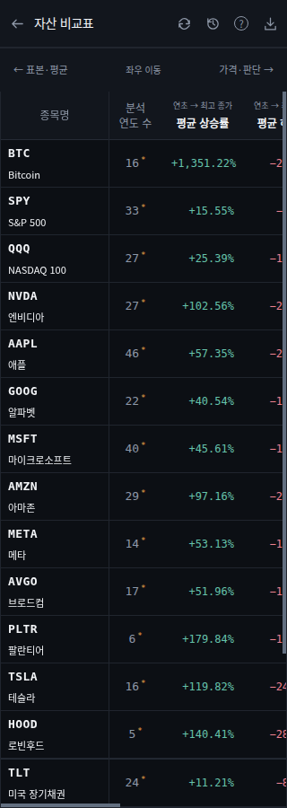
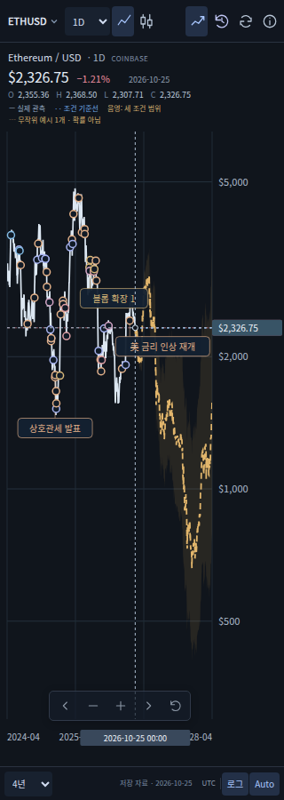

# ETH 후보 실제 비교 결과 — 2026-10-26

## 판단

BTC 사이클의 ETH 적용을 배제하지 않고 실제 코드로 비교했다. 이번 회고 표본에서 BTC 전이 기준선은 기존 ETH 단일 예시보다 같은 원점의 로그가격 오차가 작았지만, 180일 직접 비교의 비중복 표본은 3개뿐이다. ETH 재추정형과 BTC 전이형의 우열은 기간에 따라 달라졌다. **새 기본 모형은 채택하지 않는다.**

13개 경제 특징의 회귀·민감도·제거 실험과 별도 ETH/BTC 평가 경로는 구현됐지만, 실제 과거 경제 입력 판본은 0개이므로 경제 후보와 결합형의 시장 성적은 이용 불가다. 합성 테스트의 계산 성공을 실데이터 성적으로 바꾸지 않았다.

## 입력과 표본

- 완료 관측 기준일: 2026-10-25.
- 저장 ETH 3,811개 중 초기 누락 앞의 3개를 제외한 3,808개 연속 관측 사용. 2016-05-21/22 누락을 보간하지 않고 2016-05-23부터 시작.
- BTC 자료: 2010-07-18–2026-10-25, 5,944개 관측.
- 사전 고정 정책: 730일 초기 이력, 28일 간격 원점, 30·90·180일 타깃, 기존 ETH seed 20261022.
- 고유 원점 111개; 확정한 과거 타깃 320개. 기간별 109 / 107 / 104개이며, 기준선의 비중복 타깃 구간은 55 / 27 / 15개.
- 이것은 현재 저장 판본으로 다시 계산한 회고 비교다. 당시 공개 원자료·실제 발행본을 모두 복원한 실적이 아니다. 전향 확정 성적은 0이며 독립 시장 국면 수는 unknown으로 남긴다.
- ETH 재추정형의 가용 원점은 2019-09-11–2022-07-13의 일부 날짜이고 기존 ETH 엔진과 BTC 전이형의 공통 원점은 2024-06-12 이후다. ETH 재추정형과 기존 ETH 엔진의 공통 원점은 0개다.
- 모든 여섯 가격 후보 또는 경제·결합형까지 포함한 전체 후보의 공통 원점 역시 0개다. 표본이 다른 전체 평균을 모형 순위로 해석하지 않는다.

오차는 mean(abs(log(predicted)−log(actual)))다. 예를 들어 0.21은 21% 평균 절대 백분율 오차라는 뜻이 아니다. 개선율은 1−후보오차/비교오차다. 양수는 이 표본에서 오차가 작다는 뜻이며 유의성·확률·투자수익률을 뜻하지 않는다.

## 같은 원점의 가격 유지 기준선과 비교

각 행의 후보와 flat은 완전히 같은 비중복 원점을 사용한다. 서로 다른 행의 평가 기간은 다를 수 있다.

| 후보 | 기간 | 비중복 n | 평균 절대 로그오차 | 같은 표본 flat 오차 | flat 대비 개선 | 방향 정확도 |
| --- | ---: | ---: | ---: | ---: | ---: | ---: |
| btcTransfer | 30 | 48 | 0.2104 | 0.2124 | 0.95% | 52.08% |
| ethRefit | 30 | 7 | 0.1422 | 0.1626 | 12.56% | 85.71% |
| legacyEth | 30 | 15 | 0.2162 | 0.1300 | -66.30% | 46.67% |
| btcTransfer | 90 | 25 | 0.3124 | 0.3626 | 13.84% | 64.00% |
| ethRefit | 90 | 5 | 0.3936 | 0.3699 | -6.39% | 60.00% |
| legacyEth | 90 | 7 | 0.5083 | 0.4069 | -24.91% | 28.57% |
| btcTransfer | 180 | 14 | 0.5528 | 0.5886 | 6.09% | 50.00% |
| ethRefit | 180 | 4 | 0.3392 | 0.4855 | 30.14% | 75.00% |
| legacyEth | 180 | 4 | 0.4434 | 0.2532 | -75.11% | 100.00% |

보수적 추세와 단순 BTC 연동에 대한 동일 원점 요약, 방향 호출 비중 및 현 원점 예측은 저장된 JSON receipt에서 확인한다. RMSE·일별 가용 상태·개별 과거 예측 기록 전체는 workflow artifact의 전체 JSON에 보존한다. 방향 정확도는 가격 오차와 별도 지표다. 기존 ETH 180일 사례의 방향 정확도 100%도 표본 4개이며, 같은 표본의 flat보다 로그가격 오차는 더 컸다.

## 후보끼리 직접 비교

| 후보 쌍 (왼쪽 / 오른쪽) | 기간 | 공통 원점 | 비중복 n | 왼쪽 오차 | 오른쪽 오차 | 왼쪽의 상대 개선 |
| --- | ---: | ---: | ---: | ---: | ---: | ---: |
| btcTransfer / ethRefit | 30 | 12 | 7 | 0.1465 | 0.1422 | -3.04% |
| btcTransfer / legacyEth | 30 | 20 | 11 | 0.1433 | 0.2102 | 31.85% |
| btcTransfer / ethRefit | 90 | 12 | 5 | 0.2990 | 0.3936 | 24.03% |
| btcTransfer / legacyEth | 90 | 18 | 6 | 0.3427 | 0.3750 | 8.64% |
| btcTransfer / ethRefit | 180 | 12 | 4 | 0.4001 | 0.3392 | -17.97% |
| btcTransfer / legacyEth | 180 | 15 | 3 | 0.4262 | 0.5517 | 22.75% |

이 표에서는 각 행의 두 후보가 완전히 같은 날짜에 예측한 경우만 비교한다. BTC 전이형 대 기존 ETH 예시의 오차 감소는 30/90/180일 약 31.85% / 8.64% / 22.75%이지만, 비중복 표본은 11 / 6 / 3개다. ETH 재추정형은 BTC 전이형보다 30일·180일 오차가 작고 90일 오차가 컸다. 소수의 선택된 가용 날짜이므로 일관된 승자나 고정 사이클 법칙으로 해석하지 않는다.

## 최신 원점에서 실제 반환한 상태

BTC 전이형은 기존 BTC 상세 사이클의 상대 기준선을 ETH 관측 가격에 정규화한다. 실제 BTC의 0.75 성장 유지 계수, 50% 낙폭 조건, 기본 48/12개월 구조와 기준일까지 계산된 시계 보정을 가설로 사용한다. BTC 달러 목표값·발행 일정을 ETH에 이식하지 않는다.

ETH 재추정형은 최신 원점에서 추정한 고점권 도달일이 이미 지나 unavailable을 반환했다. 40% 하락 / 20% 반등 / 14일 확인 정책의 과거 반전 구간으로 얻은 기간 중앙값은 233일, 하락 76일, 상승 157일, 성장 유지 계수 약 0.1311, 저점 보존율 약 0.3853이었다. 이는 감지한 반전 구간의 추정치이며, 독립된 거시 사이클 수나 3년 상승·1년 하락의 반증이 아니다. 완료된 큰 반전 구간과 확인 시점이 충분하지 않거나 일정이 만료되면 추가 파형을 만들어 예측을 채우지 않는다.

경제 후보는 실제 경제 snapshot 0개로 unavailable이다. 결합형 역시 사용 가능한 경제·ETH 재추정 예측과 충분한 과거 공통 오차가 없어 unavailable이다. ETH/BTC 경제 예측의 실제 평가 표본도 각 기간 0개다.

## 실험적 구간과 장기 해석

이전 확정 오차만 이용한 명목 80% 구간은 운영 확률구간이 아닌 회고 실험이다. BTC 전이형의 비중복 포함률은 30일 86.11%(36개), 90일 92.31%(13개), 180일 100%(2개), 평균 로그 폭은 약 0.7752 / 1.1755 / 1.7417이었다. 특히 180일 2개 관측의 포함률은 보정 근거가 되지 않는다. ETH 재추정형은 구간 보정에 필요한 표본이 없어 구간 평가 0개다.

기존 세 조건의 최소·최대 음영은 별도 scenario envelope다. probability:null, confidenceInterval:false로 유지한다. 어떤 30·90·180일 결과도 2030–2035년 경로를 검증하지 않는다.

## ETH 화면의 표시 수정

최종 초안은 실제 관측, 파란 조건 기준선, 금색 무작위 예시 1개, 세 조건의 예시 음영을 구분한다. 기준선은 기존 외부 평가 조건과 앱 가정이며 새 경제 회귀의 예측으로 표시하지 않는다. 금색 곡선의 seed와 가격은 그대로다. ETH/BMNR 공유 경로의 유효한 동일 입력 결과도 보존한다.

모바일 범례는 두 줄로 표시하고 차트 여백을 확보한다. 기존 비교표의 다크 테마·18자산·BTC 첫 행·한 줄 도구 모음 및 스크롤 고정 열은 보존한다.

## 실제 실행과 검토 상태

- 실제 후보 실행 소스: `65578526682205e4239417eb01229879db8de4eb` (트리 `41ecdc481b96ad58084debd65967a7aa6aa1c44c`). [커밋](https://github.com/twoimo/bitcoin-cycle-atlas/commit/65578526682205e4239417eb01229879db8de4eb).
- [후보 평가·실제 브라우저 run 40309068923](https://github.com/twoimo/bitcoin-cycle-atlas/actions/runs/40309068923): 후보·입력 경계·렌더러 집중 테스트 **62개 통과**, 실패·취소·건너뜀 0개. 저장 가격으로 실제 비교 실행. 브라우저 **10/10개 통과**, 화면 PNG **30장**.
- 브라우저: Chrome/155.0.8059.39; 320 / 390 / 768 / 1024 / 1440px, 높이 900px. 각 폭에서 비교표와 ETH를 실제 렌더링했다. 비교표의 18자산·BTC 우선·한 줄 도구 모음·고정 열의 시작/중간/끝 위치·실제 대화상자 클릭, ETH 실제 가격·기준선/단일 예시 구분·범례/차트 겹침을 확인했다. Chrome headless 결과이며 실제 iOS/Safari 장치의 결과가 아니다.
- [전체 CI run 40309069049](https://github.com/twoimo/bitcoin-cycle-atlas/actions/runs/40309069049): **1229개 통과**, 실패·취소·건너뜀 0개. 후보 head와 main을 합친 GitHub 검사 커밋 `057c87a853fd7a53e7c6f3387270df0b927cd237`에서 실행했으며, PR head 직접 실행과 혼동하지 않는다.
- 독립 수치 검사 **318,010개**, 요청 소유권 변이 **16/16개** 검출. 실제 TLC 1.7.4 실행과 ETH 초기화 재현 **17개**, 실제 소스 변이 **9개**가 기대한 결과를 냈다. 유한 상태·명시한 경계의 검증이며 전체 프로그램·예측 정확도·무한 상태에 대한 증명은 아니다.
- [전체 JSON·소스 묶음·화면 artifact](https://github.com/twoimo/bitcoin-cycle-atlas/actions/runs/40309068923/artifacts/12644520146): 5,138,437 bytes, ZIP digest `sha256:651e15c3798343d131ffccfa34bfae8238ca52725f562cd37d809195a174f74f`. 보존 만료: 2026-11-25T10:39:54Z.
- 리뷰용 소스·입력 묶음: **56개 파일, 2,332,501 bytes**, SHA-256 `e4c8549b624cd5fe2331161a4d6d1b9079697e03cfd91575cfb280c101e05072`. 실제 저장 입력의 SHA-256과 실행 시각은 [comparison-receipt.json](comparison-receipt.json)에 있다. 이 파일은 요약 receipt이며 원점별 전체 결과 JSON은 위 artifact에 있다.
- CJK 글꼴은 공식 notofonts/noto-cjk의 커밋 `f8d157532fbfaeda587e826d4cd5b21a49186f7c`과 font/license Git blob을 확인했다. 네트워크 연결·전송·캐시 갱신에 시간 제한을 두었다.
- 실행 실패·취소도 구분해 보존했다. [run 40307059437](https://github.com/twoimo/bitcoin-cycle-atlas/actions/runs/40307059437)은 Ubuntu 글꼴 패키지 다운로드 지연 중 같은 PR의 후속 실행으로 취소됐고 브라우저는 실행되지 않았다. [run 40308035957](https://github.com/twoimo/bitcoin-cycle-atlas/actions/runs/40308035957)은 글꼴 다운로드·해시 검증 뒤 runner에 없는 `rg` 검사에서 실패했고 브라우저는 실행되지 않았다. 표준 `grep`으로 바꾼 뒤 [run 40308306112](https://github.com/twoimo/bitcoin-cycle-atlas/actions/runs/40308306112)와 최종 후보 run이 성공했다. 앞선 두 실행을 브라우저 통과로 세지 않는다.
- 경제 입력 버전 `eth-economic-input-3`는 **25개 원자료 → 13개 특징**을 요구한다. Merge 전 실행층 PoW 블록·ommer 발행을 순공급 변화에 포함하며, 전환을 걸친 28일 창과 완전히 전환 이후인 창을 구분한다. 이 보완의 합성 회계 테스트가 통과했다는 사실이 실제 경제 자료 확보를 뜻하지 않는다.

상세 기록: [CI receipt](ci-receipt.json), [브라우저 receipt](browser-receipt.json).

### 실제 320px 비교표

### 실제 320px ETH

원본 artifact는 유한 보존 기간이 있으므로 핵심 수치·시각·소스 식별자를 JSON으로, 실제 320px 대표 화면 두 장을 PNG로 이 디렉터리에 별도 보존한다. 파일에 적힌 실행 sourceCommit과 이 receipt를 보존한 후속 문서 commit은 다를 수 있다. 후속 문서 저장을 실행 당시 코드로 소급하지 않는다.

실제 Gemini 소스 반대 검토와 그 원문에 대한 ChatGPT 역검증은 미완료다. 현재 연동과 저장소에는 이를 수행할 수 있는 확인된 실행 경로가 없다. ChatGPT 분리 소스 검토는 이를 대체하지 않는다. 입력 출처·발행 판본·예측력·정밀 ETH/BMNR 정보 시점도 승격 조건으로 남는다. PR은 draft이며 main과 배포를 변경하지 않는다.

관련 문서: [모형 계약](../ETH_MODEL_COMPARISON.md), [경제 원문 검토](../ETH_ECONOMIC_SOURCE_REVIEW.md), [변경분 검토와 기존 단계 정산](../ETH_CANDIDATE_REVIEW.md).
