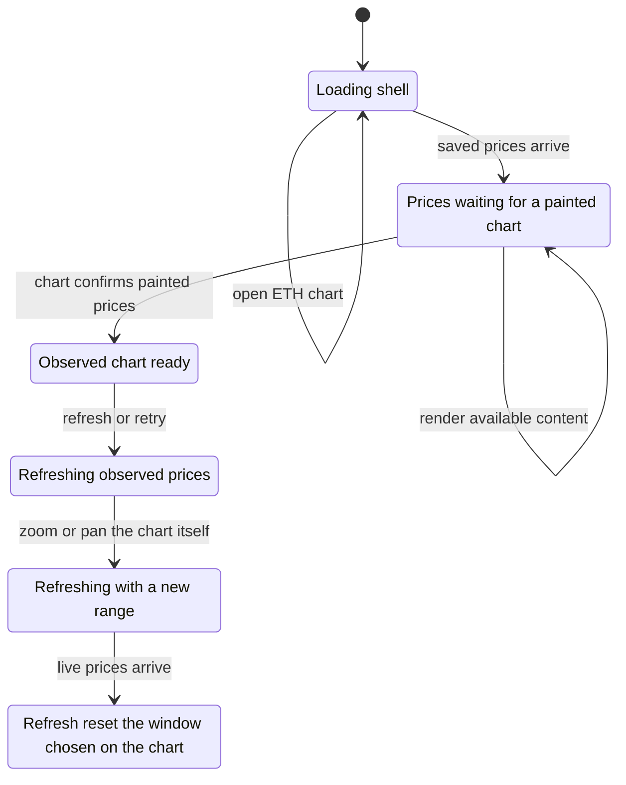

# ETH lifecycle and refresh verification

## Chart mount correspondence at 856e7742

Commit 931ed189 moved ETH drawing from drawIntradayChart to the Funnest
observed-price adapter. This section maps the paths that the move added, at
`856e77422e0a43a77470aed2e3f64fa1e522880b`. The comments in
verification/eth-state/EthLoad.tla carry the current line of every other action.
The sections after this one describe earlier revisions and cite their own line
numbers.

| Model action or guard | Runtime at 856e7742 | Meaning and assumption |
| --- | --- | --- |
| Paint, inside Render, InitialFrame and PaintConfirmed | dist/eth-view.js:254-338 | render creates the mount once (309-311) or hands it a changed series (313). Both start a paint watch and clear state.funnestReady |
| WaitForPaint | dist/eth-view.js:337 | render announces readiness only when state.funnestReady holds a painted confirmation |
| PaintConfirmed | dist/eth-view.js:253 | The then handler clears the chart error, sets state.funnestReady, cancels the tracked frame and calls render |
| PaintFailed | dist/eth-view.js:253; src/charts/funnest-chart-runtime.js:469,483 | A result without painted pixels, a rejection, or a throw from render records the chart error, announces readiness for the retry and schedules its paint |
| GuardPaintSuspension | dist/eth-view.js:253 | Both handlers drop a result that arrives while the page is suspended |
| StalePaintFailed, GuardPaintMount | dist/eth-view.js:253; src/charts/funnest-chart-runtime.js:471 | A destroyed mount rejects its pending watch. Both handlers drop a result whose mount is no longer state.funnestMount |
| Refresh after a chart error | dist/eth-view.js:388 | The retry destroys the mount and clears the error before it loads |
| NativePan, TrackNativeNavigation | dist/eth-view.js:108,310; dist/chart-navigation.js:86,225-233; src/charts/funnest-chart-runtime.js:391-399 | A zoom or pan on the mounted chart reaches the view through onViewport. Since d4f667d2 it increments navigationRevision and writes state.range when the window changes. At 856e7742 it wrote state.range without a navigation revision. bindChartNavigation delivers no range callback once a mount exists |
| ViewportEcho, GuardViewport | dist/eth-view.js:310; src/charts/funnest-chart-runtime.js:392,496 | The mount also reports windows that it sets itself. onViewport drops a report that arrives while the page is suspended |
| Hide for a discarded document | dist/eth-view.js:419 | A pagehide that is not persisted also destroys the mount. The model covers it with a Hide that no Show follows |

### Readiness waits for a painted chart

ReadyHasUsableView accepted observed prices or a load error. It now needs a
painted confirmation for those prices, a load error, or a chart error. The
promise changed on purpose in 931ed189. render announces only when
state.funnestReady is set (dist/eth-view.js:337), and the paint watch sets it
only for `painted===true` (line 253).
tests/funnest-observed-price-adapter.test.mjs:436-437 pins the source text of
that watch.

### Finding at 856e7742, fixed in d4f667d2: refresh reset a window chosen on the chart

NativeNavigationSurvivesRefresh is new. It states the navigation promise for a
window that the user chooses on the mounted chart, and it failed at 856e7742.
TLC's shortest path has seven steps:

1. Open. initEthView starts the first load (dist/eth-view.js:428).
2. ArchiveArrives. The saved archive publishes prices (line 356).
3. Render. render mounts the chart and starts its paint watch (lines 309-311).
4. PaintConfirmed. The watch reports painted pixels, and render announces
   readiness (lines 253, 337).
5. Refresh. load captures navigationToken and awaits fetchMarketCandles
   (lines 350, 363).
6. NativePan. The user zooms or pans the chart. onViewport writes state.range
   and leaves navigationRevision unchanged (line 310).
7. LiveArrives. The token still equals navigationRevision, so the continuation
   clears state.range (line 368).

The replay case "ETH refresh preserves a date window chosen on the chart while
its request was pending" runs those steps through the real initializer and
fails. After step 7 the next render pushes the default window with setAtlasRange
(line 316). The older case "ETH refresh preserves a date range chosen while its
request was pending" still passes. It calls onRangeChange directly, and
bindChartNavigation cannot deliver that callback once a mount exists.

The real adapter and engine show what the user sees. The measurement mounted
mountObservedPriceChart under tests/helpers/funnest-native-fixture.mjs, scrolled
with ArrowLeft, then called setData and setAtlasRange as render does. The
refresh frame shows the default window. The engine returns to the user's window
one frame later, because setData restores the previous range. The next layout
change shows the default window again, because setAtlasRange left the runtime
owning it.

### Results at d4f667d2

d4f667d2 makes onViewport increment navigationRevision when the chart window
changes (dist/eth-view.js:310). NativePan now marks every pending request
navigated when TrackNativeNavigation holds.
`node scripts/verify-eth-state.mjs docs/formal-eth/verification.json` wrote
verification.json and exited 0.

- The current model generated 2,146,710 states, 191,460 of them distinct, and
  left none on the queue. All seven invariants hold.
- The baseline breaks its three recorded properties and passes the other three
  over 582,152 distinct states.
- Each of the nine configurations that removes one guard breaks its named
  invariant. lost-native-navigation.cfg, which drops the new increment, breaks
  NativeNavigationSurvivesRefresh after 3,476 generated states.
- All 24 replay cases pass.
- All 15 mutations of a temporary copy of dist/eth-view.js fail an intended
  assertion in a case that the unmutated module passes. The new
  untracked-native-navigation mutation removes the increment and fails the case
  above.

### Results at 856e7742, before the fix

`node scripts/verify-eth-state.mjs docs/formal-eth/verification.json` wrote
verification.json and exited 1 with two failures, the invariant and the replay
case of the open finding.

- The current model generated 3,095,573 states, 276,126 of them distinct, and
  left none on the queue. Six invariants hold. NativeNavigationSurvivesRefresh
  breaks after 3,476 generated states.
- The baseline breaks its three recorded properties and passes the other three
  over 777,360 distinct states.
- Each of the eight configurations that removes one guard breaks its named
  invariant.
- The replay runs 24 cases. 23 pass, and the case above fails.
- All 14 mutations of a temporary copy of dist/eth-view.js fail an intended
  assertion in a case that the unmutated module passes.

## v1.29 integration correspondence

The current committed source is `7261c1807028e1b69bf9cd9be0d269a64f88acc0`. The strict process-exit rerun, exact runtime hashes, maintained mutation selectors and limits of the new features are recorded in [the integration review](../evolution-2026-10-26/publication-independent-review.md) and the current project verification skill. Current machine-readable receipt: [verification result](../evolution-2026-10-26/eth-state-final.json). Earlier revisions and charts below remain historical evidence. New economic, scenario and capital-recalculation behavior is not implicitly included in these finite lifecycle models.

Baseline: 64c8207cb044d8990289c5a7d39972e21b74c240 (v1.22.1).
The reviewed fix includes v1.23.0 import URLs; the runtime SHA-256 is
bd57616e5ed9515fb876e93bf12d8ff4cf185825465e4e82c0b86b5dde47ab5d.
Committed runtime correspondence: `1ad3be543e870e74f10708c266f19572b217d25f`.
The source hash was matched to the committed Git tree before recording this sync point; verification and documentation are committed separately.

## What failed and what changed

The complete original ETH initializer failed four of the first 11 new tests:

| Observed failure | Reproduction through production entry points | Fix |
| --- | --- | --- |
| Canceled initialization releases an empty restored chart | initEthView → pagehide → old archive abort rejection → persisted pageshow → initial animation frame before new archive arrives | Only a rendered chart or actionable error calls one-shot revealReady |
| Old initialization/layout callbacks publish while suspended | initEthView → archive success → pagehide before first frame → resize/queued frame | Both schedule and render honor suspended; pageshow clears it |
| Refresh resets a newer chosen date range | load chart → click refresh → navigation onRangeChange → live response → render | Capture navigationRevision at request start; preserve later date/price input and update data bounds |
| Information dialog throws ReferenceError | load chart → click information → renderInfo | Define and test the HTML escaper used in the daily-data link |

The final replay suite adds actual intraday-controller coverage: force refresh
retains later date/price navigation, a switch to weekly revokes an old intraday
request, and a weekly refresh retains a later preset with updated archive bounds.
The fixture executes the entire production initEthView and the actual inline
boot script, not extracted approximations of load/render. HTTP can deliberately
complete after abort.

The final suite has 17 cases, including direct replays of every shortest pstack
bug story and two refresh clicks before the disabled button state is painted.
Against the preserved baseline it reports 10 passes and 7 expected
failures; against the fixed module it reports 17 passes. The checker also detects
nine deliberate mutations of real production source and then passes the restored
copy. The exact outputs are in baseline-replay.txt and verification.json.

## Model and atomicity

The model is verification/eth-state/EthLoad.tla. EthLoad.cfg is the fixed behavior;
baseline.cfg preserves the original behavior without weakening any invariant.
EthLoadBaseline.tla imports that same state machine so pstack /statechart can
compare baseline and fix. The other configurations deliberately remove one guard.

Each action is a synchronous JavaScript continuation. Parsing and payload
publication have no intervening await; arrival and catch/finally are therefore
atomic at the selected abstraction. The pending archive/live HTTP boundary and
the initializer's final animation frame are separate actions. Abort does not
imply that a pending promise cannot settle.

| Model action or guard | Runtime correspondence (v1.23.0) | Meaning and assumption |
| --- | --- | --- |
| Open / BeginLoad | dist/eth-view.js:172–180,245 | Start the initializer or a new load, capture navigation and generation, await archive/live data; cached non-force daily/weekly completes synchronously |
| Refresh | dist/eth-view.js:39,143,211 | Released controls can request force refresh while loading; disabling happens in a later frame, not at request start. The model even permits refresh after disabled is painted, a deliberate over-approximation |
| ChangeInterval | dist/eth-view.js:201–203 | Change daily/weekly, clear old range and revoke request generation |
| ArchiveArrives | dist/eth-view.js:180,186–199 | Accept only current generation, validate both series, continue to live refresh on force or finish |
| ArchiveFails | dist/eth-view.js:181,195–199 | Ignore revoked failure; expose a retry if no valid series exists |
| LiveArrives | dist/eth-view.js:187–199 | Publish matching generation and preserve navigation chosen after request start |
| LiveFails | dist/eth-view.js:195–199 | Keep observed prices; only current request may mark refresh error |
| Pan / navigation token | dist/eth-view.js:90–91,98,106,174,185,192–193,203,205,215 | The boolean per request abstracts whether the monotonic navigationRevision has changed; custom date values are abstracted into one range class; price-axis behavior is additionally replay-tested |
| History-focus await and range write | dist/eth-view.js:99–108; dist/ethereum-history.js:63,74,160–162 | An enabled jump requires daily coverage. From weekly, ChangeInterval then Pan is a conservative abstraction of the cached daily switch and post-await range write |
| Render / CanRender | dist/eth-view.js:129–163 | A frame consumes the queued render; suspension blocks every DOM/readiness write |
| InitialFrame | dist/eth-view.js:245–246; baseline:235–237 | Original load's final callback may resume even after its generation was revoked |
| Hide | dist/eth-view.js:232–238 | Paired pagehide revokes active work and clears the tracked frame |
| Show | dist/eth-view.js:240–243 | A persisted pageshow schedules retained prices or starts a new archive request |
| Resize | dist/eth-view.js:230–231,163 | Layout/font notification can arrive late; schedule must honor suspension |
| RequestLimit | verification/eth-state/EthLoad.cfg:3 | Three issued requests is an exploration bound, not a production condition |

The chart's guard citation scan is supplementary: the table above and real
replays establish correspondence. A record-valued model variable does not make
automatic code correspondence or arbitrary browser scheduling a theorem.

### Repeated refresh and history-focus boundaries

Production load() has no synchronous loading lock. A first refresh sets loading,
but the refresh button's disabled property changes only in render(). Therefore two
clicks before that frame start two requests, aborting the first. The model allows
Refresh whenever the released page is attached, including while loading, and is
bounded only by RequestLimit. Allowing it even after a disabled button is painted
adds conservative interleavings; it never removes the real two-click path.

The historical event jump checks daily coverage and a disabled button in
ethereum-history.js before invoking focusHistoricalEvent. With that coverage,
daily data is already cached. Switching to daily calls an async load() whose
cached daily branch has no pending HTTP await; the caller yields only through
promise microtasks. Ordinary user event tasks cannot interrupt that microtask
sequence. A direct daily focus is the Pan range class; a weekly focus is
over-approximated by ChangeInterval followed by Pan, permitting more intervening
steps than ordinary UI input does. The post-await writer at eth-view.js:106 is
included in the navigation revision review. Catalog/dialog contents, programmatic
reentrant calls bypassing the enabled jump, and a future uncached asynchronous
focus workflow are not proved by this abstraction. If jump availability or cached
load behavior changes, model the new await boundary explicitly and replay it.

## Safety properties

| Invariant | Plain-language promise |
| --- | --- |
| ReadyHasUsableView | A readiness event has observed prices or an actionable retry error |
| NoHiddenPublication | A suspended page publishes neither a chart update nor readiness |
| NoStalePublication | A revoked success or failure does not overwrite current state |
| NavigationSurvivesRefresh | A refresh preserves a range chosen while its request was pending |
| ReadinessOnce | A document emits readiness once, including retry and restoration |
| TypeOK | The finite state stays within its declared domains |

Readiness is an event property: an earlier valid error may release the shell,
then a retry clears that error while loading. The model does not incorrectly
require an already-released page to have a price or error at every future instant.

## Reproduction

    node scripts/verify-eth-state.mjs
    node tests/eth-load-ownership.test.mjs

Node and Java 11+ are required. The checker verifies the official TLC 1.7.4 jar
SHA-256 936a262061c914694dfd669a543be24573c45d5aa0ff20a8b96b23d01e050e88.
TLC's own banner identifies its embedded checker as TLC2 version 2.19, revision
5a47802. TLA2TOOLS can select that pinned local jar; JAVA can select Java.

For baseline implementation replay without changing the working runtime:

    ETH_VIEW_SOURCE=/tmp/bitcoin-cycle-atlas-audit-base-64c8207/dist/eth-view.js node tests/eth-load-ownership.test.mjs

For a fresh machine, create a detached worktree at the recorded baseline and set
ETH_VIEW_SOURCE to its dist/eth-view.js. The fixture substitutes only the complete
runtime module's source; it still executes the actual initializer and boot script.
The baseline failures are expected evidence, never an acceptable current pass.

The verifier creates temporary copies of the production module and applies nine
deliberate mutations: premature readiness, hidden render, unguarded archive,
unguarded live error, lost daily navigation, lost intraday navigation, missing
navigation revision, repeated readiness, and missing HTML escaper. Every copy
must fail an intended assertion; the restored copy must pass. Mutation selectors
fail closed on source drift. The working runtime is not changed.

The verifier selects TAP output and requires the actual 17-case plan and complete
summary totals. A current or restored run must have 17 passes and zero failures,
skips, cancellations or todos; mutation runs must execute all 17 cases with at
least one intended assertion failure and zero skipped/cancelled/todo cases.
An exit code or a test-file count alone cannot establish a pass.

## Receipts and statecharts

verification.json records current finite exploration and real-code mutation
results. statechart/summary.json is pstack's own chart receipt; its counts, bug
stories, Mermaid and PNG files are kept together. Exact regeneration commands,
tool revisions and chart inspection results are recorded in statechart-run.md.

The fixed finite model generated 11,109 states, explored 2,243 distinct states,
and left zero states on the queue. Every listed invariant held. pstack's
baseline/fix comparison retains three original broken properties and shows that
all three are prevented by the fix. Its cover chart has 10 states and 12
transitions; omissions and the full checker evidence remain in its receipt.

Use the pstack /statechart skill's current help to regenerate every chart after
model, configuration or mapping changes. Work in scratch, use the pinned local
TLC/Java, compare baseline against the fixed model, preserve the three expected
broken properties, render all charts and inspect all PNGs. Do not replace a
failing invariant with an easier property.

## Bounds and omissions

The current exploration covers three request generations, daily and weekly
display, automatic/custom navigation, archive/live success or failure, retry,
layout callbacks, and paired hide/show. Request tokens are abstract identities;
prices and ranges are classes, not numeric market paths. A later navigation
revision cannot equal an old captured revision under JavaScript's safe-integer
lifetime assumption; an application running through more than 2^53 navigation
increments is outside this abstraction.

The model permits an already-queued callback to run while suspended. Browsers
ordinarily freeze BFCache documents, so this is a deliberate scheduler
over-approximation used to demand a defensive guard. The empty restored chart
failure also has a replay with the callback after pageshow, independent of hidden
frame scheduling.

Intraday controller publication is checked separately by verify-market-state;
its integration into this initializer is tested with the real controller.
Document/renderer/HTTP/timer/frame boundaries are injected in the replay.
The check is not an unbounded proof, does not model every possible event ordering
of a browser, and does not prove pixels, numerical accuracy, causal event effects,
fair scheduling, eventual completion, network deadlines or all other modules.
