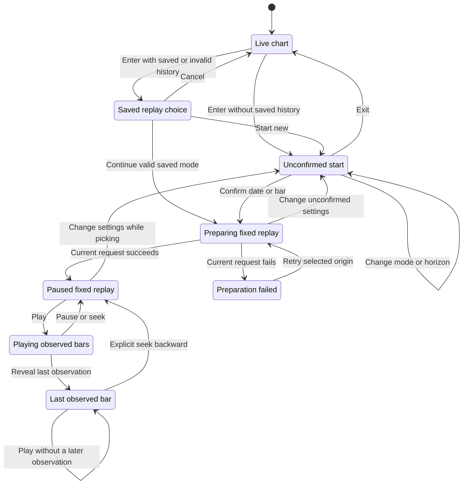

# Main-chart replay state verification

**Forecast settings cannot confirm a start the user has not chosen; an obsolete session load or timer cannot alter the current replay.** A violation silently chooses a comparison cutoff or reveals observations while the chart appears unconfirmed or paused.

This verification executes the actual JavaScript controller and coordinator. It combines exhaustive bounded command traces with focused asynchronous races and isolated mutations of the real source. It is not a TLA+ run or an unbounded mathematical proof. The project-local `verify-replay-state` skill provides the repeatable workflow requested through pstack's `create-formal-verification-skill`.

## Reproduce

Use Node 24 or newer from the repository root. The recorded run used **Node v24.22.2**.

```sh
node verification/replay-state/verify.mjs docs/replay-state/verification.json
```

The command requires no dependency install, edits no production file and rejects skipped tests, process errors, stale mutation selectors and unrelated failures. The coordinator fixture requires Node's VM modules; the runner supplies its experimental flag. The committed receipt records source/test SHA-256 identities, measured coverage and negative controls. Run `node --test tests/chart-replay-ui.test.mjs tests/chart-replay-atlas.test.mjs` for the broader interaction and forecast-identity regressions; native browser coverage is a separate gate.

## Covered code and boundaries

| Actual code | Boundary checked |
| --- | --- |
| `dist/chart-replay-state.js`: `open`, `selectOrigin`, `owns`, `revoke` | Only the current request generation and unrevoked owner may publish a session or load failure. |
| Same file: `schedule`, `play`, `pause`, `seek`, `speed` | Exactly one timer while playing, single-use callbacks, cursor bounds, and no automatic rewind at the archive end. |
| Same file: `checkedSession`, `destroy` | Session values stay fixed; destroy prevents later state publications. |
| `dist/chart-replay.js`: settings `onchange`, `open`, `start`, `beginPick` | Settings reload a preview while its start is unconfirmed. Explicit confirmation permits a fixed session; confirmed sessions remain playable. |
| Same coordinator: `requestEntry`, `readStored`, `storageKey` | Reentry finds the selected mode’s own save; preferred/fallback slots stay isolated and invalid records cannot borrow another hash. |
| `tests/chart-replay-state.test.mjs`, `tests/chart-replay-ui.test.mjs` | Actual production exports, deterministic clocks and controlled async completions; coordinator DOM, source, model and renderer doubles. |

A controller call and its synchronous notifications are one JavaScript turn. Awaited source/forecast completions and each timer callback are separate steps. The tests include reentrant notifications that close, fail or replace replay before an outer call returns. Session restoration accepts a validated saved cursor with the first ready notification, without briefly exposing the origin frame.

The coordinator's picker can preview a new start while retaining an older paused session. Selecting in the diagram means an unconfirmed start; it does not claim that every preview erases the old session immediately. Changing a forecast setting while picking clears that old session and keeps the new preview unconfirmed. Choosing an explicit saved record/Continue has its own confirmation semantics and is covered by focused UI cases rather than the settings alphabet below.

## State transitions

The following statechart is grounded in the actual transitions, with fewer than 20 arrows. It is an explanatory projection, not TLC output. `statechart.mmd` contains the same diagram. Every active state can exit to live; every state can be destroyed permanently. Those repeated exit/destroy edges, no-op stale completions, speed-only changes, direct seeks to the end, one-bar completion and confirmed-settings preparation are omitted. Terminal Play stays at the last observed bar; only an explicit seek can rewind.



The controller supports 0.3, 0.5, 1, 2, 4, 8 and 10 times playback. The 0.3 setting intentionally advances one observation per three seconds. Session identity and the fixed forecast remain unchanged by play, pause, seeking and speed changes.

## Finite bounds and measured coverage

| Check | Bound | Measured execution |
| --- | --- | --- |
| Actual controller playback | 10 commands, every length-four sequence, three observed bars | 10,000 traces, 11,111 distinct prefixes including empty, 40,000 executed transitions, **52 observable states / 380 observable edges** |
| Actual coordinator selection | Six actions, every length zero through three sequence after entry | **259 traces, 726 executed transitions, 24 observable states / 78 observable edges** |
| Async ownership and edge cases | Two overlapping loads; focused success/failure/ignored-abort orderings | All **16 controller tests pass**, including restore, reentrancy, duplicate callbacks and destruction |

Playback commands are play, pause, next, back, first, last, speed 4, current timer, stale timers and exit. The coordinator alphabet is current-chart mode, project-baseline mode, horizon 90, horizon 365, explicit date confirmation and opening the picker. Its entry state is fresh current-chart start selection. The model selector shares the mode handler, but ETH's other model paths and the default cutoff model are not exhaustively enumerated here.

State/edge counts are **observable projections** of the real executions, not complete internal state counts. Every trace starts a fresh instance; no private request or timer states are merged to prune exploration. Async completions settle between coordinator settings actions. The fixed fixture has five possible session dates and 185 archive observations. This finite enumeration does not claim all async schedules, arbitrary lengths or arbitrary data values.

## Proven defect and shortest counterexamples

The original coordinator discarded `selectOnly` when its mode/model or horizon handler called `open()`. Before any date/bar confirmation, a settings change therefore called `start(..., {automatic:true})` and published a paused, committed session. The new behavioral regression failed on that original source with `paused` instead of `selecting` and passed after the handler preserved the pending selection.

The coordinator explorer visits traces in increasing length. Its actual-source negative controls produce these shortest paths **within the stated alphabet**:

1. **Open start selection → change mode to current chart → a session is silently committed.** Removing the mode/model selection guard breaks `settings-preserve-unconfirmed-start`.
2. **Open start selection → change horizon to 90 → a session is silently committed.** Removing the horizon selection guard breaks the same invariant.

The repaired handlers preserve both `picking` and the absence of a committed session. They leave explicitly confirmed sessions usable. The regression also checks that playback retains the fixed forecast and that a confirmed horizon change retains its selected start date.

## Saved-entry regression and precedence

The native BTC save/reopen flow exposed a second real regression: entering replay reset the selected mode to the new cutoff default before looking up storage. A just-saved current-chart capture was therefore ignored in its separate generic slot, and Continue never appeared. The actual-coordinator regression reproduced this failure before the fix.

The repaired policy keeps the user's selected mode when reopening the same mounted chart. A fresh mount still prefers cutoff mode. If its cutoff slot is absent, the first entry can offer the existing generic capture. If both slots exist, the fresh cutoff slot has precedence; selecting a different mode and reopening finds that mode's history. Start new uses the default cutoff selection. An existing malformed cutoff slot blocks fallback and reports the saved-data problem; it does not silently replace or erase either record. A record whose mode belongs to the other storage slot is rejected. A stale output hash still fails Continue without changing stored bytes.

Focused actual-coordinator cases cover current-chart save/reentry, current-only fallback, both slots, malformed JSON, a cross-mode record in the cutoff slot and stale forecast identity. These are bounded behavior cases rather than an exhaustive storage concurrency proof. The engine/snapshot checks still own full saved-capture authenticity and integrity rules.

## Negative controls

All **eight** mutations are rejected by intended behavioral assertions:

| Mutation of real source | Required failure |
| --- | --- |
| Remove session request ownership | Superseded origin cannot replace the current chart |
| Remove timer generation ownership | Duplicate or revoked timer cannot reveal another bar |
| Remove recursive session freezing | Fixed session cannot become mutable |
| Reintroduce automatic rewind at archive end | Play cannot reset the disclosed cursor |
| Remove mode/model selection preservation | Settings cannot commit an unconfirmed start |
| Remove horizon selection preservation | Settings cannot commit an unconfirmed start |
| Reset the selected mode before reentry | Current-chart save must remain reachable through Continue |
| Remove storage-slot/mode validation | A saved cutoff/current hash cannot be borrowed across slots |

The runner restores the exact original files in its temporary copy and requires the controller and coordinator checks to pass again. Failed imports, syntax errors, timeouts or missing assertions never count as detected controls.

## Source synchronization and limits

The reviewed baseline is `94a1b1dda9eb359de70747043808340da369d087`; the receipt identifies the patched working sources by SHA-256. The baseline alone does not identify the fix. Covered controller SHA-256: `063e5574b5d442765ad976b7aade4f0039c0c418c414afeaeb1427dd977f3908`. Covered coordinator SHA-256: `f0fb4cef01d5fe0d3361c0416c56260e3670f442b91528ba3a2743d748f94c56`.

Review correspondence whenever a listed function, callback boundary, session shape, supported control or fixture changes. Rerun the command and review all eight controls before advancing a synchronization record. Keep the skill, verifier, tests, diagram and receipt in the same Git change. A later source hash mismatch means the old receipt is stale, not that the changed code passed. Use pstack `maintain-formal-verification-skill` for drift review. If this becomes a TLA+ model, interpret it with pstack `statechart` and retain actual TLC evidence.

The bounded checks do not prove forecasting mathematics, market predictability, provider availability, wall-clock scheduling, native DOM behavior, pixels, save/storage races, arbitrary event schedules or every cutoff-model load path. The coordinator doubles do not recompute a real forecast. Existing actual-engine, source-provenance, snapshot and native browser suites remain necessary. No replay forecast is published or reclassified as the 2026-10-21 issuance by these checks.
