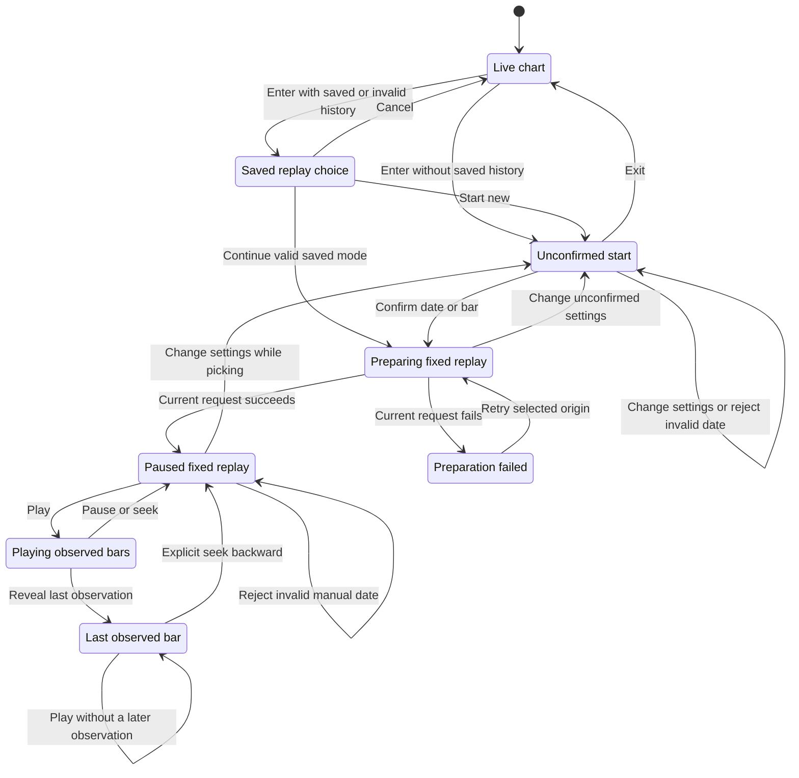

# Main-chart replay state verification

**Forecast settings cannot confirm a start the user has not chosen; an obsolete session load or timer cannot alter the current replay.** A violation silently chooses a comparison cutoff or reveals observations while the chart appears unconfirmed or paused.

Terminal destruction must also release replay ownership while an explicit save is pending. The 2026-11-05 follow-up adds two focused completion schedules and two negative controls for that exported coordinator contract; it does not extend the finite playback/selection alphabets.

The 2026-11-06 follow-up rejects invalid manually entered dates before observed-bar snapping. Button and Enter share the same validation. Two focused cases and one additional source-mutation control cover rejection without changing a resumed capture or confirming a new selection; the finite playback/selection alphabets remain unchanged. Native keyboard acceptance is recorded separately in the [date follow-up](../design-closeout-2026-11-06/replay-date-followup.md).

This verification executes the actual JavaScript controller and coordinator. It combines exhaustive bounded command traces with focused asynchronous races and isolated mutations of the real source. It is not a TLA+ run or an unbounded mathematical proof. The project-local `verify-replay-state` skill provides the repeatable workflow requested through pstack's `create-formal-verification-skill`.

## 2026-11-11 mobile information-sheet ownership follow-up

Implementation `758f2d4` keeps the original BTC period controls reachable after the responsive footer moves into the phone information sheet. `blockSurrounding` blocks unrelated rail children rather than the entire rail, preserves the sheet opener/close/footer, and deduplicates owners before recording their prior `inert` values. A focused actual-coordinator fixture checks phone entry, desktop-to-phone/footer restoration, blocked navigation and preservation of pre-existing inertness. It is a deterministic DOM fixture, not a native-input result.

The controller, the 20-arrow statechart and the finite playback/selection alphabets are unchanged. The updated receipt binds coordinator SHA-256 `4d689174ffa97b75aa02d383d2127506288d48a4fa1e1e5a258300942a45b6ca`: 16/16 controller cases, 10,000 playback traces, 259 selection traces, all 11 expected real-source negative controls detected, and restored originals passing. Browser evidence and remaining release conditions are tracked separately in the current [quality checklist](../LAUNCH_CHECKLIST_20261110.md).

## Reproduce

Use Node 24 or newer from the repository root. The latest local follow-up used **Node v26.13.0**; earlier run receipts retain their original runtime versions.

```sh
node verification/replay-state/verify.mjs docs/replay-state/verification.json
```

The command requires no dependency install, edits no production file and rejects skipped tests, process errors, stale mutation selectors and unrelated failures. The coordinator fixture requires Node's VM modules; the runner supplies its experimental flag. The committed receipt records source/test SHA-256 identities, measured coverage and negative controls. Run `node --test tests/chart-replay-ui.test.mjs tests/chart-replay-atlas.test.mjs` for the broader interaction and forecast-identity regressions; native browser coverage is a separate gate.

## Covered code and boundaries

| Actual code | Boundary checked |
| --- | --- |
| `dist/chart-replay-state.js`: `open`, `selectOrigin`, `owns`, `revoke` | Only the current request generation and unrevoked owner may publish a session or load failure. |
| Same file: `schedule`, `play`, `pause`, `seek`, `speed` | Exactly one timer while playing, single-use callbacks, cursor bounds, and no automatic rewind at the archive end. |
| Same file: `checkedSession`, `destroy` | Session values stay fixed; destroy prevents later state publications. |
| `dist/chart-replay.js`: settings `onchange`, `open`, `start`, `beginPick` | Settings reload a preview while its start is unconfirmed. Explicit confirmation permits a fixed session; confirmed sessions remain playable. |
| Same coordinator: `requestEntry`, `readStored`, `storageKey` | Reentry reads the slot selected by the mode family: cutoff history stays separate from the shared generic replay slot; invalid records cannot borrow another slot’s hash. |
| Same coordinator: `chooseEnteredDate`, `chooseStart`, `nearestOrigin` | Button and Enter reject invalid dates before snapping; pointer, Random and First retain observed-bar selection. Invalid drafts cannot replace the current capture or confirm an unselected start. |
| Same coordinator: `save`, `exit`, `finishExit`, `destroy` | Interactive Exit keeps its pending-save guard; terminal destroy releases markers and inert controls once, and revoked save completions cannot publish or alter detached controls. |
| `tests/chart-replay-state.test.mjs`, `tests/chart-replay-ui.test.mjs` | Actual production exports, deterministic clocks and controlled async completions; coordinator DOM, source, model and renderer doubles. |

A controller call and its synchronous notifications are one JavaScript turn. Awaited source/forecast completions and each timer callback are separate steps. The tests include reentrant notifications that close, fail or replace replay before an outer call returns. Session restoration accepts a validated saved cursor with the first ready notification, without briefly exposing the origin frame.

The coordinator's picker can preview a new start while retaining an older paused session. Selecting in the diagram means an unconfirmed start; it does not claim that every preview erases the old session immediately. Changing a forecast setting while picking clears that old session and keeps the new preview unconfirmed. Choosing an explicit saved record/Continue has its own confirmation semantics and is covered by focused UI cases rather than the settings alphabet below.

## State transitions

The following 20-arrow statechart is grounded in the actual transitions. It is an explanatory projection, not TLC output. `statechart.mmd` contains the same diagram. Every active state can exit to live; every state can be destroyed permanently. An interactive exit waits for its explicit save, while destroy releases ownership synchronously even during that wait. Those repeated exit/destroy edges, the save substate, no-op stale completions, speed-only changes, direct seeks to the end, one-bar completion, confirmed-settings preparation and invalid manual entry at the terminal state are omitted. Terminal Play stays at the last observed bar; only an explicit seek can rewind.



The controller supports 0.3, 0.5, 1, 2, 4, 8 and 10 times playback. The 0.3 setting intentionally advances one observation per three seconds. Session identity and the fixed forecast remain unchanged by play, pause, seeking and speed changes.

## Finite bounds and measured coverage

| Check | Bound | Measured execution |
| --- | --- | --- |
| Actual controller playback | 10 commands, every length-four sequence, three observed bars | 10,000 traces, 11,111 distinct prefixes including empty, 40,000 executed transitions, **52 observable states / 380 observable edges** |
| Actual coordinator selection | Six actions, every length zero through three sequence after entry | **259 traces, 726 executed transitions, 24 observable states / 78 observable edges** |
| Async ownership and edge cases | Two overlapping loads; focused success/failure/ignored-abort orderings | All **16 controller tests pass**, including restore, reentrancy, duplicate callbacks and destruction |
| Coordinator destruction during an explicit save | One pending save; its deferred callback resumes or rejects; destroy is called twice in each schedule | Both focused schedules pass; markers/inert state release once, stale writes remain zero and detached controls remain unchanged |
| Manual date rejection | Button and Enter; resumed capture and unconfirmed selection; empty, malformed, impossible, under-minimum and over-maximum inputs, plus native invalidity | Both focused cases pass; current cursor/origin, fixed capture and saved bytes remain unchanged; valid boundaries and input/cancel recovery pass |

Playback commands are play, pause, next, back, first, last, speed 4, current timer, stale timers and exit. The coordinator alphabet is current-chart mode, project-baseline mode, horizon 90, horizon 365, explicit date confirmation and opening the picker. Its entry state is fresh current-chart start selection. The model selector shares the mode handler, but ETH's other model paths and the default cutoff model are not exhaustively enumerated here.

State/edge counts are **observable projections** of the real executions, not complete internal state counts. Every trace starts a fresh instance; no private request or timer states are merged to prune exploration. Async completions settle between coordinator settings actions. The fixed fixture has five possible session dates and 185 archive observations. This finite enumeration does not claim all async schedules, arbitrary lengths or arbitrary data values.

## Proven defect and shortest counterexamples

The original coordinator discarded `selectOnly` when its mode/model or horizon handler called `open()`. Before any date/bar confirmation, a settings change therefore called `start(..., {automatic:true})` and published a paused, committed session. The new behavioral regression failed on that original source with `paused` instead of `selecting` and passed after the handler preserved the pending selection.

The coordinator explorer visits traces in increasing length. Its actual-source negative controls produce these shortest paths **within the stated alphabet**:

1. **Open start selection → change mode to current chart → a session is silently committed.** Removing the mode/model selection guard breaks `settings-preserve-unconfirmed-start`.
2. **Open start selection → change horizon to 90 → a session is silently committed.** Removing the horizon selection guard breaks the same invariant.

The repaired handlers preserve both `picking` and the absence of a committed session. They leave explicitly confirmed sessions usable. The regression also checks that playback retains the fixed forecast and that a confirmed horizon change retains its selected start date.

## Saved-entry regression and precedence

The native BTC save/reopen flow exposed a second real regression: entering replay reset the selected mode to the new cutoff default before looking up storage. A just-saved current-chart capture was therefore ignored in its separate generic slot, and Continue never appeared. The actual-coordinator regression reproduced this failure before the fix.

The repaired policy keeps the user's selected mode when reopening the same mounted chart. There are two storage families: cutoff history and one shared generic slot for current-chart, project-baseline, historical or recorded history. A fresh mount still prefers cutoff mode. If its cutoff slot is absent, the first entry can offer the existing generic capture. If both slots exist, the fresh cutoff slot has precedence; selecting a mode and reopening reads its family's slot. Start new uses the default cutoff selection. An existing malformed cutoff slot blocks fallback and reports the saved-data problem; it does not silently replace or erase either record. A record whose mode belongs to the other storage family is rejected. A stale output hash still fails Continue without changing stored bytes.

Focused actual-coordinator cases cover current-chart save/reentry, current-only fallback, both slots, malformed JSON, a cross-mode record in the cutoff slot and stale forecast identity. These are bounded behavior cases rather than an exhaustive storage concurrency proof. The engine/snapshot checks still own full saved-capture authenticity and integrity rules.

## Destruction during a pending save

On baseline `4dc877ad0fdeabf7f01057e7f64ac11f9a8cbedc`, the exported coordinator destructor called interactive `exit()`. That method deliberately refused a competing exit while `saving` was true. Destroy therefore removed its controls while leaving `isActive()`, document/SVG replay markers and unrelated inert controls behind. The production-source regression reproduces the path **start → Save/Exit waits → destroy**, before any late completion is required. This is a focused counterexample, not a shortest-path claim from the selection explorer.

The repair separates synchronous `finishExit()` cleanup from interactive save/exit. Destroy marks itself terminal before cleanup; repeated destruction restores the prior controls only once. `save()` checks its request ownership before using a resolved result or displaying a failure, and `exit()` checks again before touching its controls after the await. The persistence helper's existing `isCurrent` check still rejects a pending write after ownership is revoked. A successful write completed before destruction is not retroactively undone.

The test exercises late callback resumption and rejection, preserves the existing saved bytes, and verifies that ordinary Exit remains blocked during the pending explicit save. No current production call site invoking the returned coordinator destructor was found in the reviewed baseline. This is an exported lifecycle API repair, not a claimed native user-flow failure. The [dated follow-up and before/after evidence](../deep-audit-2026-11-05/replay-destroy.md) are separate from the November 4 audit receipts.

## Invalid manual date entry

At baseline `aca73b74a5128a5466488a0c701e86f5e854af46`, both manual submission handlers called `chooseStart` directly. Its nearest-observation lookup silently snapped an out-of-range date to the first or last eligible day. The date-only validation path now checks an exact calendar round trip and the input's current min/max before accepting native validity. It reports errors through native validity UI without replacing the current replay status, opening another dialog or altering the chart. Valid dates can still snap across an actual source gap, and pointer/Random/First paths are unchanged.

The targeted source mutation reconnects the old unguarded handlers and must fail the resumed-session identity assertion. These focused cases use DOM and engine doubles; native keyboard, actual forecast generation and rendered-pixel claims require their separate browser and engine receipts. The six-action exhaustive selection alphabet and its measured state counts do not include manual invalid dates.

## Negative controls

All **eleven** mutations are rejected by intended behavioral assertions:

| Mutation of real source | Required failure |
| --- | --- |
| Remove session request ownership | Superseded origin cannot replace the current chart |
| Remove timer generation ownership | Duplicate or revoked timer cannot reveal another bar |
| Remove recursive session freezing | Fixed session cannot become mutable |
| Reintroduce automatic rewind at archive end | Play cannot reset the disclosed cursor |
| Remove mode/model selection preservation | Settings cannot commit an unconfirmed start |
| Remove horizon selection preservation | Settings cannot commit an unconfirmed start |
| Reset the selected mode before reentry | Current-chart save must remain reachable through Continue |
| Remove storage-slot/mode validation | A saved cutoff/current hash cannot be borrowed across slots |
| Route destroy through the interactive save guard | Terminal destruction must still release replay ownership |
| Remove the post-await exit ownership check | A revoked save completion cannot update detached controls |
| Bypass manual-date validation from button and Enter | An invalid manual date cannot replace the current fixed session |

The runner restores the exact original files in its temporary copy and requires the controller and coordinator checks to pass again. Failed imports, syntax errors, timeouts or missing assertions never count as detected controls.

## Source synchronization and limits

The 2026-11-06 manual-date follow-up starts from `aca73b74a5128a5466488a0c701e86f5e854af46`. The previous destruction baseline is `4dc877ad0fdeabf7f01057e7f64ac11f9a8cbedc`; the original audit began at `94a1b1dda9eb359de70747043808340da369d087`. The current receipt identifies patched working sources by SHA-256, not as code already present at those baselines. Covered controller SHA-256: `063e5574b5d442765ad976b7aade4f0039c0c418c414afeaeb1427dd977f3908`. Covered coordinator SHA-256: `99a2675fd0c1018ef853da76980760705907a77f3fbdba8a908de473b21a81b8`. Historical receipts remain in `docs/deep-audit-2026-11-05/replay-state-verification.json` and `docs/design-closeout-2026-11-06/regression/formal-replay.json`.

The [v1.31.3 release follow-up](../design-closeout-2026-11-06/cache-version-sync.md) changes only the coordinator's three import query versions. The current receipt reruns the same controller, selection, saved-entry, destruction and manual-date checks at the new source hash. Fixtures, behavior, finite alphabets and the explanatory statechart are unchanged; earlier dated receipts retain their original hashes.

Review correspondence whenever a listed function, callback boundary, session shape, supported control or fixture changes. Rerun the command and review all eleven controls before advancing a synchronization record. Keep the skill, verifier, tests, diagram and receipt in the same Git change. A later source hash mismatch means the old receipt is stale, not that the changed code passed. Use pstack `maintain-formal-verification-skill` for drift review. If this becomes a TLA+ model, interpret it with pstack `statechart` and retain actual TLC evidence.

The bounded checks do not prove forecasting mathematics, market predictability, provider availability, wall-clock scheduling, native DOM behavior, pixels, every persistence/concurrent-tab interleaving, arbitrary event schedules or every cutoff-model load path. The coordinator doubles do not recompute a real forecast. Existing actual-engine, source-provenance, snapshot and native browser suites remain necessary. No replay forecast is published or reclassified as the 2026-10-21 initial-commit preserved baseline by these checks; that baseline's publication time remains unproven.

The 2026-11-07 v1.33.0 visual release changes only the coordinator import cache queries from 1.32.2 to 1.33.0. The original bounded verifier was rerun without changing its source, fixtures, assertions or negative controls. The current receipt above records that exact coordinator; the replay controller and numeric behavior are unchanged.
