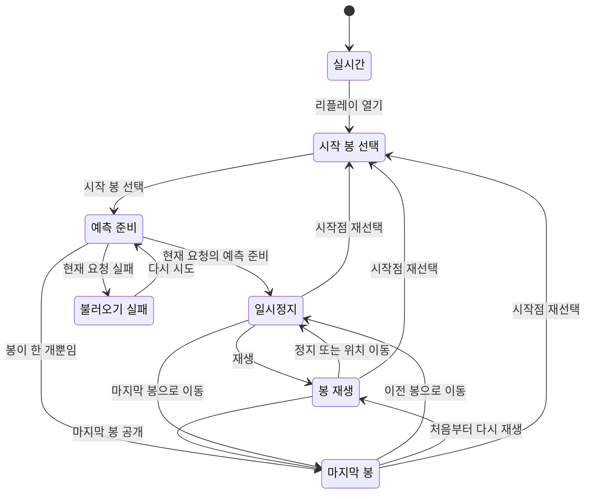

# Main-chart replay state verification

The main-chart replay controller keeps this promise: **an old session load or queued timer cannot change a chart after its origin is replaced or replay is closed**. A violation could reveal bars from the wrong origin or alter the comparison while the user believes replay is paused.

The controller also retains the exact verified session object for the complete playback. Stepping, seeking and speed changes only move a cursor; they do not rerun the forecast. The engine owns forecast validation and scoring. The view owns DOM controls, chart painting and visibility events.

## Interface

`dist/chart-replay-state.js` exports `createChartReplayController({onChange, intervalMs, setTimer, clearTimer})` and the supported speeds. It has no chart or DOM import.

| Operation | Visible behavior |
| --- | --- |
| `getState()` | Frozen snapshot containing status, session, origin, cursorIndex, length, speed, error and generation. `error` is null or a string. |
| `open()` | Enter start selection and clear the former session, timer and pending request. |
| `selectOrigin(origin, loader)` | Enter loading. Call `loader({signal, origin, generation})`; accept only the current request. Resolve to true when accepted and false when superseded, closed or failed. |
| `play()` | Start at the current bar; restart at the origin if already at the last bar. One-bar sessions remain ended. |
| `pause()` | Cancel playback without changing the session or current bar. The view calls this on document hiding or loss of the active chart. |
| `step(-1 or 1)` / `seek(index)` | Stop playback and move within the available timeline. No unavailable bar is synthesized. |
| `speed(value)` | Select 0.5, 1, 2, 4, 8 or 10 times speed, with exactly one current callback while playing. |
| `exit()` | Release session and request, stop timers, and return to idle. |
| `fail(reason)` | Stop and clear stale output after an explicit rendering failure. Preserve the selected origin for a retry. |
| `destroy()` | Permanently release the controller; later calls, responses and callbacks cannot notify the view. |

The loader must return an engine-verified session with an ordered, nonempty timeline and a fixed output identity. Its object identity is preserved because the replay engine verifies sessions using a `WeakSet`. Session values and the cloned origin are frozen to keep caller mutation from rewriting a replay.

## State transitions

This diagram describes the implementation. It is not a TLC-generated chart or an unrestricted proof. Global `exit()`/`destroy()` edges are omitted from the drawing: every state can exit to idle; destroyed controllers cannot reenter.



Late request completions and revoked timer callbacks make no transition and publish no notification. A new origin has its own request generation. Each scheduled callback also has a single-use timer generation, so even a duplicated scheduler callback cannot reveal two bars.

## Reproduce

With Node 24 or newer:

```sh
node verification/replay-state/verify.mjs
```

To save a receipt:

```sh
node verification/replay-state/verify.mjs docs/replay-state/verification.json
```

This applies pstack's behavioral testing and real-artifact verification principles. Its formal-verification guidance allows generated inputs against real code where no direct source verifier is used. The chosen check executes the JavaScript controller itself, avoiding divergence between a separate handwritten model and product code. No TLA+ model checker, formal proof or generated project skill is claimed.

The runner checks all 14 named tests with no skipped, canceled or todo cases. One test exhaustively enumerates all 10,000 length-four command sequences over play, pause, forward, backward, first, last, speed, timer firing, stale timer delivery and exit on a three-bar session. At each step it checks cursor bounds, retained output identity and exclusive timer ownership. The other tests cover two overlapping loads completing or failing out of order, ignored aborts, close/reselection/destroy, reentrant notifications, validation failures, a one-bar session, retries, every supported speed and caller mutation. If painting a ready frame immediately fails or closes replay, the pending load resolves false so its caller cannot dereference a session that has just been removed.

It then copies the actual module and tests to a temporary directory and runs three deliberately broken versions:

1. Removing request ownership lets an old origin overwrite a newer session.
2. Removing timer ownership lets a delivered callback advance a second time or after a speed change.
3. Removing session freezing allows a supposedly fixed replay to remain mutable.

Each variant must fail the named relevant behavior test with an assertion failure and a complete test run. A syntax error, missing dependency, timeout or crashed test process is not accepted as a rejected mutation. The unmodified source is then restored in the temporary directory and all tests must pass again. Product files are never modified by this verifier.

## Identity and limits

The development baseline is `fec62fc3c6bddee1d892efab01938102ad780b11`. The receipt records the actual controller and test SHA-256 identities, the Node runtime and each result; an eventual committed source must be compared to these hashes before reusing the receipt. Changing a transition, ownership guard or controller callback requires rerunning this verification and reviewing the chart.

The finite trace check does not cover arbitrary trace lengths, all possible timing schedules, forecast mathematics, acquisition provenance, DOM integration or browser painting. It cannot establish that a model predicts markets successfully. The parent chart integration must separately verify that hidden-document events pause playback and that exiting restores the live chart.
