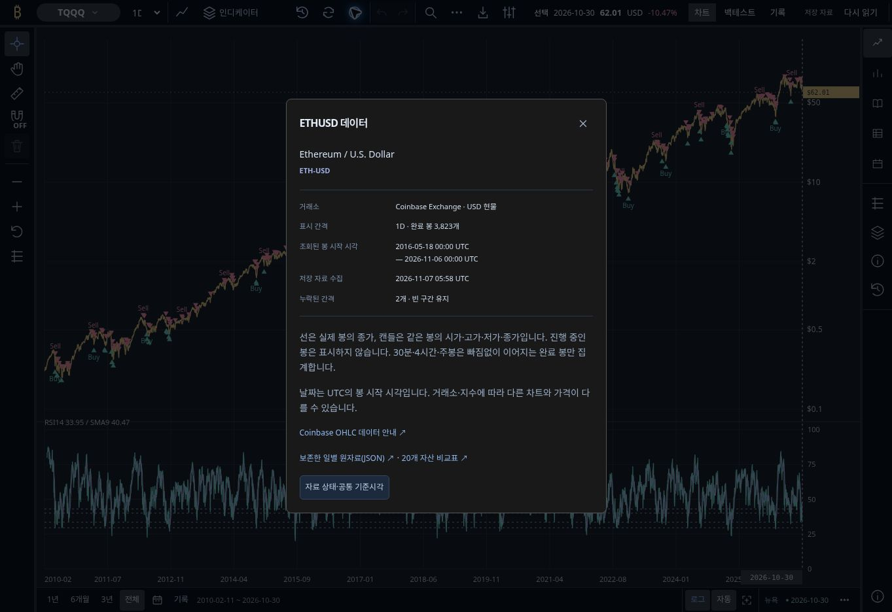
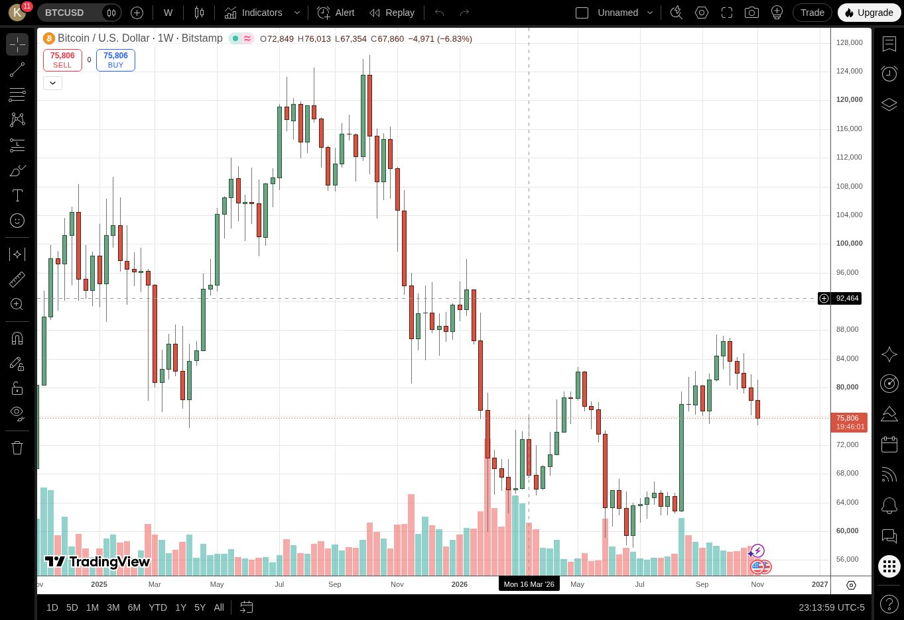

# Published workbench verification — 2026-11-08

This continuation starts from `69c16ad79ad8eab251298efe7c92f5eafa6ea54f`.
PRs #69 and #70 were already merged. Their unified price-chart implementation
was retained, not implemented again. The requested reference remains
TradingView; `bitcoincyclescomparison.com` is not a deployment target.

## Independently observed starting state

The GitHub main branch returned `69c16ad79ad8eab251298efe7c92f5eafa6ea54f`.
The public HTTPS publication manifest instead identified
`3d12a19cc3db25b2e56d1f12c804a2cd75fe27db`, manifest
`6e0efc06a1d2dfaca4a7a8f5c805ed546963a18bdf02b7f83c54b111f579fcd8`,
and browser/publication Build `c0093ee0-f167-4a12-9bdf-c6da5b784948`.
Its manifest response was HTTP 200, JSON, and `Cache-Control: no-store`.
A correct v1.36 title alone therefore did not prove that PR #70 was deployed.

The next production browser Build,
`cc73c4ee-5938-4906-b22d-a97359b0b640`, was stopped with outcome `fail`.
The preceding main model Build,
`ad654892-94fe-49f9-ae1b-5f36c60e16e3`, had provider outcome `success`.
These are distinct stages and are not reported as one successful deployment.

The failed consumer's complete recovered native report identifies source
`69c16ad79ad8eab251298efe7c92f5eafa6ea54f`, tree
`ce0f3a2c97e71bc180be04b2f96a116946808269` and the required 53-case inventory.
Its five failures were BTC replay at 320×568 and 900×430, and consolidated
workspace refresh request identification at 320×900, 390×844 and 1440×900.
The latter three had already verified the visible failure notice, preserved
2026-11-06 cutoff and $75,826.53 archive quote; their declared case omitted the
old `surface` field and the narrow request policy correctly rejected it.

## Direct browser observation

The connected extension was unavailable in this conversation. A real cloud
Chrome session was used for direct interaction with the public Workers site
and TradingView. Both were observed at 1363 × 936 CSS pixels. No mobile
TradingView observation or physical-device claim is made.

| Region | TradingView | Published Atlas |
| --- | --- | --- |
| Outer top controls | x52, y0, 1311 × 38 | x52, y0, 1311 × 38 |
| Closed right rail | x1318, y42, 45 × 894 | x1318, y42, 45 × 894 |
| Bottom controls | x56, y898, 1258 × 38 | x56, y898, 1258 × 38 |
| Chart allocation, including axes | x56, y42, 1258 × 856 | x56, y42, 1258 × 856 |

TradingView separates its 1196 × 827 price canvas, 62px price axis and 28px
time axis. Atlas renders its measured plot and axes within one SVG allocation.
Equal outer bounds do not imply identical internal axes or feature content.

Native wheel zoom changed TradingView candle spacing and the visible range;
price-axis dragging changed only its vertical scale. The surrounding regions
kept their measured dimensions. The reference screenshot uses the session's
existing light chart surface; Atlas retains its approved dark chart.

Atlas BTC's plus control changed the start from 2024-11-07 to 2025-08-26 while
retaining the 2028-11-07 right endpoint and the same top/rail/chart dimensions.
ETH rendered one primary SVG in the same allocation. ETF, HYPE and housing
selection used one active center frame and retained the common perimeter.
TQQQ → market analysis → price chart restored TQQQ and its canonical query.
Selecting Seoul retained `symbol=HOUSING-SEOUL&region=seoul` and monthly
capabilities; HYPE retained its own symbol query.

Cold direct navigation to `/market-lab/charts/?symbol=TQQQ` subsequently
reproduced another ownership defect: the hidden native BTC renderer appended
`indicator-hide=volume&indicator-list=open&indicator-settings=%7B%7D`.
This differs from the clean query observed when switching from ETH. It is a
real direct-entry issue; the diagnostic's canonical query check is retained.

## Reproduced defect

Starting with ETH and selecting TQQQ left three ETH-only header actions visible:
history, refresh and source information. Clicking source information opened
`ETHUSD 데이터` over the TQQQ chart. The same inherited actions remained after
selecting HYPE and housing. This was an observed action-ownership error, not
an inference from matching CSS or a duplicate primary chart.

## Verification boundaries

The baseline TypeScript check and all 109 panel tests passed, despite the
observed header ownership defect. The local `tsx` CLI could not create its
Unix IPC socket (`EPERM`), so the same panel files ran through
`node --import tsx --test tests/web/*.test.tsx`. This does not relabel the
failed local CLI invocation or replace the canonical Cloudflare gates.

Direct desktop observations, local tests, source-bound Cloudflare verification,
actual deployed manifest identity and the published-origin browser diagnostic
are separate evidence categories. Final deployment evidence must identify the
new source's own Build UUIDs and manifest; the starting receipts above cannot
qualify a later change.

## Scheduled refresh: observed inactive state

The live account contains three deployed scripts: the product Worker and its
production/review model components. The registered market refresh and ETH
prepare/publish Build configurations do exist, but all three have zero Build
history and lack the required repository/Build/KV secrets. No scheduler Worker
or cron issuer is deployed. A local schedule definition is not live evidence.

The current 6-hour cadence cannot be certified against the project's 3,000
monthly free-minute contract. Measured successful production model and browser
publication durations round conservatively to 17 and 15 minutes. November's
30 days × four daily publications × 32 minutes is already 3,840 minutes, or
4,140 with the required 300-minute reserve, before collection, archive jobs or
review runs. This is a preliminary lower bound, not a completed budget report
or a claim about the account's billing plan. Activating cron alone would not
resolve either missing credentials or the budget deficit.
